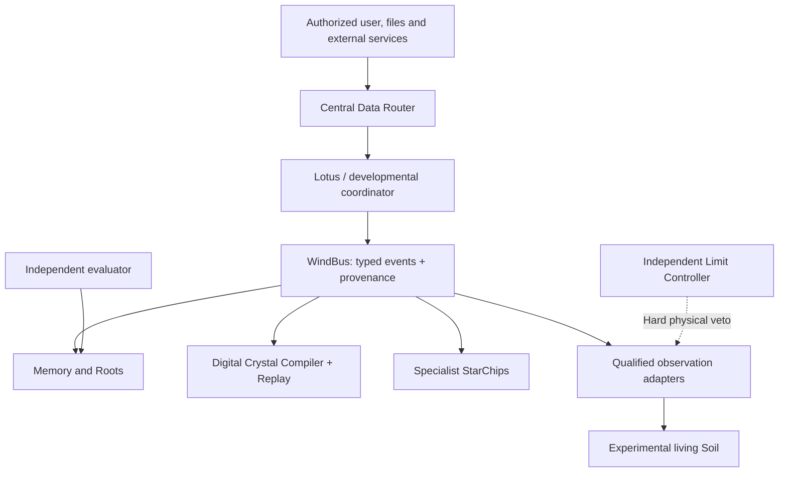

# ChristEye Anaiero

**We Develop Software LLC · Scientific research and modular computer architecture · November 15, 2026**

[**Website S01 blueprint**](website/README.md) · [**V3.1 scientific implementation**](specifications/v3/README.md) · [**Scientist workflow**](processes/SCIENTIST_WORKFLOW.md) · [**Molecules and axons**](processes/MOLECULAR_INDEX.md) · [**Biological schemas**](schemas/biology/README.md) · [**Phase 1**](docs/phase-1.md) · [Complete documents](docs/full-document-library.md) · [24 subsystem contracts](docs/module-contracts.md) · [Full schemas](docs/schema-reference.md) · [Scientific research](research/full-markdown/README.md) · [Website](docs/index.html)

ChristEye Anaiero is a research and engineering program investigating modular developmental computing, supervised biological instrumentation, specialist StarChips, capability-bearing digital CrystalPacks, Roots and retained knowledge, and the possible future living embodiment of these systems.

> **Research status.** Software prototypes and documentation exist. The project has **not** demonstrated an intelligent organoid computer, biological transfer of arbitrary memories, a validated physical Crystal, or an autonomous cell-growth system.

## Read the documentation as an engineer

| Need | Open this |
|---|---|
| First complete technical phase | [P01 physical reference and interface guide](docs/phase-1.md) |
| All original Phase 1 design documents | [P01: six full Markdown specifications](phases/P01/README.md) |
| Cell counts and module allocations | [Original physical composition plan](phases/P01/docs/01_Physical_Module_Composition_and_Counts.md) |
| Molecular and structural research | [41-entry detailed inventory](docs/molecule-and-structure-inventory.md) |
| Electrical interfaces and WindBus | [Phase 1 electrical companion](phases/P01/docs/03_Electrical_WindBus_and_Training_Companion.md) |
| Feeding, sampling and care | [Daily care, qualification and assays](phases/P01/docs/04_Daily_Care_Quality_Gates_and_Assays.md) |
| Mandatory design-document format | [20-section specification standard](docs/document-standard.md) |
| Full JSON schema fields | [Schema dictionary](docs/schema-reference.md) and [original JSON](schemas/README.md) |
| All 24 module data contracts | [Full module processing/data reference](docs/module-contracts.md) |
| Current full design/companion pairs | [24 designs + 24 companions + master](specifications/v3/README.md) |
| Cell-free P02 electronics | [14 full P02 documents](phases/P02/README.md) |
| Supervisory electronics and scientific operations | [21 full P02B documents](phases/P02B/README.md) |
| Full scientific background | [Research studies in Markdown](research/full-markdown/README.md) |
| Historical source documents | [Superseded v2 archive](archive/v2/README.md) |

**180 original Word documents are represented as complete Markdown editions:** the six Phase 1 originals plus 174 additional specifications, companions, research documents, and archived prior editions. The five diagrams embedded in those additional Word files are stored with their corresponding Markdown.

## Architecture



The diagram represents a **proposed control and information architecture**, not a demonstrated arrangement of functional neural tissue. See [full architecture](docs/architecture.md).

## Phase status and integrity

| Phase | Purpose | State |
|---|---|---|
| P01 | Supplier-specific cell-composition reference, molecular inventory, interfaces and measurement boundaries | **Documented, not constructed** |
| P02 | Cell-free controller, acquisition, WindBus, reference learning tasks | **Software prototype** |
| P02B | Scientific director, cell-foundry workflow, supervisory electronics, telemetry | **Software prototype** |
| P02C | Physical boards and OEM integration | Not commissioned |
| P03–P06 | Qualified living culture, retained learning, multiple modules and 3D Soil | Research planned |
| P07–P08 | Physical Crystal carrier, replication, expansion and deployment | Research hypotheses |

The original machine-readable P01 counts, molecule inventory, unknown parameters and bibliography are in [phases/P01/registers](phases/P01/registers/README.md). Schema and module registries are in [schemas](schemas/README.md) and [registries](registries/README.md).

## Run the public digital reference

Python 3.11+ is recommended; the reference uses the standard library.

```bash
python -m unittest discover -s tests -v
python -m examples.run_digital_replay
python -m examples.p02b_supervisor_demo
```

Software tests confirm digital contracts only. The reference runtime has no permission to dispense culture medium, modify tissue growth, inject biological materials or stimulate neural tissue.

## Scientific source provenance

Scientific proposals are labeled **F** (finding in a named study), **X** (cross-source interpretation), **H** (hypothesis), **D** (design decision), or **A** (analogy). A source reference does not itself demonstrate a new device. Read [source and equation audit](research/full-markdown/R03_03_Formal_Models_and_Reconciliation_1_.md) before using any older Crystal formula.

## Ownership and publication

**Copyright © 2026 We Develop Software LLC. All rights reserved except as expressly permitted by the [WDS Public Research Reference License](LICENSE.md).**

The experimental research and complete non-patent technical design records are project property. The **physical patent document itself is not included** in this repository. Public research descriptions do not authorize clinical use or manufacture, and the WDS license does not grant patent rights. Historical naming is preserved in archived documents for traceability.

## Website and GitHub Pages

Readable Markdown works directly in GitHub without downloads. The responsive website source is at [docs/index.html](docs/index.html). To publish it via GitHub Pages, follow [the exact deployment steps](docs/DEPLOY.md); GitHub Pages must be enabled by the repository owner.
