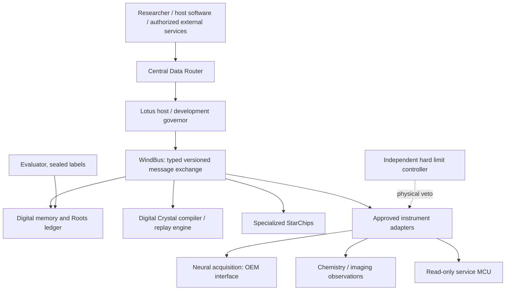

# Architecture: ChristEye Anaiero

## System and responsibility map

This is a *functional architecture*, not a fabricated tissue circuit.

### Eight bounded roles

| Role | Contract |
|---|---|
| Lotus | choose among authorized educational and routing actions; log why |
| Heart | biological response formation in a declared living preparation; **not** identical to the independent electronic interlock |
| Spirit | a named participating neuronal/glial population or functional network, not an unmeasured intention |
| Soil | the living organoid whole within the organoid research branch, with its cells, local matrix and developmental history |
| Mesh | typed structural, functional, intervention-supported and task-semantic graphs; never silently promote one edge type to another |
| Roots | measured delayed retention of a declared relation, with cue, context, reader and provenance |
| Wind | a named encoded event, measured influence or expressed capability, with a scoped boundary |
| Crystal | digitally reproducible knowledge/education package **or** separately investigated physical carrier; the two are different |

### Physical partitions

The **dry** compartment hosts digital logic, data acquisition and audit. The **culture** compartment uses qualified OEM headstages and a supported chamber. The **service** compartment has separately identified support and measurement paths. Initial learning and auxiliary cartridges are electronically bridged, not assumed to share liquid or axons.

### Essential separation

Scientific analysis may **request** review; software-only StarChips cannot change culture medium, manufacture cells, issue electrode stimulation, or override limits. Every interface binds identity, version, allowed information, timing, units, uncertainty and disconnection semantics.

### Traceability

See [Scientific source editions](research.md) and [independent limits](governance.md).
