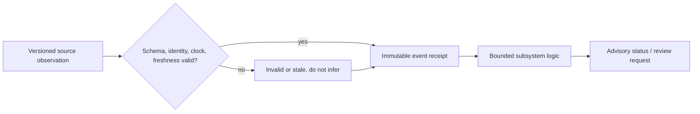

# P02B-01 · Scientific direction and cell production — Engineering design

**Revision:** public Markdown edition 1.0 · **Status:** design and software simulation, not a qualified living deployment

## Objective and scope

Separate protocol and claim authority from living source production and qualification.

## Input boundary

study question, source/lineage provenance, preparation identity, prior pilot evidence, ethics and supplier restrictions. Missing identifiers, invalid units or stale calibration block any inference and cause an explicit review or rejection state.

## Output and data structures

preregistered plan, source-lot release, amendment record, claim adjudication, human signatures.

**Required records:** `StudyProtocol, SourceLot, PreparationVersion, RoleAssignment, ClaimRecord, Deviation, ApprovalReceipt`. Every record needs stable IDs, UTC timestamp plus clock domain, source version, validity, uncertainty where measured, and evidence provenance.

## Reference processing sequence

Scientific director freezes test; cell lead qualifies lineage/source and production; statistician checks unit and comparison; biosafety review authorizes scope; evaluator seals confirmation; owner reviews claim.

## State and authority model

States are `UNINITIALIZED`, `VALIDATING`, `OBSERVING`, `ADVISORY`, `FAULT_LATCHED`, and `REVIEW_REQUIRED`. Only qualified personnel and separately released physical controllers can issue real actuation. The P02B software implementation is **observation/advice-only**.

## Failure-mode requirements

source identity incomplete; undetected batch change; evaluator can see sealed labels; software assistant proposes a change as if authorized. Record requested versus observed outcomes and retain failure evidence instead of converting missing data to normal state.

## Release and acceptance tests

missing-signature refusal; frozen-protocol hash validation; source-lot conflict detection; independent batch trace; false finding status blocked. All tests are specified for a digital harness or qualified bench setup; biological performance has its own independent gates.

## Integration and dependencies

Use [WindBus](../windbus.md) to exchange only allowed information with Lotus and the Central Data Router. Verify dependency/route provenance before enabling a connection. Keep [independent physical limits](../governance.md) outside adaptive learning authority.

## Not yet specified

Vendor-compatible connector/pinout, live voltage/energy envelope, laboratory SOP, validated sampling range and any physical software-to-care authorization remain controlled unknowns, not guessed defaults.

**Source register:** CE-DEV-001 v0.4 sections 7–9, 23; Research and System Design v1.0 requirements R01–R12. For research boundaries see the [scientific source editions](../research.md).
