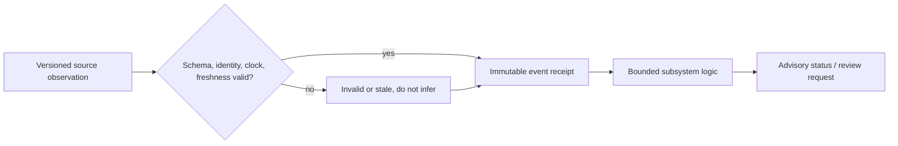

# P02B-02 · Board topology and instrument interfaces — Engineering design

**Revision:** public Markdown edition 1.0 · **Status:** design and software simulation, not a qualified living deployment

## Objective and scope

Separate host, supervisory read-only telemetry, independent physical limits, OEM care, optical sensing, chemistry assays, remote status and vendor neural recording.

## Input boundary

manufacturer interface documents, power/connector limits, acquired channel/clock manifests, hardware identity, sensor locations. Missing identifiers, invalid units or stale calibration block any inference and cause an explicit review or rejection state.

## Output and data structures

typed board identity, reserved connector map, topology graph, external permit contract, vendor interface questionnaire.

**Required records:** `BoardRecord, PortContract, ClockDomain, GroundingReview, LimitTable, VendorQualification, FailureMode`. Every record needs stable IDs, UTC timestamp plus clock domain, source version, validity, uncertainty where measured, and evidence provenance.

## Reference processing sequence

Inventory OEM ports; define dry/culture/service partitions; qualify simulated links; bench-test each development board; independently review inhibit path; only then freeze pins and power.

## State and authority model

States are `UNINITIALIZED`, `VALIDATING`, `OBSERVING`, `ADVISORY`, `FAULT_LATCHED`, and `REVIEW_REQUIRED`. Only qualified personnel and separately released physical controllers can issue real actuation. The P02B software implementation is **observation/advice-only**.

## Failure-mode requirements

ground loop; unqualified OEM port; overcurrent; unexpected host backfeed; false assumption that wireless data can carry raw MEA streams. Record requested versus observed outcomes and retain failure evidence instead of converting missing data to normal state.

## Release and acceptance tests

USB disconnect; pin identity mismatch; power-on-state verification; EMI/ground and supplier approval; redundant inhibit review. All tests are specified for a digital harness or qualified bench setup; biological performance has its own independent gates.

## Integration and dependencies

Use [WindBus](../windbus.md) to exchange only allowed information with Lotus and the Central Data Router. Verify dependency/route provenance before enabling a connection. Keep [independent physical limits](../governance.md) outside adaptive learning authority.

## Not yet specified

Vendor-compatible connector/pinout, live voltage/energy envelope, laboratory SOP, validated sampling range and any physical software-to-care authorization remain controlled unknowns, not guessed defaults.

**Source register:** CE-DEV-001 v0.4 sections 5–6, 26–29; MaxOne OEM and development-board documentation. For research boundaries see the [scientific source editions](../research.md).
