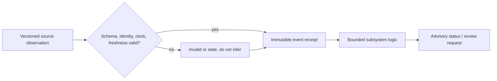

# P02B-03 · Host debugging and remote diagnostics — Engineering design

**Revision:** public Markdown edition 1.0 · **Status:** design and software simulation, not a qualified living deployment

## Objective and scope

Provide trustworthy developer observations of board and module health without allowing remote care actuation.

## Input boundary

read-only telemetry, authenticated host sessions, clocks, calibration age, route validity, firmware manifests. Missing identifiers, invalid units or stale calibration block any inference and cause an explicit review or rejection state.

## Output and data structures

status dashboard, fault history, data-loss counters, audit download, diagnostics exports.

**Required records:** `TelemetryEnvelope, DeviceSession, DebugReceipt, FaultEvent, AuthDecision, ClockHealth`. Every record needs stable IDs, UTC timestamp plus clock domain, source version, validity, uncertainty where measured, and evidence provenance.

## Reference processing sequence

Enumerate connected boards; authenticate reporter; validate schema+sequence+freshness; store immutable event; display current state and last-good age; allow export only.

## State and authority model

States are `UNINITIALIZED`, `VALIDATING`, `OBSERVING`, `ADVISORY`, `FAULT_LATCHED`, and `REVIEW_REQUIRED`. Only qualified personnel and separately released physical controllers can issue real actuation. The P02B software implementation is **observation/advice-only**.

## Failure-mode requirements

expired packet; duplicated sequence; Bluetooth session spoof; stale state displayed as current; telemetry flood; untrusted client action. Record requested versus observed outcomes and retain failure evidence instead of converting missing data to normal state.

## Release and acceptance tests

out-of-order frame rejection; invalid-auth denial; offline BLE loss; restart/no replay; monotonic audit chain. All tests are specified for a digital harness or qualified bench setup; biological performance has its own independent gates.

## Integration and dependencies

Use [WindBus](../windbus.md) to exchange only allowed information with Lotus and the Central Data Router. Verify dependency/route provenance before enabling a connection. Keep [independent physical limits](../governance.md) outside adaptive learning authority.

## Not yet specified

Vendor-compatible connector/pinout, live voltage/energy envelope, laboratory SOP, validated sampling range and any physical software-to-care authorization remain controlled unknowns, not guessed defaults.

**Source register:** P02 WindBus contracts, P02B supervisor digital twin; platform security and clock documentation. For research boundaries see the [scientific source editions](../research.md).
