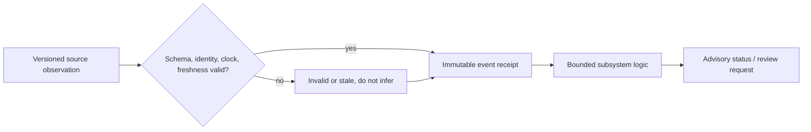

# P02B-04 · Metabolic and multimodal observation — Engineering design

**Revision:** public Markdown edition 1.0 · **Status:** design and software simulation, not a qualified living deployment

## Objective and scope

Associate electrical, metabolic, optical and morphology signals with task history without treating correlation as a stored memory.

## Input boundary

calibrated glucose/lactate/pH observations, MEA events, optical exposures, morphology records, logged interventions. Missing identifiers, invalid units or stale calibration block any inference and cause an explicit review or rejection state.

## Output and data structures

multimodal observation with uncertainty, time alignment and competing explanations.

**Required records:** `Observation, AssayRecord, ImagingRun, RegionOfInterest, TrialRecord, ValidityMask, Calibration`. Every record needs stable IDs, UTC timestamp plus clock domain, source version, validity, uncertainty where measured, and evidence provenance.

## Reference processing sequence

Record source and physical sample origin; capture timestamp and uncertainty; register datasets by preparation; keep direct instrument measurements separate from biological inferences.

## State and authority model

States are `UNINITIALIZED`, `VALIDATING`, `OBSERVING`, `ADVISORY`, `FAULT_LATCHED`, and `REVIEW_REQUIRED`. Only qualified personnel and separately released physical controllers can issue real actuation. The P02B software implementation is **observation/advice-only**.

## Failure-mode requirements

lactate confounded by dilution; an optical signal attributed to wrong cell; imaging perturbation; unregistered clocks; nuisance effects mistaken for retention. Record requested versus observed outcomes and retain failure evidence instead of converting missing data to normal state.

## Release and acceptance tests

blank controls; time-skew injection; reporter-lag documentation; different assay lots; held-out prediction; negative-result preservation. All tests are specified for a digital harness or qualified bench setup; biological performance has its own independent gates.

## Integration and dependencies

Use [WindBus](../windbus.md) to exchange only allowed information with Lotus and the Central Data Router. Verify dependency/route provenance before enabling a connection. Keep [independent physical limits](../governance.md) outside adaptive learning authority.

## Not yet specified

Vendor-compatible connector/pinout, live voltage/energy envelope, laboratory SOP, validated sampling range and any physical software-to-care authorization remain controlled unknowns, not guessed defaults.

**Source register:** CE-DEV-001 v0.4 sections 9–12, 16; Technical Companion v1.0 molecular crosswalk. For research boundaries see the [scientific source editions](../research.md).
