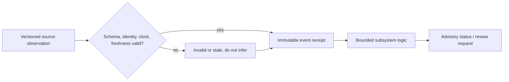

# P02B-05 · Scientific assistant StarChips — Engineering design

**Revision:** public Markdown edition 1.0 · **Status:** design and software simulation, not a qualified living deployment

## Objective and scope

Train digital research and cell-foundry assistants to propose testable questions and identify missing evidence; keep human experimental authority.

## Input boundary

approved literature corpus, role/evidence ontology, prior negative results, instrument limitations, controlled-source records. Missing identifiers, invalid units or stale calibration block any inference and cause an explicit review or rejection state.

## Output and data structures

hypothesis packet, assay question, literature provenance, uncertainty level, review request, test recommendation.

**Required records:** `HypothesisPacket, SourceCitation, TrainingCase, Recommendation, HumanReview, ModelVersion`. Every record needs stable IDs, UTC timestamp plus clock domain, source version, validity, uncertainty where measured, and evidence provenance.

## Reference processing sequence

Retrieve source; generate contrasting explanations; list necessary measurements; formulate falsifiable prediction; require source/role validity and human review.

## State and authority model

States are `UNINITIALIZED`, `VALIDATING`, `OBSERVING`, `ADVISORY`, `FAULT_LATCHED`, and `REVIEW_REQUIRED`. Only qualified personnel and separately released physical controllers can issue real actuation. The P02B software implementation is **observation/advice-only**.

## Failure-mode requirements

AI conflates Star dialogue with real data; invents a cell recipe; claims a theoretical model is clinically validated; hallucinates source or timing. Record requested versus observed outcomes and retain failure evidence instead of converting missing data to normal state.

## Release and acceptance tests

blinded source attribution; unanswerable prompts; conflicting evidence; refusal of unapproved actuation; source-paragraph audit. All tests are specified for a digital harness or qualified bench setup; biological performance has its own independent gates.

## Integration and dependencies

Use [WindBus](../windbus.md) to exchange only allowed information with Lotus and the Central Data Router. Verify dependency/route provenance before enabling a connection. Keep [independent physical limits](../governance.md) outside adaptive learning authority.

## Not yet specified

Vendor-compatible connector/pinout, live voltage/energy envelope, laboratory SOP, validated sampling range and any physical software-to-care authorization remain controlled unknowns, not guessed defaults.

**Source register:** Lotus Stream Research 2026-11-13; CE-DEV-001 v0.4 scientific source audit. For research boundaries see the [scientific source editions](../research.md).
