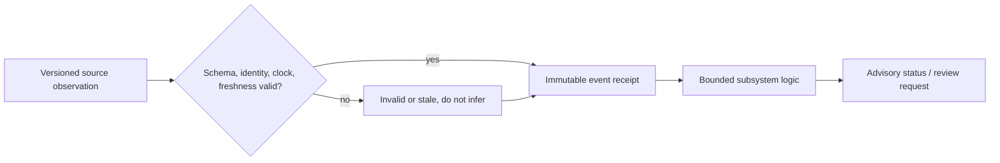

# P02B-06 · Supervisor MCU and firmware — Engineering design

**Revision:** public Markdown edition 1.0 · **Status:** design and software simulation, not a qualified living deployment

## Objective and scope

Implement deterministic read-only sensor/board monitoring with host-safe failure behavior and independently logged firmware identity.

## Input boundary

approved device telemetry, monotonic tick, sensor ID and calibration, board firmware build, validated USB/UART transport. Missing identifiers, invalid units or stale calibration block any inference and cause an explicit review or rejection state.

## Output and data structures

authenticated telemetry envelopes, loss/error counters, watchdog heartbeat and passive fault report.

**Required records:** `FirmwareManifest, BoardRecord, TelemetryEnvelope, WatchdogReceipt, FaultLatch, BootSequence`. Every record needs stable IDs, UTC timestamp plus clock domain, source version, validity, uncertainty where measured, and evidence provenance.

## Reference processing sequence

Boot into passive state; identify firmware; verify sensor health; sample validated channels; timestamp/sequence; send to host; latch faults; never authorize a live physical action.

## State and authority model

States are `UNINITIALIZED`, `VALIDATING`, `OBSERVING`, `ADVISORY`, `FAULT_LATCHED`, and `REVIEW_REQUIRED`. Only qualified personnel and separately released physical controllers can issue real actuation. The P02B software implementation is **observation/advice-only**.

## Failure-mode requirements

unexpected reset; stale telemetry; partial UART frame; duplicated counter; firmware rollback; host failure causing unsafe action. Record requested versus observed outcomes and retain failure evidence instead of converting missing data to normal state.

## Release and acceptance tests

restart sequence monotonicity; invalid schema/CRC; watchdog stop; brownout simulation; no unauthorized output transitions. All tests are specified for a digital harness or qualified bench setup; biological performance has its own independent gates.

## Integration and dependencies

Use [WindBus](../windbus.md) to exchange only allowed information with Lotus and the Central Data Router. Verify dependency/route provenance before enabling a connection. Keep [independent physical limits](../governance.md) outside adaptive learning authority.

## Not yet specified

Vendor-compatible connector/pinout, live voltage/energy envelope, laboratory SOP, validated sampling range and any physical software-to-care authorization remain controlled unknowns, not guessed defaults.

**Source register:** P02B digital twin; STM32 H7 hardware reference; CE-DEV-001 v0.4 independent limit rule. For research boundaries see the [scientific source editions](../research.md).
