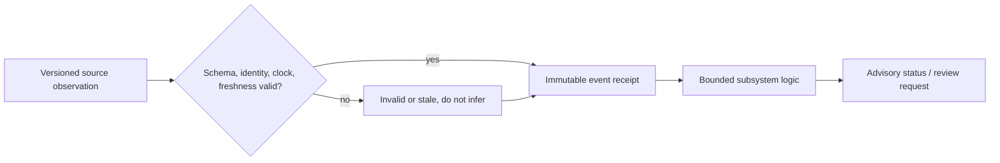

# P02B-07 · Incubator and provision telemetry — Engineering design

**Revision:** public Markdown edition 1.0 · **Status:** design and software simulation, not a qualified living deployment

## Objective and scope

Observe qualified culture-environment and service history separately from learning feedback.

## Input boundary

supported OEM diagnostics, environmental sensors, service receipts, instrument identity and calibration date. Missing identifiers, invalid units or stale calibration block any inference and cause an explicit review or rejection state.

## Output and data structures

care-status record, sample freshness, environmental deviation request for operator review.

**Required records:** `ServiceEvent, EnvironmentalObservation, SensorFreshness, CultureIdentity, CareReview`. Every record needs stable IDs, UTC timestamp plus clock domain, source version, validity, uncertainty where measured, and evidence provenance.

## Reference processing sequence

Verify OEM channel; read measurements; report physical source/location; validate freshness; log service timing; escalate deviations for qualified human review.

## State and authority model

States are `UNINITIALIZED`, `VALIDATING`, `OBSERVING`, `ADVISORY`, `FAULT_LATCHED`, and `REVIEW_REQUIRED`. Only qualified personnel and separately released physical controllers can issue real actuation. The P02B software implementation is **observation/advice-only**.

## Failure-mode requirements

remote reservoir mistaken for at-cell pH; absent service assumed normal; learning score alters feeding; unauthorized automated pump command. Record requested versus observed outcomes and retain failure evidence instead of converting missing data to normal state.

## Release and acceptance tests

unplugged OEM port; stale sample; conflicting redundant sensors; service record without physical receipt; host shutdown. All tests are specified for a digital harness or qualified bench setup; biological performance has its own independent gates.

## Integration and dependencies

Use [WindBus](../windbus.md) to exchange only allowed information with Lotus and the Central Data Router. Verify dependency/route provenance before enabling a connection. Keep [independent physical limits](../governance.md) outside adaptive learning authority.

## Not yet specified

Vendor-compatible connector/pinout, live voltage/energy envelope, laboratory SOP, validated sampling range and any physical software-to-care authorization remain controlled unknowns, not guessed defaults.

**Source register:** CE-DEV-001 v0.4 section 9 and controller states; cell-production oversight. For research boundaries see the [scientific source editions](../research.md).
