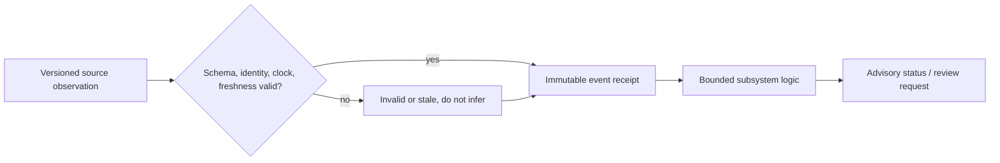

# P02B-08 · Chemistry sensor and assay channel — Engineering design

**Revision:** public Markdown edition 1.0 · **Status:** design and software simulation, not a qualified living deployment

## Objective and scope

Define traceable chemical observation from qualified transducer and assay rather than inferred neuronal activity.

## Input boundary

qualified sample and blank, chemistry-specific transducer, calibration standard, AD5940-style front end, provenance. Missing identifiers, invalid units or stale calibration block any inference and cause an explicit review or rejection state.

## Output and data structures

concentration or assay result with units, location, recovery factor, uncertainty and reference method.

**Required records:** `AssayIdentity, ReferenceSample, ChemicalObservation, CalibrationCurve, Blank, SensorFault`. Every record needs stable IDs, UTC timestamp plus clock domain, source version, validity, uncertainty where measured, and evidence provenance.

## Reference processing sequence

Confirm analyte specificity; record sample path and volume; calibrate detector; measure reference/blank; store result with recovery and detection limits; classify faults.

## State and authority model

States are `UNINITIALIZED`, `VALIDATING`, `OBSERVING`, `ADVISORY`, `FAULT_LATCHED`, and `REVIEW_REQUIRED`. Only qualified personnel and separately released physical controllers can issue real actuation. The P02B software implementation is **observation/advice-only**.

## Failure-mode requirements

sensor fouling; reagent cross-response; sample dilution; calibration drift; electrode artifact; surface adsorption misread as uptake. Record requested versus observed outcomes and retain failure evidence instead of converting missing data to normal state.

## Release and acceptance tests

blank specificity; repeatability; recovery and stability; matrix mismatch; cross-lot comparability; excluded samples report. All tests are specified for a digital harness or qualified bench setup; biological performance has its own independent gates.

## Integration and dependencies

Use [WindBus](../windbus.md) to exchange only allowed information with Lotus and the Central Data Router. Verify dependency/route provenance before enabling a connection. Keep [independent physical limits](../governance.md) outside adaptive learning authority.

## Not yet specified

Vendor-compatible connector/pinout, live voltage/energy envelope, laboratory SOP, validated sampling range and any physical software-to-care authorization remain controlled unknowns, not guessed defaults.

**Source register:** CE-DEV-001 v0.4 chemical inventory; AD5940 OEM datasheet; biochemical assay validation practice. For research boundaries see the [scientific source editions](../research.md).
