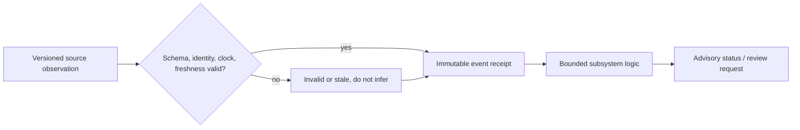

# P02B-09 · Neural acquisition and multimodal time base — Engineering design

**Revision:** public Markdown edition 1.0 · **Status:** design and software simulation, not a qualified living deployment

## Objective and scope

Acquire vendor neural signals and imaging exposures with a common, measured timing description.

## Input boundary

HD-MEA vendor stream, selected channel map, stimulation receipts, sync pulse, camera exposure timestamps. Missing identifiers, invalid units or stale calibration block any inference and cause an explicit review or rejection state.

## Output and data structures

recorded signals, artifacts mask, channel validity, clock uncertainty, latency and replay-safe event metadata.

**Required records:** `AcquisitionSession, ElectrodeMap, ClockCalibration, SyncReceipt, ArtifactWindow, FileSegment`. Every record needs stable IDs, UTC timestamp plus clock domain, source version, validity, uncertainty where measured, and evidence provenance.

## Reference processing sequence

Freeze channel selection; establish clocks; capture physical stimulus receipt; acquire raw/events; mask artifact; correlate exposure trigger; seal evaluation segments.

## State and authority model

States are `UNINITIALIZED`, `VALIDATING`, `OBSERVING`, `ADVISORY`, `FAULT_LATCHED`, and `REVIEW_REQUIRED`. Only qualified personnel and separately released physical controllers can issue real actuation. The P02B software implementation is **observation/advice-only**.

## Failure-mode requirements

clock domain mismatch; dropped samples; timestamp derived from browser display; optical reporter lag treated as spike timing; unsorted electrodes called unique cells. Record requested versus observed outcomes and retain failure evidence instead of converting missing data to normal state.

## Release and acceptance tests

clock skew and jitter; synthetic dropout; bridge round-trip; record retention; channel-map revision; frozen decoder digest. All tests are specified for a digital harness or qualified bench setup; biological performance has its own independent gates.

## Integration and dependencies

Use [WindBus](../windbus.md) to exchange only allowed information with Lotus and the Central Data Router. Verify dependency/route provenance before enabling a connection. Keep [independent physical limits](../governance.md) outside adaptive learning authority.

## Not yet specified

Vendor-compatible connector/pinout, live voltage/energy envelope, laboratory SOP, validated sampling range and any physical software-to-care authorization remain controlled unknowns, not guessed defaults.

**Source register:** CE-DEV-001 v0.4 sections 5, 12, 26; 2026 formal model corrections. For research boundaries see the [scientific source editions](../research.md).
