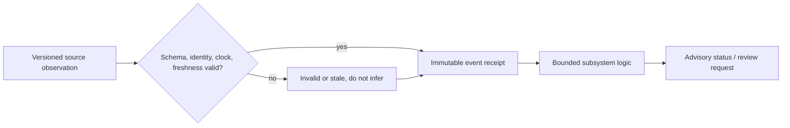

# P02B-10 · Commissioning, release and GitHub evidence — Engineering design

**Revision:** public Markdown edition 1.0 · **Status:** design and software simulation, not a qualified living deployment

## Objective and scope

Separate documented configuration, software-tested behavior, and externally qualified hardware/biological release.

## Input boundary

source revisions, signed test plan, reproducible software build, vendor approvals, risk register, preregistered analysis. Missing identifiers, invalid units or stale calibration block any inference and cause an explicit review or rejection state.

## Output and data structures

versioned release manifest, gate decision, test report, exceptions list, immutable evidence links.

**Required records:** `ReleaseManifest, AcceptanceGate, TestRun, Deviation, EvidencePointer, DecisionRecord`. Every record needs stable IDs, UTC timestamp plus clock domain, source version, validity, uncertainty where measured, and evidence provenance.

## Reference processing sequence

Freeze candidate; run software tests; verify source license; inspect safety boundaries; review vendor/biology blockers; record what is and is not demonstrated.

## State and authority model

States are `UNINITIALIZED`, `VALIDATING`, `OBSERVING`, `ADVISORY`, `FAULT_LATCHED`, and `REVIEW_REQUIRED`. Only qualified personnel and separately released physical controllers can issue real actuation. The P02B software implementation is **observation/advice-only**.

## Failure-mode requirements

using seeded simulation result as organoid learning; altering endpoint after seeing test; stale acceptance threshold; publication includes patent material. Record requested versus observed outcomes and retain failure evidence instead of converting missing data to normal state.

## Release and acceptance tests

reproducible CI; missing artifact detection; archive hash; cross-branch link audit; negative test handling; publication screening. All tests are specified for a digital harness or qualified bench setup; biological performance has its own independent gates.

## Integration and dependencies

Use [WindBus](../windbus.md) to exchange only allowed information with Lotus and the Central Data Router. Verify dependency/route provenance before enabling a connection. Keep [independent physical limits](../governance.md) outside adaptive learning authority.

## Not yet specified

Vendor-compatible connector/pinout, live voltage/energy envelope, laboratory SOP, validated sampling range and any physical software-to-care authorization remain controlled unknowns, not guessed defaults.

**Source register:** CE-DEV-001 v0.4 release criteria; Formal Models and Reconciliation v1.0. For research boundaries see the [scientific source editions](../research.md).
