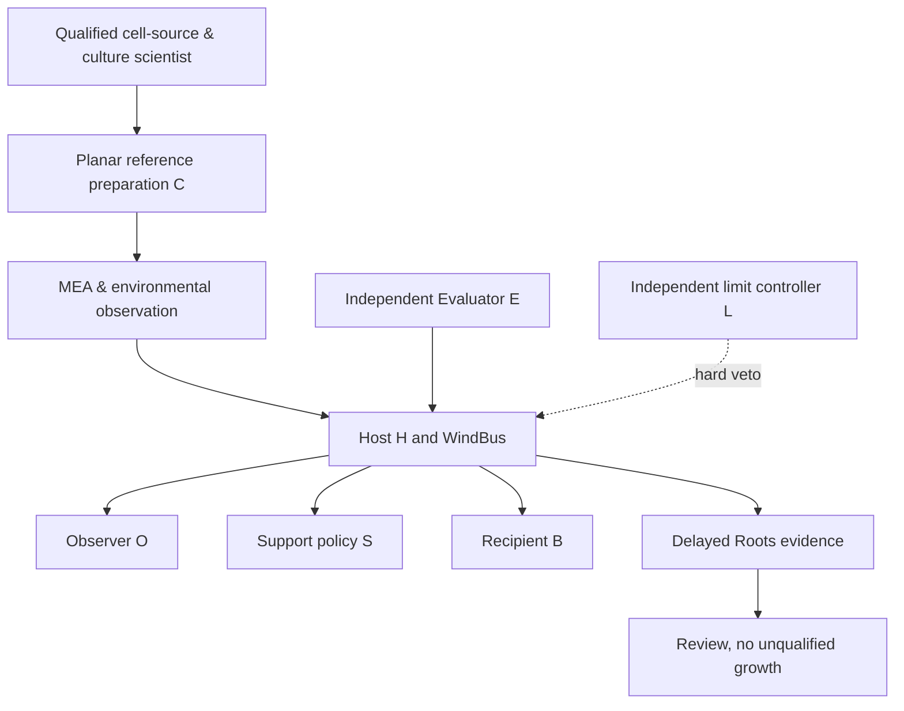

# Phase 1 — Physical reference and interface design

> **ChristEye Anaiero · 15 November 2026 · We Develop Software LLC**  
> **Status:** P01 documented; no physical construction · WDS Public Research Reference License.  
> [Documentation Home](index.md) · [Full document library](full-document-library.md) · [Phase P01 original](../phases/P01/README.md)

The navigation-oriented reference to the six **complete P01 design documents** and their machine-readable records. Later technical work inherits this P01 boundary unless explicitly released as a new preparation.

## 1. Current architecture and experimental boundary

This is an **authority and information diagram**, not an anatomical proof. The C/O/B/S preparations remain separate and the electronic bridge is distinct from physical axonal joining. [R13](../phases/P01/references.md#r13)

## 2. Living modules versus software services

The P01 physical inventory starts with one core reference sample, then independently characterized observer, recipient, and support learners only when qualified. **The 24 digital management services need no dedicated cells.** Local astrocytes are included within each qualified preparation; a digital support StarChip does not replace living astrocyte–neuron physiology.

| Physical module | Initial reference neurons | Reference astrocytes | First stage | What the number means |
|---|---:|---:|---|---|
| **C** — Core learner | 80000 | 20000 | R1 | supplier reference only |
| **O** — Observer learner | 80000 | 20000 | R2 | supplier reference only |
| **B** — Recipient learner | 80000 | 20000 | R2 separate campaign | supplier reference only |
| **S** — Support-policy learner | 80000 | 20000 | R3 | supplier reference only |
| **G_local** — Local glia support | Unspecified | Unspecified | R1+ | already allocated not additional |
| **Prod** — Cell bank/maturation service | Unspecified | Unspecified | Before R1 | blocked unqualified |
| **3D-C** — Future 3D organoid Soil | Unspecified | Unspecified | P06 | blocked unqualified |
| **Immuno** — Anti-disease / microglial research | Unspecified | Unspecified | P06+ | not in reference release |
| **OPC** — Oligodendrocyte lineage study | Unspecified | Unspecified | P06+ | not in reference release |
| **Neuromod** — Brainstem/neuromodulatory candidate | Unspecified | Unspecified | P06+ | not in reference release |
| **Crystal-P** — Physical Crystal candidate | Unspecified | Unspecified | P07 | blocked unqualified |

The 80,000 + 20,000 worked example applies only to the **BrainXell/Axion planar 24-well MEA reference**, not MaxOne, 3D organoids, other tissue sources or the completed learning mesh. It is a supplier example rather than a verified Anaiero run. [R01](../phases/P01/references.md#r01) · [R02](../phases/P01/references.md#r02)

## 3. The mandatory design artifacts

1. [Program Phases and Document Standard](../phases/P01/docs/00_Program_Phases_and_Document_Standard.md)
2. [Physical Module Composition and Counts](../phases/P01/docs/01_Physical_Module_Composition_and_Counts.md)
3. [Molecules Structures and Development Companion](../phases/P01/docs/02_Molecules_Structures_and_Development_Companion.md)
4. [Electrical WindBus and Training Companion](../phases/P01/docs/03_Electrical_WindBus_and_Training_Companion.md)
5. [Daily Care Quality Gates and Assays](../phases/P01/docs/04_Daily_Care_Quality_Gates_and_Assays.md)
6. [Build Decisions Controlled Unknowns and Handoff](../phases/P01/docs/05_Build_Decisions_Controlled_Unknowns_and_Handoff.md)

## 4. What we can measure, and what we cannot conclude

| Measurement | Legitimate interpretation | Not justified |
|---|---|---|
| MEA spikes and evoked latency | Responsiveness and network activity | Proven general cognition |
| Calcium and astrocytic reporters | Selected cell-state changes | Portable astroengram |
| Glucose and lactate | Supply, exchange and measured metabolic state | Encoding of remembered facts |
| Structure, synapses and spines | Morphological organization | Content-specific knowledge without task controls |
| RNA/protein measurements | Candidate molecular correlates and pathways | Automatic memory addressing or behavioral transfer |
| Delayed task success | Bounded Root at a named delay and task | Full mind or clinical benefit |

The scientific separation above is required by [R06](../phases/P01/references.md#r06), [R08](../phases/P01/references.md#r08) and [R13](../phases/P01/references.md#r13).

## 5. Daily-care and nourishment controls

Separate **Milk** (qualified metabolic support), **Honey** (outcome-contingent information), **Bread** (foundational digital curriculum) and **Meat** (advanced curricula). The physiological care pathway must not use task performance as a permission to withhold support or change nutrition. A scheduled measurement is not an automatic feeding prescription.

Required service receipts: preparation ID, operator authority, laboratory SOP, observed environment at sample location, timestamp, sample/measurement validity, instrument version, deviations and escalation. [Full care document](../phases/P01/docs/04_Daily_Care_Quality_Gates_and_Assays.md).

## 6. Electrical and information contract

The reference task uses C0/C1 context plus A/B sequence and a GO event, with outputs X, Y or HOLD. Decoders and codebooks remain frozen for held-out biological-learning claims. Experimental electrical settings must come from the selected supplier, device and scientific lead—not from a generic ChristEye equation.

| Context | Sequence | Output |
|---|---|---|
| C0 | AB | X |
| C0 | BA | Y |
| C1 | AB | Y |
| C1 | BA | X |
| C0 or C1 | AA or BB | HOLD |

The frozen reader, per-class macro recall, exposure-matched controls and delayed probes are specified in the [Electrical/WindBus companion](../phases/P01/docs/03_Electrical_WindBus_and_Training_Companion.md).

## 7. Controlled unknowns blocking a live build

| ID | Question | Owner | Gate |
|---|---|---|---|
| U01 | Reference hardware mode | Culture+hardware lead | R1 |
| U02 | Exact neuron/astrocyte lot + subtype purity | Culture lead | G1 |
| U03 | 3D organoid initial cell count and geometry | Organoid lead | P06 |
| U04 | Complete medium formulation and change schedule | Culture lead | G2 |
| U05 | Coating / matrix / support volumes | Culture lead | G2 |
| U06 | Electrical stimulation profile library | Electrophysiology lead | G3 |
| U07 | Input/output electrode map and decoder | Systems lead | G3 |
| U08 | Noise threshold, activity drift tolerance | Electrophysiology lead | G3 |
| U09 | Closed-loop delay/exposure budget | Systems lead | G4 |
| U10 | Learning pilot replicates and confirmed controls | Stats lead | G4 |
| U11 | Retention test horizons and readout | Science lead | G5 |
| U12 | Bridge bandwidth, codebook, disconnect | Systems lead | G6 |
| U13 | Astrocyte reporter specificity | Imaging lead | A1/A3 research |
| U14 | Physical Crystal carrier and reader | Mechanism lead | G7 |
| U15 | Molecular-peptide input | Molecular biology lead | Research only |
| U16 | Surveillance / microglia-like cells | Culture lead | P06+ |
| U17 | Human organoid ethical review | Institution | Before live organoid |

Each open variable requires a vendor/laboratory evidence record. A missing value is never silently replaced with a number from another tissue or chip. [Machine-readable unresolved parameters](../phases/P01/registers/controlled_parameters.csv).

## 8. Release gate sequence

**R0:** cell-free instrument and simulation → **R1:** core source, interface and retention → **R2:** separate observer or recipient teaching study → **R3:** support-policy contribution → **P06:** 3D Soil research → **P07:** physical Crystal candidate. Each stage requires its own documented release; passing one never establishes the later claim.

## 9. Source notes

All P01 source IDs and scope limitations are preserved in the [annotated source register](../phases/P01/references.md). The [Phase P01 baseline](../phases/P01/README.md) links the original full specifications and machine registers.
