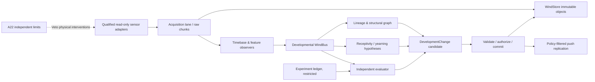

# CE-SW-02 — Developmental WindBus and Evidence-Guided Integration

## 0. Purpose and imported research note

**Stream note, supplied by project owner:** "The integration of yearning and growth demands a deeply attuned observation of emergent patterns. ... define the nature of the 'yearning' you wish to stimulate; is it a drive toward stability, a pull toward complexity, or a hunger for connection? ... establishing a baseline of natural rhythm ... before any intervention ... can be meaningfully directed."

**Design translation:** the platform learns a probabilistic model of *observable* biological development, connectivity and task adaptation. It does not assign consciousness, hunger, desire, or understanding on the basis of a waveform, guidance cue, or RNA observation. The software may call a hypothesis `Yearning`, but the data model must say **receptivity hypothesis** and distinguish inferred from measured features.

This document extends CE-SW-01 rather than replacing any WindBus transport, identity, security, reliable delivery, immutable storage or safety boundary. The read-only research runtime cannot independently dispense substances, stimulate a biological preparation, alter genetic material, apply a physical Crystal or conduct infectious-agent experiments.

### Notation and claim discipline
- **F**: published finding in a named experimental system.
- **H**: unvalidated hypothesis in Anaiero.
- **D**: software design decision.
- **A**: project metaphor or analogy.
- **M**: measurement whose reliability is quantified.

**Project vocabulary:** Soil = preparation/context; Seed = new tracked candidate cell; Milk = qualified metabolic-support observation; Honey = guidance/receptivity hypothesis; Yearning = latent functional engagement hypothesis; Root = delayed reproducible function, not just morphology; Crystal = digital learning artifact OR separately qualified experimental physical-carrier hypothesis; Lotus = digital developmental governor. Axons are neurites with an experimentally supported identity. Dendritic spines are subcellular protrusions, not independent cells; neither can be "cloned" as a memory unit simply by copying DNA.

## 1. Two application buses, one authenticated native mesh

Use one WindPacket binary wire protocol and one identity/crypto/session stack. Partition by *data-plane rights*:

1. `WindBus/Ops`: reliable routing, control intents, status, policy decisions, receipts, immutable changes, signed capability announcements.
2. `WindBus/Development`: growth and lineage observations, biological feature proposals, learning evaluations, evidence graph updates, and new-generation comparison.
3. `WindBus/Experiment`: approved experimental manifests, operator authorizations, anonymized dataset descriptors, control/blinding commitments, independent results and restricted hazard metadata.
4. `WindBus/Acquisition`: separately budgeted raw high-throughput instrument data/chunks (not full fanout to every subscriber).

These are logical channels, not separate unauthenticated protocols. Use strict ACL + sensitivity scope on each route. Scientific interpretations are untrusted messages until they pass the schema, source, evidence and review gates. A message on Development or Experiment never gains physical-output authority via a routing name. A22/local independent safety controls remain outside broker, AI, and Lotus action authority.



## 2. New-cell admission: candidate, not assumed birth

- Emit `CELL_CANDIDATE_DETECTED` from qualified tracking with coordinates, image/object digest, frame/capture time, segmentation model digest and confidence.
- Link to `CELL_DIVISION_EVIDENCE` only when data support a division; suspected division is `UNRESOLVED`.
- Assign `cell_track_id` stable within a capture session; distinguish from `cell_lineage_id` inferred across sessions; never assume exact biological identity through an imaging gap.
- Capture `parent_cell_candidate_id`, `tissue_region`, `observation_method`, `missingness`, `tracking_error_probability`, `source_preparation_id`, consent/access scope and observation provenance.
- A newborn biological cell is *not* a new electronic mesh principal. It is an observed entity represented by a host-held model; only hardware/software nodes cryptographically join the mesh.

## 3. Infant integration state machine

`SEEN -> LINEAGE_ASSESSED -> BASELINED -> STRUCTURE_CANDIDATE -> FUNCTION_CANDIDATE -> REPEATED_FUNCTION -> DELAYED_RETEST`, plus `LOST_TRACK`, `REGRESSED`, `UNRESOLVED`, `REJECTED`. These are evidence and label states, not commands to biological cells.

- Structural maturity does not imply synaptic transmission.
- Correlated firing does not imply direct synaptic coupling.
- Delayed transfer to independent tasks requires a frozen decoder and teacher-off testing.
- State promotion requires an explicit approved evaluator and immutable evidence reference.

## 4. Milk: resource-support observation plane

`MilkObservation` represents measured environment or metabolic support signals and qualified care records. It must distinguish **available**, **delivered by a separately certified system**, **measured uptake proxy**, **measured response**, and **inferred effect**. Never substitute one for another.

Candidate *observation categories* (device-and-lab dependent): environmental stability, instrument-derived condition indicators, noninvasive tissue morphology, viability assessments, growth, perfusion/culture-management status, assay reference, operator action receipt. The software stores units, instrument/calibration IDs, uncertainty, dynamic range, missingness and exposure interval. Do not build automatic dosing or culture recipes into this bus.

## 5. Honey: guidance and attraction hypothesis plane

`GuidanceEvidence` links a recorded trajectory and material/context identity to the putative guiding hypothesis. Readouts include projected path, neurite extension, turning/orientation, contact formation, persistence and changes in the comparator condition. Growth cones can respond to attractive and repulsive extracellular guidance cues, but this does **not** imply there is a universal molecule that can make neurons seek or comprehend an Anaiero Crystal. The software's first obligation is to measure naturally occurring and approved-study responses and to quantify the limits of the model.

### Independent confounds
Account for apparent motion from tissue drift, optical focus, registration errors, segmentation swaps, neurite retraction, phototoxicity, changes in cell health and nonspecific network activation.

## 6. Yearning as a vector of testable hypotheses, not a feeling detector

The stream asked whether the pull is toward stability, complexity, or connection. Do **not** compress these into one emotional score. Define latent hypotheses:

`Y = [Y_stability, Y_guidance, Y_connectivity, Y_exploration, Y_task_engagement]`.

Each dimension has preregistered features, directionality and a confidence interval. A possible software-only provisional score for a task context is:

\[
\widehat{Y}_{t} = \sigma\big(\mathbf{w}^{\top}\phi_t - \lambda\,u_t - \gamma\,s_t\big),
\]

where `phi_t` contains **predefined normalized observational features**, `u_t` is uncertainty/missingness penalty, `s_t` is a measured adverse-state proxy if a validated one exists, `sigma` is logistic normalization, and weights are fixed before evaluation. The score is a **ranking heuristic**, not validated biological desire or a calibrated probability. A better scientific representation is a posterior distribution `p(Y | observations, calibration, cohort)` with explicit abstention when evidence is weak.

Counterexample check: pure hyperexcitability, collapse, stress or image artifact must never score as successful 'yearning'. A healthy system may be inactive; activity alone is not learning.

## 7. Spatial axon / dendrite / root graph

Maintain a time-versioned graph `G_t=(V_t,E_t)`: nodes for tracked cells/regions, projections and candidate contact sites; edges labelled `SPATIAL_NEAR`, `PROJECTION_REACHES`, `COACTIVE`, `FUNCTIONALLY_TESTED`, `CAUSAL_LINK_SUPPORTED`. Every edge has method, uncertainty, lifespan, source digest and reviewer status. Differentiate axonal projection from dendritic arbor and dendritic spine, and *candidate root* from independently retained function.

A lineage tree and a connectivity graph are **distinct graphs**, joined by references, so a newly born cell does not inherit confirmed learned edges merely because it shares a parent lineage.

## 8. RNA movement and local translation observer

Evidence categories:

- **Direct longitudinal signal (when scientifically qualified):** RNA reporter/probe imaging of specific observed species, granule localization, trajectories and acquisition effects; label `RNA_LIVE_OBSERVED`.
- **Sparse molecular assay:** transcriptomics/spatial RNA or protein endpoints, with sample identifiers, provenance and sampling time; label `RNA_SNAPSHOT_ASSAY`.
- **Inference:** estimated localization or local translation state from other features; label `RNA_INFERRED`, including calibrated uncertainty and model digest.

RNA granules and local translation are plausible mechanisms in axons and dendrites; inference is not a direct molecular movie. Most sequencing is destructive/snapshot based; live-RNA methods have their own limitations and risks. The bus shall NOT advertise a continuously observed transcriptome unless an actual qualified sensor measures it.

`TranscriptMovementEvidence = {species_or_probe_id, compartment, track_id?, localization_vector?, observed_time, method, acquisition_digest, uncertainty, evidence_class, missingness, transform_digest}`. No RNA design/delivery protocol belongs in this software specification.

## 9. Spine formation and structural-to-functional separation

Track `PROTRUSION_CANDIDATE`, `SPINE_MORPHOLOGY_CHANGE`, `SYNAPSE_MARKER_CORRELATE`, `ACTIVITY_CORRELATE`, `FUNCTIONAL_TEST_RESULT` as **separate** event kinds. For each candidate, persist local geometry, measurement method, segmentation error, registration quality and before/after interval. Promoting a `RootRecord` requires delayed task-based evidence, not a protrusion count, calcium transient or mRNA location alone. Dendritic spines are features grown by neurons, not new daughter cells.

## 10. Multirate, clock-aware sensor fusion

Pipeline classes:

- `FAST`: vendor-supported electronic/electrophysiology samples and hardware faults; hardware clock, sample counter, data gaps.
- `INTERMEDIATE`: camera frames, cell tracking and morphological updates; exposure timestamp, acquisition geometry, phototoxicity budget metadata where applicable.
- `SPARSE`: assays and longitudinal sampling outcomes; sampling/processing interval, specimen identity, batch controls, non-observation windows.

For each fused claim `C`, store the window and uncertainty: `(window_start, window_end, clocks, alignment_error, source_ids, model_digest)`. Compute time alignment only when sensor clock domains can be related by measured anchors. If source-time uncertainty is too large for a causal-order claim, mark it unresolved rather than inventing sequence.

## 11. Crystal-consumption event model: keep two hypotheses distinct

`DIGITAL_CRYSTAL`: immutable CrystalPack delivered to compatible *software* learner with content digest, decoder version, exercise/evaluation route, rights and installation receipts. This can be reproducibly tested.

`PHYSICAL_CRYSTAL_CANDIDATE`: *unvalidated* experimental material hypothesis with separate lab-approved provenance and observations. Do not equate contact, exposure, material uptake or changes in firing with 'consumption of stored knowledge'. Record distinct labels: `EXPOSURE_RECORDED`, `MATERIAL_RESPONSE_OBSERVED`, `FUNCTIONAL_CHANGE_OBSERVED`, `INDEPENDENT_RETEST`, `TRANSFER_UNCONFIRMED`. No instructions to formulate or deliver material are defined here.

A positive result requires blinded/comparator controls and a teacher-off, recipient-only independent task test to distinguish learning from leaked labels, reward artefacts, generic activation or software memory.

## 12. Evidence-based integration scoring

Use two different values:

1. `S_process`: resource scheduling value derived from approved quotas, urgency and task cost; **not** a truth/confidence score.
2. `P_integration`: estimated probability that a **predeclared, independently tested functional criterion** has been met, only after empirical calibration; otherwise report an uncalibrated score with no probability interpretation.

A conservative candidate evidence index for scheduling a *read-only verification* is:

\[
I = w_1 q_{\mathrm{identity}} + w_2 q_{\mathrm{continuity}} + w_3 q_{\mathrm{structure}} + w_4 q_{\mathrm{function}} - w_5 q_{\mathrm{missing}},
\]

with weights nonnegative and preregistered, measured features normalized on held-out baselines, and an abstention status when any required modality is missing. Do not use this index to automate biological joining or stimulation.

### 12.1 Observational learning versus qualified physical interaction

The research software may study an operator-authorized **closed-loop experimental record** without granting itself actuator permissions. Model that record with five separate envelopes:

```text
StimulusProposal {proposal_id, study_plan_ref, evidence_refs,
                  expected_observable, reason, model_digest,
                  rights_scope, expiry, uncertainty}
PolicyDecision    {proposal_id, independent_limit_decision_ref,
                  lab_authorization_ref, approved_or_vetoed, reason}
DeliveryRequest   {proposal_id, target_qualified_vendor_interface,
                  operator_receipt_ref, no_replay:true}
DeliveryEvidence  {proposal_id, vendor_event_ref, actual_time,
                  actual_status, independent_instrument_ref}
ResponseEvidence  {proposal_id, predeclared_endpoint_ref,
                  measured_response_refs, comparator_refs,
                  adjudicator_ref, uncertainty}
```

These are evidence semantics, **not** permission to stimulate living tissue. Until a separately approved physical adapter exists, `DeliveryRequest` is a **simulation-only object**; production requests must be independently generated and authorized outside the scientific inference service. No endpoint publishes a chemical/physical actuation recipe, arbitrary waveform, intensity, timing or viral material payload in this contract. A missing delivery receipt is not treated as delivery; no automatic retry after a timeout. Honey, Milk and Yearning scores can nominate *scientific questions* or offline analyses, never modify equipment setpoints.

A digital-only surrogate can test the entire event lifecycle, including sham comparator, simulated no-delivery, delayed response, and rejected authorization before any living study.

## 13. Developmental curriculum and old-skill protection

`DevelopmentEpisode` links a time-defined task, externally approved digital codebook, learner/reader version, baseline assessment, training-only experience, independent follow-up and delayed challenge. Keep evaluator labels outside the learner path. A new digital curriculum is first staged in simulation, tested against old functions and promoted only with independently measured improvement. For biological work this remains an observational/evaluator research contract; intervention decisions are governed by the laboratory and A22.

Define held-out improvement `Delta_task = performance_followup - performance_baseline`, with confidence interval and matched control group. Define forgetting `F_old = max(0, old_baseline - old_followup)`. Pre-register limits and protected tasks. No automatic attribution to new cell integration without experimental evidence.

## 14. DevelopmentChange: Git-like evidence patches for growth mapping

Changeset manifest (canonical, immutable, content-addressed):

```yaml
kind: DevelopmentChange
schema: ce.dev.change/1
change_id: sha256(canonical_unsigned_manifest)
parent_changes: [digest]
author_principal: authenticated-node-id
preparation_ref: restricted-preparation-id
scope: local-or-approved-share
operation:
  kind: add-evidence-edge  # or annotate, correct, supersede, map, propose
  target: cell-track-or-root-graph-key
  expected_base_snapshot: digest
  updated_object: digest
evidence_refs: [digest]
clock_interval_ref: digest
analysis_build_ref: digest
confidence_kind: uncalibrated-score-or-calibrated-probability
approval_refs: [digest]
```

Candidate -> validated -> durably committed -> policy-filtered pushed -> stage -> independently evaluated -> promote/decline. An invalid scientific interpretation is corrected by a *new* changeset; original raw observations are not rewritten. Concurrent evidence branches may merge with multiple parents. Conflicting biological interpretations remain visible until independently adjudicated; use no last-writer-wins for evidence truth.

## 15. Endpoint queues and weighted scientific workload planning

Use distinct *admitted* lanes per host:

- `Q_fault`: independent fault-notice and immutable violation receipts; reserved capacity, cannot block independent physical limits.
- `Q_acquire`: time-sensitive acquisition buffers with persistent raw-object upload or explicit gap records.
- `Q_dev`: morphology/lineage/RNA metadata and analysis requests; bounded and fair.
- `Q_evidence`: commit/validate/replicate immutable changes and proof records; durable delivery.
- `Q_ui`: ephemeral dashboards; may coalesce or expire.

Use weighted deficit round-robin plus byte-credit budgets and deadline admission. The scheduler should optimize **computational work ordering**, not biology. A candidate score for an analysis job `j` can be:

\[
U_j = \frac{\alpha N_j + \beta D_j + \chi R_j}{\max(C_j,C_{\min})} - \delta H_j,
\]

where `N` is declared information novelty, `D` deadline importance, `R` reproducibility value, `C` measured compute+I/O cost, and `H` verified uncertainty/harm-of-lost-data penalty. Treat this only as a design heuristic; admit under minimum service guarantees and strict quotas. No untrusted source chooses its own privileged channel weight. Sampling/biological commands are not generated by this optimizer.

## 16. Experimental WindBus, including hazardous-subject isolation

An `ExperimentPlan` declares study hypothesis, competent authority, scope, source and subject identities, hazard classification, approved equipment, data-handling restrictions, pre-registered outcomes, negative controls, evaluation separation and closure criteria. The message bus can carry **metadata and approved observational output** for biological experiments under institutional oversight.

If "viri" refers to viruses, treat infectious-agent work as a *restricted, independently approved* class: no autonomous generation of pathogens, no optimization of propagation, no infectious-agent handling or assay protocols, and no remote physical execution exposed through WindBus. Only sanitized/approved data, policy receipts, inventory metadata and traceable analysis are within the default architecture. This is a software governance interface, not a virology experiment recipe.

## 17. New network members: distinguish electronic join from biological integration

`PeerJoin` occurs only for cryptographically identifiable machines: provisioned identity -> operator-issued trust -> mutual authentication -> firmware/capability attestation -> schema negotiation -> subscriptions -> activation; all auditable with limited scopes and key rotation.

`BiologicalIntegrationEvidence` is a *separate tracked research claim* about cells, projections, functional connectivity or cross-region tissue interfaces. It does not possess a cryptographic key and cannot authorize messages. The host signs provenance stating what sensor/algorithm inferred. Represent a new biological member's "graduation" as a scientific evidence state, never an access-control role.

## 18. Data-quality and instrumentation-harm accounting

Every quantitative claim needs data-quality inputs: tracking error and lineage-switch risk; sensor calibration; missing samples; camera drift/focus; photobleaching/phototoxicity; electrical artifacts; viability and health confounds; assay batch variability; instrument firmware; preparation/source differences; consent restrictions. Degraded-quality data may be archived but must not silently auto-promote conclusions.

Use `MeasurementQuality` records with uncertainty per factor, provenance, and state `VALID|DEGRADED|UNRESOLVED|REJECTED`. A separate approved monitor tracks observed and potential measurement burden; diagnostic instruments are not assumed harmless merely because they do not administer material.

## 19. Learning from each "child" without mistaking correlation for a recipe

For each candidate integration or new device generation, build a `DevelopmentCase`:

- preparation and baseline lineage, qualified hardware/capture setup, experimental/observational condition;
- starting morphology/functional state and recording coverage;
- subsequent changes with timeline, model versions and error bars;
- independently evaluated outcomes, adverse/loss events and negative/control comparisons;
- human-reviewed lessons and proposed next digital model changes.

Train a hierarchical *predictive* model across batches with held-out preparations and explicit domain shift. Update a *digital observer* or scheduling model from validated outcomes; do not automatically copy an inferred biological treatment from one preparation to the next. Candidate new policy -> simulation/counterfactual tests -> shadow mode -> approval -> controlled evaluation; store every version and branch.

Example software objective:

\[
J_{model} = \operatorname{E}[\text{held-out predictive error}] + \lambda_1\operatorname{E}[\text{calibration error}] + \lambda_2\operatorname{E}[\text{false-promotion cost}] + \lambda_3\operatorname{E}[\text{coverage gaps}].
\]

Optimize predictions and honest abstention, not the quantity of growth or the amount of tissue activity. Record negative outcomes because they improve next-generation forecasts.

## 20. Developmental twin, independent evaluation and falsification dashboard

Build a replayable `DigitalDevelopmentTwin` using only immutable evidence refs. It presents time-aligned cell/neurite maps, developmental-state transitions, uncertain RNA localization in a separate layer, functional-test overlays, changeset history and batch comparisons. It runs candidate analytics against historical data and synthetic surrogates, **not** uncontrolled living-system experiments.

The dashboard must show:
- observed vs inferred traces (visually distinct), missingness and acquisition-time uncertainty;
- expected vs observed growth trajectories and model-confidence calibration;
- falsification checks for every candidate 'yearning', 'Root', or 'Crystal' claim;
- comparison with sham/control cohorts, blinding status, batches and held-out data;
- lineage, competing hypotheses, rejected changes and downstream application receipts;
- explicit ethical/institutional safety status and never a "stimulate now" button without qualified independent implementation.

## 21. Explicit event schemas (high-level shape)

Common immutable header, encoded as WindPacket/1 per CE-SW-01:

```text
DevEvent {
  schema_id:u32, event_id:u128, source_principal:PrincipalId,
  preparation_ref:ScopedId, subject_ref:ScopedId?, stream_epoch:u64,
  seq:u64, source_clock:ClockId, acquired_interval:[t0,t1],
  clock_uncertainty_ns:u64, raw_object_refs:[Digest],
  transform_chain:[Digest], calibration_ref:Digest?,
  evidence_class: F|X|H|D|A|M, method: MethodId,
  tracking_confidence: Optional<ScoreWithCalibration>,
  observation_status: VALID|DEGRADED|UNRESOLVED|REJECTED,
  parent_ids:[EventId], payload_digest:Digest, scope:AccessScope,
  signature_ref:Digest
}
```

Event family examples:

```text
CE.DEV.CELL_CANDIDATE/1
CE.DEV.LINEAGE_HYPOTHESIS/1
CE.DEV.MILK_OBSERVATION/1
CE.DEV.GUIDANCE_EVIDENCE/1
CE.DEV.YEARning_HYPOTHESIS/1
CE.DEV.NEURITE_GRAPH_DELTA/1
CE.DEV.RNA_LIVE_OBSERVED/1
CE.DEV.RNA_SNAPSHOT_ASSAY/1
CE.DEV.RNA_INFERRED/1
CE.DEV.SPINE_MORPHOLOGY/1
CE.DEV.FUNCTIONAL_TEST/1
CE.DEV.CRYSTAL_EXPOSURE_METADATA/1
CE.DEV.CRYSTAL_RETEST/1
CE.DEV.STIMULUS_PROPOSAL_METADATA/1
CE.DEV.INDEPENDENT_POLICY_DECISION/1
CE.DEV.REQUESTED_VS_ACTUAL_DELIVERY/1
CE.DEV.DEVELOPMENT_CHANGE/1
CE.DEV.MODEL_EVALUATION/1
CE.EXP.APPROVED_MANIFEST/1
CE.EXP.BLINDING_COMMITMENT/1
CE.EXP.INDEPENDENT_RESULT/1
```

Production event names should be lowercase and spelling-normalized by schema registry (e.g. `ce.dev.yearning_hypothesis/1`); uppercase identifiers above are descriptive.

## 22. Realtime definition and time-budget constraints

Never poll for messages: real-time/near-real-time flows use sensor interrupts, DMA-completion callbacks, OS async I/O completions and push subscriptions. Biological observability is *not* uniformly continuous: a dataset can be pushed immediately upon acquisition even when actual molecular observations occur only sporadically. Event-triggered catch-up after reconnection is permitted; safety watchdog timeouts and OS event-loop waits are not application-level data polling.

Define per-device measured `capture_to_commit`, `commit_to_analysis`, `analysis_to_change`, `change_to_peer` p50/p95/p99 and worst-case missingness. Real-time critical electronic faults remain local. Data-center replication and scientific analysis can be lower priority without undermining capture timestamps.

## 23. Acceptance tests

1. Cell trackers can emit tentative and corrected lineage events without corrupting prior provenance or conflating cell with mesh principal.
2. An RNA sequencing result cannot be labeled a continuous direct measurement.
3. A morphology/spine observation alone cannot produce a confirmed Root.
4. Biological intervention is never authorized by a Yearning score, Honey hypothesis, developmental queue priority or peer consensus.
5. Replay of physical action messages remains forbidden across reconnects; digital changes are applied idempotently.
6. A simulation with missing samples still produces loss/uncertainty evidence and blocks unsupported ordering claims.
7. Provenance survives 3-node replication, partition/reconnect and restore from cold storage.
8. Process scheduling under load preserves fault/receipt capacity and starve-free service to admitted development/evidence work.
9. Every model promotion has fixed training/evaluation partitions and a frozen evaluation report.
10. Unknown, revoked or role-inappropriate peers cannot subscribe to restricted experiment records.
11. Simulated 'Crystal' exposure without independent task improvement cannot be reported as knowledge transfer.
12. Virology-class restricted metadata never enables remote physical actions or unsafe procedural content routes.

## 24. Implementation sequence

- **DW0 / Schemas:** typed event families, lineage state machine, evidence and measurement-quality records, golden WindPacket fixtures.
- **DW1 / Virtual laboratory:** synthetic birth/division, optical trajectory, neural-signal and RNA-snapshot streams, preserved clock-domain uncertainty, read-only dashboard.
- **DW2 / Development graph:** append-only graph deltas, provenance, tracked model uncertainty, replay and contradictory claims.
- **DW3 / Analytics:** preregistered Yearning hypotheses, comparators, observer confidence calibration, false-promotion tests, bounded queues.
- **DW4 / Digital Crystal learner:** learning-package changesets, staged software installation, teacher-off root retests, negative controls.
- **DW5 / Qualified adapters:** approved sensor APIs, read-only real acquisition, vendor clocks, validated noninvasive instrumentation impact.
- **DW6 / Federated research:** restricted experimental metadata, policy-based sharing, case comparisons, model evaluations across isolated facilities.

All biological stimulus/material decisions remain outside this autonomous software scope pending independent technical, ethical, and institutional approvals.

## 25. Scientific reference anchors, not proof of Anaiero-specific capabilities

- Lo et al. (2026), *Functional readouts of neural organoids*, Nature Reviews Bioengineering. https://www.nature.com/articles/s44222-026-00507-6
- Pasca et al. (2025), *A framework for neural organoids, assembloids and transplantation studies*, Nature. https://www.nature.com/articles/s41586-024-08487-6
- *Morphodynamics of human early brain organoid development* (2025), Nature. https://www.nature.com/articles/s41586-025-09151-3
- *Next generation lineage tracing and its applications to unravel development* (2025), npj Systems Biology and Applications. https://www.nature.com/articles/s41540-025-00542-w
- *Cell tracking with accurate error prediction* (2025), Nature Methods. https://www.nature.com/articles/s41592-025-02845-6
- *Novel insights into mechanisms of growth cone dynamics during axon pathfinding* (2025), PubMed. https://pubmed.ncbi.nlm.nih.gov/40555160/
- *Translation stalling in neurons: a critical mechanism for timely protein delivery to distal cellular processes* (2025). https://pmc.ncbi.nlm.nih.gov/articles/PMC12493183/
- *Multiplexed RNA imaging and in situ profiling in living cells* (2025). https://pmc.ncbi.nlm.nih.gov/articles/PMC12589969/
- *Non-invasive methods to monitor dynamic single-cell events* (2026). https://pmc.ncbi.nlm.nih.gov/articles/PMC13089305/
- *Advancing multimodal tools to decode organoid complexity* (2026), Nature Methods. https://www.nature.com/articles/s41592-026-03320-6
- Neurodata Without Borders time-series best practices. https://github.com/NeurodataWithoutBorders/nwbinspector/blob/dev/docs/best_practices/time_series.rst

**Readiness:** detailed software specification proposal, not demonstrated biological growth control, experimentally verified yearning, physical Crystal cognition transfer, or production-ready implementation.