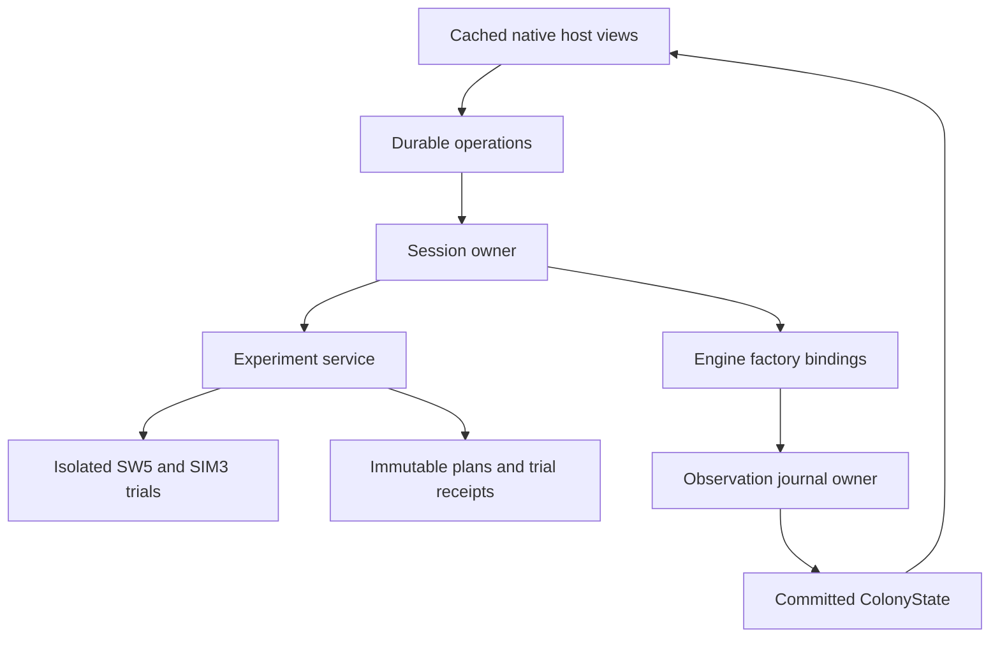

# CE-SW-32 — Reusable native experiments and durable operations

This batch extends CE-SW-31's operating session with immutable experiment
definitions, actual isolated SW5 and SIM3 trials, resumable receipts, explicit
engine contracts, persistent operation results, and observed outcome feedback.
The controller remains native C++20 on Windows and Linux.

## Ownership and boundaries

`NativeSessionApplication` composes a compiled engine factory registry. Each
binding owns its adapter and resources; the session sees `ISimulationEngine`
and optional typed ports. SW5, SIM3, and supervised scientific bindings share
the lifecycle without claiming that their models or metrics are equivalent.

`NativeSessionService` is the sole live mutation owner. `OperationService`
persists command intent before asking it to act. `SessionExperimentRuntime`
composes the durable experiment store with an evaluator rebuilt from an
immutable source checkpoint. `ExperimentService` owns trial progression and
selection. The Projector only materializes committed observations.



The source guard now recursively checks application, infrastructure, services,
contracts, and models, including angle includes and nested headers. Legacy
bridges have exact importing-header and destination allowlists. These checks
enforce include direction; they do not turn the existing header-oriented
implementation into independently linked shared libraries.

## Versioned engine contracts

Each engine declares input, metric, and checkpoint schemas; its clock domain;
logical or simulated time; behavior identity; summary meanings; and support
for isolated forks, evaluation, live changes, and restoration. Session-state
version 2 persists those declarations and rejects incompatible continuation.
Version 1 sessions remain readable and bind declarations when migrated.

| Engine | Participants | Connections | Energy compatibility slot | Time | Evaluation / live changes |
| --- | --- | --- | --- | --- | --- |
| SW5 | Live cells | Active cell links | Model energy proxy | Logical ticks | Real isolated guidance trials / durable guidance application and undo |
| SIM3 | Live cells, excluding dead entries | Configured colony links | Model energy proxy | Logical ticks | Real isolated link/teaching trials / no live application |
| Scientific | Unsupported | Unsupported | Modeled membrane voltage in microvolts | Declared simulated nanoseconds | No experimental forks or policy application |

The old `CEVSESSION/1` observation adapter retains its legacy 1 ms proxy mapping
for compatibility. New `CEVSESSION/2` sessions use the declared engine clock:
SW5/SIM3 acquired nanoseconds remain zero for logical time, while scientific
samples retain their actual declared simulated step duration. Scientific
observations use the separate `membrane_voltage` metric, never viability or
model-energy evidence.

## Immutable definitions and actual trials

`CEVEXPERIMENT/1` pins engine/model/behavior identity, metric and clock schemas,
the complete staged input schedule, objectives and constraints, policy
candidates, optional artifacts, optional original CEVPLAN/base provenance,
and outcome policy. Its canonical seal is checked before registration.
Definitions are indexed by immutable hash; replacing a file or registering a
new version does not change an already registered version.

Each run pins a complete source checkpoint plus source, epoch, revision,
start tick, seed, model, behavior, input schedule, and timebase. Every candidate
uses that same source and baseline. SW5's trial policy and live application
share `DigitalRoutePolicyService`, including generation changes. SIM3 trials
use the same extracted transition service as its live Runner. Completed trial
receipts include baseline/trial metrics, complete state hashes, status, and a
receipt hash bound to the definition and source context.

An interrupted run rebuilds its evaluator from the saved source checkpoint,
even if the live engine has since advanced or the original definition file
has been removed. It resumes after its committed candidate prefix. A failed
or cancelled trial cannot become a partially approved selection.

The built-in policies support SW5 guidance, SIM3 existing-link unit changes,
and SIM3 one-time teaching. Bounds are eight candidates, eight stages, four
distinct objectives, sixteen artifacts, and a total horizon of 1–128 ticks.
The current deterministic evaluators accept seed zero; they reject nonzero
seeds. SIM3 retains its existing 10,000-tick model ceiling. A generic runtime
does not remove a model's own numerical or policy limits.

CEVPLAN references are validated using the original learning-plan parser,
including the original base and artifact hashes and roles. They provide
provenance; VLM actions are not implicitly converted into SW5/SIM3 inputs.

## Commands and a working example

Use a fresh state directory with the supplied version 2 configuration:

```sh
cmake -S native -B build/native -DCMAKE_BUILD_TYPE=Release
cmake --build build/native --parallel 2
build/native/ce_colony_runtime start /tmp/anaiero-session.sock \
  examples/runtime/mixed-sustained.cevsession run/mixed-sustained
```

Windows uses the same native executable with a same-user named-pipe endpoint.
Pass its short name, for example `anaiero-session`; the adapter supplies the
`\\.\pipe\` prefix. Use the appropriate `.exe`/Release path. From another
terminal, submit a sealed example plan:

```sh
build/native/ce_colony_runtime query /tmp/anaiero-session.sock \
  'SUBMIT 100 EXPERIMENT "examples/experiments/sw5-guidance.cevexperiment"'
build/native/ce_colony_runtime query /tmp/anaiero-session.sock 'RESULT 100'
build/native/ce_colony_runtime query /tmp/anaiero-session.sock 'EXPERIMENT_STATE'
```

Paths are interpreted by the host process. A registered `name@sha256` can be
used instead of a path. The supplied SW5 and SIM3 definitions target engines
101 and 201 in the mixed configuration. They default to analysis without
automatic application.

| Command | Behavior |
| --- | --- |
| `EXPERIMENT "path"` | Allocate an operation ID, register or resolve a definition, and start a durable run |
| `SUBMIT <id> <command>` | Use a caller-supplied stable operation ID for a mutation |
| `RESULT <id>` | Return the retained durable operation result, or explicit queued/unknown/expired state |
| `EXPERIMENT_STATE` | Return source/definition identity, trial receipts and forecasts, selection, and outcome residuals |
| `RESUME_EXPERIMENT` | Continue a paused run after its completed prefix |
| `APPLY`, `REVERT <engine>` | Apply an eligible SW5 selection or undo its recorded guidance at current model time |
| `CANCEL` | Stop admission of queued commands, request cancellation, and persist cancellation of active work |
| `STATE`, `WATCH <revision>` | Read cached per-engine publication, progress, and storage views |
| `TRACE` | Read the latest 32 events from a bounded 256-event diagnostic ring |

The host's immediate `QUEUED` response is admission to its bounded in-memory
queue. `RESULT` labels this `durable:false`. The serial owner subsequently
persists an accepted operation before allowing its effects. A disconnected
client should query `RESULT`, and can retry an admitted operation with the
same ID and identical command. The same ID with a different command is
rejected. IDs are monotonic within a session; 64 completed results are retained
with an explicit expiry watermark. Expired IDs cannot replay effects. IDs
that were only queued may disappear after cancellation or process loss.

`last_result: acknowledged` describes command dispatch, not successful effects.
The durable `RESULT` state is authoritative. Its session/evidence revisions
show the completed boundary, including when cancellation leaves a previously
committed partial effect. `TRACE` is diagnostic and is not a durable receipt.

## Application and outcome feedback

Applying a selection checks its exact source revision and checkpoint hash.
The session first commits a target checkpoint and route intent; replacement,
publication, and the experiment's applied receipt are recoverable steps.
Undo changes guidance at the current tick and does not rewind model time.

An explicitly enabled SW5 automatic-apply policy schedules the pinned outcome
horizon. The live engine receives the same staged inputs used by its trial.
Only a durably published snapshot at that exact horizon can produce an outcome
receipt. Residuals compare observed metrics with the selected forecast. The
configured no-regression constraints and tolerance determine retain or revert;
automatic revert runs only when the definition explicitly enables it.

Cancellation durably suppresses an experiment's pending automatic effects.
A last trial that has completed cannot apply merely because finalization runs
after `CANCEL`. A paused run can be explicitly resumed. A cancelled outcome
policy remains paused across later ordinary steps; its historical receipts
remain available. A failed scientific epoch requires restoration in a fresh
process. Recovery drains any already authorized incomplete cycle to its
durable boundary and does not restart the cancelled operation's entire target.

A run cancelled after its last trial remains completed with automatic
application suppressed. `RESUME_EXPERIMENT` resumes paused trials; it does not
reauthorize this completed decision. Start a new run or analysis to obtain a
new application decision. `CANCEL` also pauses an armed outcome policy while
the session is otherwise idle.

## Verification

The experiment suite exercises real SW5 and SIM3 trials, matched baselines,
identity rejection, shared live/trial guidance semantics, midpoint cancellation,
old-source reconstruction, original CEVPLAN provenance, CAS conflicts,
journal/head crash cuts, rotated-history recovery, failed receipts, and
persisted retain/revert decisions. Operation tests cover every boundary from
accepted intent through terminal receipt, duplicate/conflicting requests,
retention expiry, and cancellation during blocked dispatch.

Integrated tests combine those services with native session recovery, staged
application and exact predicted/observed state equality, cancellation around
finalization, scientific voltage, and stores beyond the old 4,096-event limit.
All native targets compile with warnings as errors. Windows and Linux CI run
the native suites; the separately pinned NEURON job is described in CE-SW-34.
