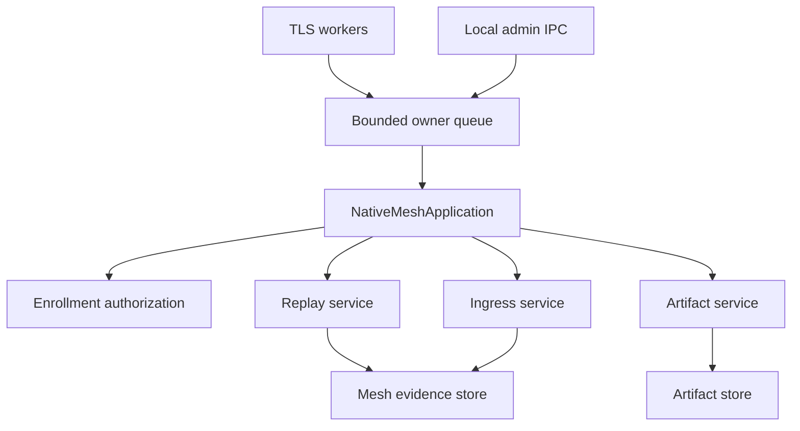

# CE-SW-35 — Authenticated native mesh

This increment connects native Anaiero nodes through authenticated TLS, scoped
observation publication, durable subscriptions and bounded immutable artifact
downloads. It extends the experiments, storage and scientific-session work in
[CE-SW-32](CE-SW-32_reusable_native_experiments.md),
[CE-SW-33](CE-SW-33_sustained_storage.md), and
[CE-SW-34](CE-SW-34_supervised_scientific_sessions.md).

The mesh is an optional native C++20 component on Windows and Linux. Enabling
`ANAIERO_ENABLE_MESH` adds an OpenSSL 3 dependency to the mesh targets. The
ordinary controller profile remains usable without OpenSSL or Python.

## Ownership and architecture

`NativeMeshHost` owns TLS connections and bounded dispatch. Its transport
workers submit requests to one application owner. They do not read a Registry,
advance a Projector, import an enrollment policy or invoke a simulation engine.
`NativeMeshApplication` composes authorization, ingress, replay, artifact and
projection services on that owner.



The application owns separate segmented Registries for enrollment/ingress
metadata, observations, and artifacts. Subscription descriptors and receive
cursors are separately sealed atomic files under the mesh state directory.
Each Registry retains its single-writer lock. A mesh process does not borrow
the observation Registry from a running native session. Local session transfer
uses an explicit offline import while the relevant store can be exclusively
owned; network `PUBLISH` supplies live mesh ingress.

The host admits at most eight connections and sixteen queued owner jobs. Each
enrolled principal has one current application connection. Reading a socket
and waiting for the owner are separate operations: transport deadlines do not
turn filesystem publication into a hard real-time operation. Trusted service
extensions observe authorization, ingress, replay and artifact events without
reentering the owner or blocking it.

Implementation:
[host](../../native/include/anaiero/infrastructure/native_mesh_host.hpp),
[application](../../native/include/anaiero/application/native_mesh_application.hpp),
[host contracts](../../native/include/anaiero/contracts/mesh_host.hpp).

## Transport identity and enrollment

The transport uses TLS 1.3 only, mutual certificate authentication and the ALPN
identifier `anaiero-mesh/1`. The native client requires both successful CA-chain
verification and an exact SHA-256 pin of the server certificate. The server
requires a verified client certificate, then asks enrollment policy whether
that certificate belongs to an authorized principal. Numeric IPv4 and IPv6
addresses are supported; this initial transport does not perform DNS discovery.

OpenSSL performs certificate-chain validation, the TLS handshake and record
cryptography. Anaiero explicitly configures protocol bounds and peer
verification using the documented
[protocol-version APIs](https://docs.openssl.org/3.0/man3/SSL_CTX_set_min_proto_version/)
and [peer-verification flags](https://docs.openssl.org/3.0/man3/SSL_CTX_set_verify/).
The implementation disables early data, session tickets and session reuse.
[RFC 8446, section 8](https://www.rfc-editor.org/rfc/rfc8446#section-8)
describes the separate replay concerns around early data and application
retries; Anaiero also keeps durable application identities and acknowledgement
cursors because a disconnected client can retry an ordinary authenticated
request.

An enrollment record binds:

| Field | Purpose |
| --- | --- |
| Principal | Stable local peer identity |
| Certificate SHA-256 | Exact approved certificate |
| Generation | Monotonic peer policy/key generation |
| Expiry and revoked flag | Current admission authority |
| Publish scopes | Exact source, epoch, clock and colony tuples |
| Subscribe scopes | Exact readable source streams |
| Artifact roots | Explicit immutable digests that may be downloaded |

A valid certificate alone grants no publication, subscription or artifact
access. Every operation checks the current enrolled generation, certificate,
expiry, revocation and capability. `NEXT` and `ACK` resolve their persisted
subscription scope and authorize it again. Artifact chunks are authorized
again even after their description was previously read.

Policy updates use an expected durable revision. Changed peer records advance
their generation; removed authority is represented by a revoked tombstone.
Successful replacement/reload invalidates existing verified-session handles.
An uncertain policy write closes authority until a successful reload establishes
the committed policy. Certificate/enrollment expiry is checked per request;
the service keeps a nondecreasing view of wall time during its lifetime.

Only the same-user local administration endpoint accepts `IMPORT`, `REVOKE`
and `RELOAD`. The network protocol cannot change enrollment or reach the native
session command dispatcher. `STATE`, `TRACE` and `STOP` are local administration
operations as well. Revocation takes effect at the next serialized request;
an operation already authorized and committed before revocation retains its
historical receipt.

The local configuration and policy files use canonical sealed formats
`CEVMESH/1` and `CEVMESHPEERS/1`. Their SHA-256 seals detect altered bytes; they
are not remote signatures. Credential paths are local files supplied by the
operator. The first release uses operator-managed trust and certificate
rotation; it does not implement a public enrollment authority, automated
certificate issuance, online revocation fetching or dynamic service discovery.

Implementation:
[TLS adapter](../../native/include/anaiero/infrastructure/native_tls.hpp),
[identity records](../../native/include/anaiero/contracts/mesh_identity.hpp),
[authorization service](../../native/include/anaiero/services/mesh_authorization_service.hpp),
[configuration codec](../../native/include/anaiero/infrastructure/mesh_configuration.hpp).

## Durable ingress and provenance

An authenticated publication follows this order:

1. Check the peer's exact source/epoch/clock/colony grant, canonical observation
   shape, source ordering and projection capacity.
2. Commit an immutable ingress receipt in the metadata Registry.
3. Commit the canonical observation in the evidence Registry.
4. Advance the live Projector and its checkpoint mirror.
5. Return `PERSISTED` with the local evidence cursor and receipt digest.

The receipt records the principal, certificate, enrollment generation, policy
revision, local receipt time, source identity, source sequence and exact payload
digest. Its ingress kind distinguishes a mutual-TLS arrival from an explicitly
authorized local import. Retrying identical bytes reuses the first receipt,
including its original certificate and receipt time. An old duplicate does
not rewrite provenance after certificate rotation.

A source/epoch has one durable principal owner and one clock/colony binding.
Competing publication grants are rejected. Revoking a principal does not allow
a replacement principal to continue its existing source epoch; the replacement
must begin a new epoch. A different colony also requires a different source
or epoch. This complete-stream rule lets an exact scoped subscription preserve
the strict per-source observation sequence.

The current projection additionally keeps a source ID's clock binding across
its retained epochs. Changing that clock requires a new source ID. Native
engine exports already provide stable source clocks and use one colony per
engine stream.

The adapter accepts exact previously committed observations, including old
duplicates, and rejects changed bytes under an existing sequence, gaps, changed
clock/colony/origin and backward acquired time. A failed persistence or
projection boundary stops ingress until recovery. On restart,
`MeshRecoveryService` verifies the exact canonical ingress receipt and payload
digest for each checkpoint source tip before restoring that checkpoint. It
performs the same check on every committed tail observation before projection.
Missing or mismatched receipts stop recovery, including when evidence survives
but the corresponding metadata has been restored to an older state. The
checkpoint mirror advances only after durable evidence publication.

Startup checks the retained checkpoint tips and active tail, rather than
replaying every archived observation. The offline `maintain` command performs
the full evidence-to-receipt audit before checkpoint/archive maintenance and
unreferenced-object collection. Receipt lookups use bounded memory but may
scan historical metadata; this release does not promise constant startup or
maintenance time independent of retained history.

An ingress receipt establishes what this node durably received through a
specified admission path. It is not a transferable signature from an original
author, biological calibration, or proof that a measured value is true.
Observation origin and model/timebase semantics remain explicit. This first
network publication path accepts simulated observations; it does not grant
physical actuation, scientific solver launch or remote experiment execution.

Implementation:
[ingress contract](../../native/include/anaiero/contracts/mesh_ingress.hpp),
[ingress service](../../native/include/anaiero/services/mesh_ingress_service.hpp),
[receipt store](../../native/include/anaiero/infrastructure/mesh_ingress_store.hpp),
[recovery service](../../native/include/anaiero/services/mesh_recovery_service.hpp),
[epoch journal](../../native/include/anaiero/infrastructure/windstore_epoch_observation_journal.hpp).

## Subscription, replay and reconnect

A subscription identity binds a principal, caller-chosen bounded ID and an
immutable exact scope. Reusing that principal/ID with a different scope fails.
Certificate rotation keeps the durable subscription identity while a new
verified connection reopens its volatile state.

`SUBSCRIBE` includes the receiver's durable global sequence/hash. The server
checks that exact tip against its retained history before offering an earlier
unacknowledged page. The client also rejects a server ACK ahead of its own
durability, or an equal-sequence hash disagreement. Restoring a sender or
receiver from an incompatible backup therefore requires explicit recovery;
reconnect cannot silently replace already accepted history.

Each `NEXT` offers at most sixteen matching observations while considering at
most sixty-four global event records against the subscription. Other scopes'
payloads are not returned.
The response includes an `after` cursor and a terminal global sequence/hash.
The terminal cursor accounts for examined records outside the subscribed
scope without disclosing their payloads. It is an authenticated server-issued
offer, not a standalone cryptographic proof for third parties.

One outstanding page per subscription provides backpressure. Repeating `NEXT`
before acknowledgement returns the same offer. `ACK` accepts exactly that
offer's terminal sequence/hash, or an identical already committed ACK. It
rejects skipped, forged, conflicting and regressing boundaries. The server
persists the ACK before reporting success. A newly registered zero cursor is
durable, so an unacknowledged reader participates in retention immediately.

The receiver durably advances its remote cursor after each accepted observation,
following its own receipt/evidence/projection boundary. It then records the
page's terminal cursor before acknowledging the page. A crash between those
steps can replay the unacknowledged page; exact committed duplicates are
accepted without extra projection revisions. Cursor identity includes the
remote principal, subscription and exact scope, with the current generation
retained in the local receipt file.

Reconnect and user-requested synchronization perform bounded reconciliation,
with at most 4,096 pages per invocation and durable progress retained if that
budget is exhausted.
There is no periodic database polling or autonomous push daemon in this
increment. A disconnect drops only volatile offers; durable ACK and receive
cursors remain. An empty caught-up page is not cached permanently, allowing a
later explicit request to observe newly committed evidence.

The existing Registry callback subscription API is not exposed over the
network. Mesh paging uses `read_event_page`: logarithmic segment-metadata
lookup, bounded segment/event reading, and separately verified payload fetches.
Segment integrity validation can read the complete bounded segment containing
the selected records; the sixty-four-record budget describes subscription
filtering and cursor advancement, not an exact count of all decoded metadata.
Slow readers retain unacknowledged hot segments. Once archived, retained cold
history remains available to reconnecting and newly registered readers.

Implementation:
[replay contract](../../native/include/anaiero/contracts/mesh_replay.hpp),
[replay service](../../native/include/anaiero/services/mesh_replay_service.hpp),
[store adapter](../../native/include/anaiero/infrastructure/windstore_mesh_replay.hpp).

## Immutable artifacts

The enrollment policy grants exact artifact root digests. Merely knowing a
content hash does not grant retrieval authority. This increment does not
automatically grant access to a root's transitive references.

An artifact description pins its digest and total size. Each request downloads
at most 16 KiB from an object of at most 4 MiB. The source revalidates the
immutable object's content hash when reading chunks. The receiver checks
offsets and sizes, stages one bounded transfer, verifies the final complete
SHA-256 and only then publishes the CAS object and its durable completion
receipt. Repeated completed transfers return the existing verified result.

Incomplete in-memory staging is discarded on process loss and restarts at
offset zero. This avoids treating a partial file as a completed artifact.
Artifacts are data: transfer neither executes them nor silently installs an
engine, plan, solver, plugin or policy. The wire carries hashes and offsets,
never destination filesystem paths.

Implementation:
[artifact contracts](../../native/include/anaiero/contracts/mesh_artifact.hpp),
[artifact services](../../native/include/anaiero/services/mesh_artifact_service.hpp),
[artifact store](../../native/include/anaiero/infrastructure/windstore_mesh_artifact.hpp).

## Wire contract

Each TLS application frame has a four-byte big-endian length followed by at
most 65,536 bytes. Length zero, oversized frames, incomplete transfers and
invalid protocol negotiation are rejected. Header and body share an absolute
deadline for that frame operation. Application messages are canonical LF text;
observation and artifact bytes use lowercase hexadecimal. Parsing rejects
alternate spellings, trailing fields and noncanonical numeric/whitespace forms.

| Request | Successful response | Meaning |
| --- | --- | --- |
| `PING` | `PONG` | Current enrolled connection is usable |
| `PUBLISH <observation-hex>` | `PERSISTED <sequence> <event-hash> <receipt-hash> <payload-hash> <duplicate>` | Durable local receipt, evidence and projection boundary |
| `SUBSCRIBE <id> <source> <epoch> <clock> <colony> <receive-sequence> <receive-hash>` | `SUBSCRIBED <sequence> <hash>` | Validate the receiver tip, then register immutable scope and return current durable ACK |
| `NEXT <id>` | `PAGE ...` | Bounded matching records and terminal offered cursor |
| `ACK <id> <sequence> <hash>` | `ACKNOWLEDGED <sequence> <hash>` | Durable acceptance of the exact offered boundary |
| `ARTIFACT <sha256>` | `ARTIFACT <sha256> <bytes>` | Authorized immutable object metadata |
| `CHUNK <sha256> <offset>` | `CHUNK ...` | Bounded bytes from that authorized object |

Every row is prefixed with `CEVMESH/1` and terminated by LF. The host sends
`CEVMESH/1 READY` only after both TLS and local enrollment admission succeed.
`PAGE` and `CHUNK` responses have additional canonical payload lines. Failures
use `CEVMESH/1 ERROR <code>`. The complete encoder/decoder is
[mesh_wire.hpp](../../native/include/anaiero/infrastructure/mesh_wire.hpp).

## CLI and first transfer

The [complete two-node example](../../examples/mesh/README.md) supplies runnable
Bash and native PowerShell setup, creates a temporary local CA and certificates,
and exercises import, two scoped subscriptions, artifact verification,
reconnect, live revocation and offline maintenance. It commits no credentials.
The certificate preparation uses the OpenSSL CLI; the mesh host and client use
the linked native TLS library directly.

For the supplied
[mixed session](../../examples/runtime/mixed-sustained.cevsession), the exact
scopes are:

| Engine | `SOURCE:EPOCH:CLOCK:COLONY` |
| --- | --- |
| SW5, engine 101 | `61:1:101:101` |
| SIM3, engine 201 | `71:1:201:201` |

The engine's cadence field is not its clock domain. These scopes retain the
native engine's source, epoch, capability clock and colony identities.

To pull A into B, A enrolls B for subscription and B enrolls A for publication.
A also enrolls its own certificate for publication before importing its local
native session. In the example's Bash environment, the enrollment and transfer
commands are:

```bash
# The full example creates mesh_bin, mesh_work and these certificate files.
mesh_a_pin="$(openssl x509 -in "$mesh_work/credentials/a.crt" -noout -fingerprint -sha256 | cut -d= -f2 | tr -d ':' | tr 'A-F' 'a-f')"
mesh_b_pin="$(openssl x509 -in "$mesh_work/credentials/b.crt" -noout -fingerprint -sha256 | cut -d= -f2 | tr -d ':' | tr 'A-F' 'a-f')"
mesh_expiry="$(date -u -d '+1 day' +%s)"

"$mesh_bin" enroll "$mesh_work/a.cevmesh" "$mesh_work/a-state" node-a "$mesh_a_pin" "$mesh_expiry" \
  publish=61:1:101:101 publish=71:1:201:201
"$mesh_bin" enroll "$mesh_work/a.cevmesh" "$mesh_work/a-state" node-b "$mesh_b_pin" "$mesh_expiry" \
  subscribe=61:1:101:101 subscribe=71:1:201:201
"$mesh_bin" enroll "$mesh_work/b.cevmesh" "$mesh_work/b-state" node-a "$mesh_a_pin" "$mesh_expiry" \
  publish=61:1:101:101 publish=71:1:201:201

# Run after the native session exits, while both state directories are offline.
"$mesh_bin" import-session "$mesh_work/a.cevmesh" "$mesh_work/a-state" \
  examples/runtime/mixed-sustained.cevsession "$mesh_work/native-state"

# With A serving, B performs one bounded reconciliation per invocation.
"$mesh_bin" sync "$mesh_work/b.cevmesh" "$mesh_work/b-state" sw5-display 61:1:101:101
"$mesh_bin" sync "$mesh_work/b.cevmesh" "$mesh_work/b-state" sim3-display 71:1:201:201
```

Pins are lowercase, colon-free SHA-256 of the exact leaf certificate's DER
bytes. Configuration `server_pin` must contain A's pin when B connects to A.
Enrollment expiry is a Unix-second timestamp, checked in addition to
certificate validity. The complete example's leaf certificates last two days
and its enrollment lasts one day.

`enroll` replaces a principal's complete grant set. Include its existing scopes
and artifact grants when changing it. `policy` prints the current sealed policy;
`revoke` and `import-policy` require its expected revision. A running node
accepts those administrative changes through local IPC, for example:

```bash
"$mesh_bin" query "$mesh_work/admin.sock" STATE
"$mesh_bin" query "$mesh_work/admin.sock" 'REVOKE node-b 2'
"$mesh_bin" query "$mesh_work/admin.sock" STOP
```

Revision `2` applies to the fresh two-enrollment server in the complete
walkthrough. Read the current revision for an existing node. Windows uses the
same commands with a same-user named-pipe endpoint. `serve-stdio` also supports
an explicit caller-owned local pipe; a `STATE` response gives event-driven
readiness for process supervisors.

`push` publishes a local subscribed stream to the configured remote endpoint;
the receiving policy must grant that local principal publication authority.
`artifact-add` admits an opaque local file, and `fetch-artifact` downloads an
explicitly granted digest. `inspect` and `maintain` open the state exclusively
while its server is stopped. See
[mesh_cli.cpp](../../native/examples/mesh_cli.cpp) for all command arguments.

## Build and verification

The mesh-enabled controller profile uses the ordinary native toolchain:

```sh
cmake -S native -B build/mesh -DANAIERO_CONTROLLER_ONLY=ON \
  -DANAIERO_ENABLE_MESH=ON -DCE_WIND_BUILD_TESTS=ON \
  -DCMAKE_DISABLE_FIND_PACKAGE_Python3=TRUE -DCMAKE_BUILD_TYPE=Release
cmake --build build/mesh --config Release --parallel 2
ctest --test-dir build/mesh -C Release --output-on-failure -R anaiero_mesh_
```

OpenSSL 3 development libraries must be available to CMake. The native mesh
workflow uses `libssl-dev` on Ubuntu and the documented Windows runner vcpkg
installation with the `x64-windows` OpenSSL triplet. Its controller profile
disables Python discovery, requires real socket tests through
`ANAIERO_REQUIRE_MESH_TLS=1`, and runs the TLS, authorization, ingress, replay
and integrated mesh gates on Windows and Linux. The
[workflow](../../.github/workflows/native-mesh.yml) is the authoritative hosted
verification entry point; its existence does not itself claim a successful run.

Focused replay/artifact verification committed 4,203 events, exercised
slow-reader retention and cold replay, and checked ACK failures before and
after publication, restart, exact duplicate handling, source binding and cursor
generation. Artifact checks cover incomplete staging, wrong offsets, wrong
digests, oversized objects and durable completion retries. A measured local
fixture run passed in 61.008 seconds with 8,448 KiB peak child RSS; these are fixture
measurements rather than a universal resource guarantee.

## Resource and operating limits

| Resource | Current bound |
| --- | --- |
| Enrolled peers | 32 |
| Publication scopes / subscription scopes per peer | 8 each |
| Explicit artifact grants per peer | 16 |
| Simultaneous native connections | 8 |
| Current connection per principal | 1 |
| Queued application-owner jobs | 16 |
| Durable replay subscriptions / receiver cursor files | 32 each |
| Matching observations per offered page | 16 |
| Global records examined per page | 64 |
| Outstanding pages per subscription | 1 |
| Application frame | 64 KiB |
| Artifact / artifact chunk | 4 MiB / 16 KiB |
| Receiver staging transfers | 1 |
| Retained projection source/epoch cursors | 32 |
| Retained projected metric entries | 256 |
| Configurable transport deadline | 1–60,000 ms |

Retained source epochs and subscriptions need explicit future retirement
policies; they are not automatically forgotten when a peer disconnects or is
revoked. Historical evidence and receipt history consume disk. Admission,
bounded pages and storage headroom provide backpressure, but they do not
promise constant disk consumption, unlimited peers, real-time service latency
or arbitrary hostile-traffic availability. This release does not add consensus,
remote policy execution, source retirement, automatic topology discovery or
distributed scientific optimization.
