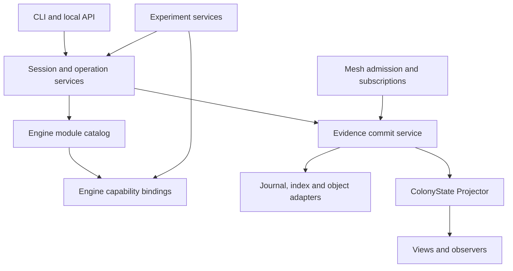
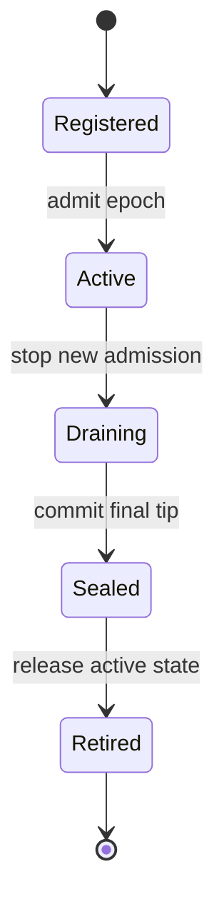

# CE-SW-37: Modular runtime and complete evidence lifecycle

**Implementation checkpoint:** [CE-SW-38](CE-SW-38_compiled_runtime_and_lifecycle.md)
implements M1–M4. Its native sealed AVL index replaces the recommended SQLite
adapter. Legacy evidence migration preserves old bytes without claiming live
state conversion. Retention reclaims payloads under finite quotas and reserved
maintenance headroom. [CE-SW-39](CE-SW-39_continuous_native_operation.md) adds
reviewed canonical-prefix compaction and the continuous canonical M5 host/mesh.
[CE-SW-40](CE-SW-40_operating_envelope_and_package_lifecycle.md) adds receiver
retention, package activation/rollback and actual mixed-host profiles. M6's
sustained operating and deployment-device evidence remains an open gate.
The design below preserves the broader target and its acceptance conditions.

## 1. Decision and scope

Build the next native runtime around **independently compiled modules,
registered engine capabilities, recoverable state transitions, an indexed
canonical evidence ledger, and explicit resource lifecycles**.

This design closes the engineering gaps identified in the
[readiness review](native_development_plan.md): concrete factory/session
coupling, source-only module boundaries, missing shared-session VLM execution,
historical lookup cost, source/peer/subscription churn, retained disk growth and
continuous mesh qualification. Completion means the acceptance gates pass for
a declared Windows/Linux operating profile. An interface or an increasing test
count alone does not close a gap.

All names and contracts introduced below are proposed. The
[implementation checkpoint](native_implementation_status.md) remains the
authority for capabilities that currently run. This document governs the
architecture and delivery order; the earlier plan's detailed A–E capability
descriptions remain useful where mapped in section 14.

Native Windows and Linux remain equal C++20 hosts. Core operation requires no
Python, WSL, container or external numerical solver. Domain decisions remain
in services; filesystem, SQL, transport, process and thread mechanisms remain
behind typed ports. ColonyState Projector materializes committed readable
state. Experiment selection and change authority remain separate services.

## 2. What SW5, SIM3 and VLM mean

Use descriptive names in documentation and operator views. Preserve existing
codes, numeric IDs and file formats as compatibility aliases.

| Existing label | Descriptive name | Current responsibility |
|---|---|---|
| SW5 | Cell Behavior Engine | Advances individual synthetic cells, state/proxy counters, candidate links and responses to support/stress/signal/lesson inputs; supports current cell-atlas and route experiments |
| SIM3 | Multi-Colony Engine | Advances groups of synthetic cells, colony resources, configured inter-colony links and scheduled support/teaching/division processes |
| CEVLM/2 + CEVPLAN/1 | Virtual Machine and Plan Engine | Runs the existing symbolic machine/process interpreter and staged learning-plan actions |
| Scientific provider | Numerical Model Engine | Executes a pinned numerical model, currently including passive voltage and scalar environmental concentration |

SW5 and SIM3 are historical project labels for parallel engine implementations.
They have different models and commands. Their synthetic learning counters,
support inputs and resource units do not become physical quantities by sharing
a host. See [CE-SW-19](CE-SW-19_cell_behavior_atlas_and_developmental_surrogate.md),
[CE-SW-12](CE-SW-12_persistent_multicolony_runner.md) and
[CE-SW-09](CE-SW-09_learning_crystal_rna_plan_manifests.md).

The VLM interpreter already executes CEVPLAN outside shared native sessions.
The new work binds that real interpreter to the shared lifecycle and evidence
path; retaining another plan hash would not provide execution.

## 3. Gap closure map

| Gap | Architectural change | Required proof of completion |
|---|---|---|
| Shared include root and mostly INTERFACE libraries | Compiled module targets, private implementation directories, installed public SDK | An external consumer builds against the installation alone; portable core builds without concrete engine/OS/TLS headers |
| Fixed factory and concrete engine knowledge in session code | Bounded EngineModuleCatalog and module-owned lifecycle/evaluation/change/observation bindings | An independently built additional engine using existing capability families runs without edits to runtime, optimizer, Projector or persistence |
| SW5-shaped inputs and overloaded summaries | Schema-bound input, change and observation envelopes | Wrong schema, unit, clock, model or behavior is rejected before effects; compatibility summaries preserve old meanings |
| VLM plans lack durable shared-session execution | Finite VLM engine with retained artifacts, committed progress and isolated replay | Existing plan output and original receipts match standalone, uninterrupted, restarted and isolated runs |
| Model/configuration changes have uneven recovery | Common prepared-transition and canonical commit contract | State/configuration/receipts recover coherently at every cut; no duplicate accepted mutation |
| Historical receipt lookup scans history | Verified indexes with coverage watermarks | Indexed point/range work; full audit avoids a full metadata scan per observation |
| Epoch/peer/subscription churn consumes permanent active slots | Separate active directories, durable lifecycle catalogs and replay floors | Repeated churn exceeds old lifetime slot counts while active memory stays within budget; no resurrection on restart |
| Archives and metadata grow without a total-storage policy | Protected roots, leases, maintenance plans, archive/expiry rules and quotas | Disk pressure produces explicit admission/backpressure; reclamation cannot invalidate required continuation/provenance |
| Mesh owner blocks on storage/artifacts and sync is explicit | Async commit/read jobs, live availability watermarks, byte/work credits | Slow peers/bulk work cannot indefinitely starve unrelated work; the owner and cached reads remain responsive during storage stalls while dependent commits pause with explicit backpressure |
| Deployment scale remains unqualified | Versioned workload profiles, crash matrix, soak and release report | Both native platforms meet declared resource/recovery budgets with reproducible evidence |

### Baseline evidence

The reviewed code has a three-entry factory registry and exposes concrete
cell-world/SIM3 accessors in session bindings. Common session records and live
application still contain SW5 types. Shared step inputs are shaped around SW5,
and the coordinator expects every accepted advance to increase tick by one.
There is no persisted finite-engine completion state.

Historical lookup falls back to a complete retained-event scan. Mesh receipt
verification uses it; full audit can therefore repeat that scan for many
observations. The mesh owner also performs storage and artifact work
synchronously. Artifact chunk reads currently reload/verify the complete
object. Active epoch state has finite slots without a retirement path.

These findings are pinned to the reviewed code, not inferred from an API
inventory alone:

- [Build targets](../../native/CMakeLists.txt)
- [Factory bindings](../../native/include/anaiero/application/session_engine_factories.hpp)
- [Common session records](../../native/include/anaiero/contracts/native_session.hpp)
- [Session orchestration](../../native/include/anaiero/services/native_session_service.hpp)
- [Experiment binding](../../native/include/anaiero/application/session_experiment_runtime.hpp)
- [Coordinator](../../native/include/anaiero/services/simulation_coordinator_service.hpp)
- [Historical lookup](../../native/include/christeye/living/segmented_store.hpp)
- [Mesh host](../../native/include/anaiero/infrastructure/native_mesh_host.hpp)
- [Artifact access](../../native/include/anaiero/infrastructure/windstore_mesh_artifact.hpp)

## 4. Modules and ownership

### Compiled module boundaries

| Proposed module | Public responsibility | Private responsibility |
|---|---|---|
| `anaiero_contracts` | IDs, passive records, errors, schema envelopes and typed ports | No concrete engine or OS implementation |
| `anaiero_runtime` | Session lifecycle, scheduling, operation/cancellation and progress services | Runtime orchestration implementation |
| `anaiero_experiments` | Trial orchestration, selection, outcome and change-request contracts | Scoring/selection services; engine semantics stay in engine modules |
| `anaiero_evidence` | Commit, index-coverage, source-lifecycle, retention and audit services | Domain rules over storage ports |
| `anaiero_projection` | Committed-state materialization and bounded read models | Projection and snapshot services |
| Engine modules | Registration plus lifecycle/schema/checkpoint/optional evaluation/change capabilities | Cell Behavior, Multi-Colony, VLM Plan and Numerical Model implementations |
| `anaiero_storage_native` | Journal, immutable-object, index and archive port implementations | Native files, SQLite adapter, flushing, locks and storage layout |
| `anaiero_mesh` | Admission, subscriptions, delivery scheduling and peer lifecycle services | Evidence protocol composition; TLS details remain in transport adapters |
| Native host/transport modules | File/process/IPC/thread/clock/TLS ports | Windows/Linux and optional OpenSSL mechanisms |
| Controller and CLI | Composition and typed operator requests | Module/profile selection and presentation |

Use separate module public include directories and private `src/` directories.
Move non-template implementation into compiled translation units. Install
only public headers and exported CMake targets. Small portable codecs and
appropriate templates may remain header-only.

Static libraries are the default packaging mechanism. Optional shared/native
plugins use the separate ABI below. C++ language modules and a shared library
for every class are unnecessary.

The runtime and experiment targets depend on contracts, not engine internals.
Host/TLS/index dependencies belong only to components that need them. An SDK
consumer selecting the portable runtime must not inherit OpenSSL or SQLite
implementation headers. Preserve old include paths temporarily through an
explicit compatibility target with a retirement policy.

### Runtime ownership

The diagram shows responsibilities, not a thread per box. Use a small declared
set of owners:

- A session owner serializes each live engine's commands and staged state.
- A commit-domain owner serializes admission revisions and durable commit
  completion. Blocking storage runs through a separate native worker.
- Bounded read/hash workers operate on immutable leased generations.
- Transport readiness/handshake workers own sockets and bounded byte buffers.
- Experiment workers own isolated engines, never the live engine object.

No callback crosses ownership with a borrowed mutable model pointer. Requests
and completions use bounded owned records. Reserve completion capacity before
admitting work so a full ordinary queue cannot prevent completion delivery.

## 5. Engine catalog and extension contracts

### Registration

Replace core dispatch on a closed engine-kind enum with a stable engine type
identifier and a bounded injected `EngineModuleCatalog`. Keep legacy numeric
kinds in compatibility readers.

Each registration supplies:

- Type ID, human-readable name and contract version.
- Module artifact/build identity and behavior identity.
- Configuration, input, checkpoint, observation and change schema identities.
- Execution/resource limits and logical or physical clock interpretation.
- Required host ports.
- Factory plus actual optional capability bindings.

The core lifecycle remains small. Optional interfaces provide checkpoint/
restore, isolated trials, change preparation, program progress and diagnostics.
Observation translation belongs to the engine module. The common session
must no longer expose an atlas, cell world, SW5 route option or SIM3 runner.

A capability flag is accepted only with a compatible implementation binding
and conformance evidence. Validate configuration, dependencies and schemas
before activation. Freeze the active catalog; recovery pins the same behavior,
schemas and module identity rather than silently selecting an installed update.

### Three supported delivery modes

| Mode | Purpose | Boundary |
|---|---|---|
| Built-in module | Compact standard controller | Linked module registers through the same catalog |
| Trusted native module | Add an installed engine without rebuilding the core | Versioned C entry point/function tables for platform-specific DLL/shared-object artifacts |
| Supervised provider process | Separate failure/resource ownership | Versioned bounded protocol and native owned-child lifecycle |

The native ABI uses opaque handles, explicit size/version fields, fixed-width
values, bounded caller-owned buffers and explicit create/destroy ownership.
No STL containers, exceptions or compiler-specific C++ vtables cross it.
Record platform, architecture and compatibility requirements; a C function
table does not make a single binary universal.

Validate the module manifest, digest and installation/trust policy before
loading. Native loader initialization already executes code. In-process
extensions are trusted; hard crash/hang containment requires a process boundary.
Process separation alone is not a filesystem/network security sandbox.
Only admit modules under the declared host execution policy.

Unload only after all instances, buffers, callbacks and queued operations have
released the module. A session cannot hot-swap the module interpreting its
checkpoint. An upgrade requires a versioned migration or a new source epoch.

### Input, observation and change envelopes

Common envelopes bind engine instance/type, source/epoch, expected revision,
schema/version, model/behavior, clock, immutable program/input identity and a
bounded payload. The core validates identity, size, sequence and declared
schema. Module services validate and execute model-specific meaning.

Observations carry explicit metric/quantity descriptors. A concentration must
not depend on being placed into a compatibility field named `energy`.
Compatibility adapters may emit old summaries with their existing descriptors.
Unknown schema families fail negotiation; sharing a unit does not establish
species, compartment, transformation or causal meaning.

**Module closure gate:** compile an out-of-tree engine against the installed
SDK and load/register it on both platforms, with no changes to runtime,
optimizer, Projector or session persistence for existing capability families.
Build those portable components without concrete engine include paths.
A new capability family still needs an explicit versioned contract.

## 6. One recoverable transition and commit protocol

### Prepared model transitions

Separate calculating a model result from making it authoritative.
A `PreparedTransition` binds:

- Stable operation/step/change identity and exact request digest.
- Expected prior revision/state and source/policy revision.
- Engine/module/model/behavior and input/program identity.
- Target configuration/checkpoint, generated observations and receipts.
- Exact next sequence/tick, plan progress and terminal state where applicable.

Engine modules stage results without exposing them as committed live state.
An in-memory copy, isolated instance or recoverable supervised working process
can implement staging. The contract specifies visibility and recovery, not
one memory layout.

A legacy engine cannot publish an independent authoritative state pointer
before canonical commitment. The current SIM3 runner writes its history and
`culture.state` during advance; its persistence must move behind transition
ports or into private staging storage. Update legacy compatibility views only
from committed canonical roots, and exclude competing legacy writers after
cutover. Keeping a recovery checkpoint and hiding a callback alone does not
establish transactional staging.

The commit service coordinates one bounded canonical batch. State/configuration
references, ingress provenance, observations, lifecycle changes and operation
outcome can be exposed under the same committed root. The prior valid root
remains authoritative until the new complete root is durable.

Initially permit at most one uncommitted prepared transition per engine.
Assign every batch an ordered predecessor/root generation. The persistence
worker preserves that order; a failed predecessor is reconciled before its
dependents proceed. Additional pipelining requires an explicit dependency
protocol rather than incidental queue ordering.

### Commit order

1. Validate authority, expected revisions, immutable references and capacity;
   reserve data, metadata and completion resources.
2. Stage and flush the required immutable objects/checkpoints.
3. Append and flush the canonical transaction and its referenced records.
4. Atomically publish a sealed root exposing the complete transaction.
5. Advance the derived index and its verified coverage watermark.
6. Deliver durable completion, install/reconcile the engine result, project
   committed observations and notify downstream subscribers.

Filesystem work runs on the persistence adapter's worker. Domain admission
and transition eligibility remain service decisions. The physical writer
enforces expected revision guards supplied by the ordered commit service.

Before root publication, an abandoned tail is uncommitted. After publication,
recovery completes installation/projection. Index failure after commitment
must report a committed-but-degraded operation and enter bounded repair; it
cannot be reported as an ordinary uncommitted rejection.

Uncertain persistence stops further authoritative advancement until the
operation identity is reconciled. Retry with the same identity and digest
resolves the original outcome; conflicting bytes fail. If a result receipt is
outside its retained availability window, return expiry/unavailability instead
of assuming the request is new.

### Authority and cancellation

Policy revocation and source retirement commit through the same ordering
domain. Each is a durable barrier. A request committed before the barrier
retains its historical receipt. Queued work with an obsolete revision must be
reauthorized or rejected before commitment.

Report revocation as effective only after its barrier commits. Asynchronous
admission carries credential generation, exact scope, digest, expected
revisions and an authorization validity deadline. Recheck expiry at the final
serialized commit-admission point before irreversible canonical writing.
Record that authority/time in the receipt. Expiry after this point does not
retroactively undo an admitted transaction; it prevents later admission.

Cancellation can prevent work before commitment; it cannot undo committed
effects. A timeout/disconnect means the caller may not know the outcome.
Shutdown stops admission, drains under the declared policy and leaves
recoverable intent when completion cannot be established. A stuck OS storage
call cannot be promised universally interruptible within a hard deadline.

| State | Meaning |
|---|---|
| Queued | Volatile reservation; not durable success |
| Committing | Outcome must be established by completion or recovery |
| Committed | Canonical root durably references the complete transaction |
| Projected | The local read model incorporates the committed observation |
| Acknowledged | A specified receiver durably accepted an exact terminal cursor |

Per-engine transitions are atomic within their commit domain. A session
checkpoint may record a recoverable vector of engine revisions. This does not
claim atomic commitment across every engine, peer or physical device.

## 7. Durable programs, experiments and model changes

### Finite VLM Plan Engine

Wrap unchanged CEVPLAN/1, CEVLM/2 and required artifact bytes in a versioned
registration manifest. Bind the real `plans::Session` interpreter, a logical
clock and explicit admission bounds. Retain the bytes needed by execution;
original filesystem paths are no longer required after registration.

Initial proposed scope remains eight stages/128 logical ticks and a quiescent
base. Preflight task, journal and event capacity already consumed by that base.
Persist ready/running/paused/completed/cancelled/faulted states and the committed
program position. Completion publishes once and removes the finite engine
from stepping while other session engines continue.

The legacy interpreter has no complete public cursor-restore operation.
Initially reconstruct its committed prefix from pinned artifacts with external
publication suppressed. Verify complete machine state, stage position and
receipt tip before resuming. A direct serialized cursor can follow if its
compatibility and performance evidence justify it.

**Gate:** the existing three-stage `bread-first` plan has identical CEVLM/2
output and original plan receipts under standalone execution, shared-session
execution, restart after every tick and isolated replay. Run/transport metadata
are compared separately. Test every checkpoint/evidence cut, original-path
removal, cancellation, finite completion and concurrent continuation of another
engine.

### Engine-owned experiment and change semantics

ExperimentService selects through optional trial capabilities. Engine modules
own their candidate schema, isolated execution, observations and change
preparation. Preserve the same source state, input program and horizon for
baseline and candidate comparisons.

Move SW5 route application out of common session code. Multi-Colony changes
must bind mutable configuration and model state in one prepared transition.
Do not enable an apply capability solely because an isolated evaluator exists.

Reverting a link policy changes future ticks and preserves elapsed time.
Pending teaching can be cancelled. Executed one-shot teaching retains its
effect and receipt; configuration rollback does not reverse it. A compensating
mutation requires its own semantics and a new durable operation.

An explicit historical fork receives a distinct identity. Scientific live
application and VLM plan-variant optimization require their own qualified
capability contracts; replay equivalence alone grants neither.

## 8. Indexed evidence with one authority

Keep the sealed canonical ledger and immutable objects authoritative.
Introduce `IEvidenceIndex` and catalog ports as rebuildable projections of
that history.

| Index key | Result |
|---|---|
| Store ID + canonical commit sequence | Location, length, record digest and transaction identity |
| Typed observation source UID + epoch + sequence | Canonical position, payload and ingress receipt |
| Stream/scope + sequence | Bounded ordered replay range |
| Generic registry tuple + occurrence | Ordered historical events and exact-payload deduplication |
| Object digest | Verified hot/archive location, pins and retention state |
| Source or peer identity | Lifecycle, ownership and credential generations |
| Subscription UID + generation | Scope, durable cursor, lease and replay floor |
| Pin/root identity | Required checkpoints, programs, receipts and objects |

Preserve legacy generic registry semantics: several events may share kind,
entity, clock, producer and source tick when their payload/origin differ.
Do not add a universal unique source/tick constraint. Strict sequence
uniqueness belongs to the typed observation/receipt contract.

### Coverage and recovery

Every index generation records store ID, canonical generation, indexed
sequence and commit hash. Verify coverage before using an index absence or
claiming replay is caught up.

- Behind the valid root: repair the committed suffix before authoritative
  admission/query decisions requiring that coverage.
- Ahead of the root or inconsistent with its hash: discard/quarantine the
  derived generation and rebuild from verified canonical history.
- Returned record: verify key, location bounds and canonical digest.
- Missing historical record: return index/history unavailability or corruption;
  never reinterpret an old or retired sequence as a new observation.

Current source tips and lifecycle fences come from verified committed state.
An incomplete index cannot relax them. Replay checks continuity and the trusted
stream tip. Index rebuild is bounded, resumable and observable.

### Native index backend

**Implemented first adapter:** CE-SW-38 uses a sealed native AVL index behind
these ports, with bounded canonical locators, verified coverage and repair.
The following SQLite recommendation records the original alternative; it is not
a runtime dependency or an implemented adapter in CE-SW-38.

**Original recommended first adapter: a pinned, qualified SQLite build**, linked as a
native implementation detail behind the index/catalog ports. Its C amalgamation
can embed in C/C++ without auxiliary build scripts.
[SQLite compilation documentation](https://www.sqlite.org/howtocompile.html)

Use one index writer, bounded read transactions, cache/temp/WAL budgets and
explicit checkpoint scheduling on local storage. SQLite WAL supports readers
alongside one writer; network filesystems and long-lived readers impose
constraints, including delayed checkpoint progress.
[SQLite WAL documentation](https://www.sqlite.org/wal.html)

Qualify a durable setting such as WAL with `synchronous=FULL`; read settings
back and record the selected version/options in the build manifest.
[SQLite synchronization documentation](https://www.sqlite.org/pragma.html#pragma_synchronous)

SQLite does not atomically commit an external object file and ledger root.
The canonical-root/index-watermark protocol remains mandatory. All authority,
source fences and replay floors must be reconstructible from canonical records,
not only database rows. Dependency selection and resource limits are verified
during implementation; no current SQLite version or workload result is claimed.

### Complexity gates

Point lookup targets indexed logarithmic work plus bounded record verification.
Range replay targets a seek plus returned records. Full audit targets streaming
linear work or indexed joins of roughly N log N, with no full-history lookup
for every observation. Verify with visited-record/page counters as well as
timing at increasing history sizes.

Startup verifies the committed root, lifecycle/checkpoint roots, active tips,
bounded tail and required index coverage. Full historical audit is a separate
streaming job; it must not enroll every historical epoch into the live Projector.

## 9. Source, peer and subscription lifecycle

### Source/epoch state machine

Authorization suspension/revocation is an independent policy dimension.
History location/availability is independent of active lifecycle.

Draining resolves the bounded admitted prefix and pending publications.
Sealing commits the final sequence/digest and ownership closure. Retirement
releases active resources only after its lifecycle/checkpoint state is durable.
A sealed epoch cannot accept later append. A new active epoch has a new,
explicitly admitted identity.

Apply the transition to enrollment, runtime projection, delivery cursors,
checkpoint tips, Projector metrics and pending publication state. Lagging
subscribers may read retained history after active retirement; their retention
leases do not require an old source to occupy active RAM forever.

### Required checkpoint revision

Current restore checks equate the sum of active source sequences with lifetime
revision and associate empty active state with zero history. Retirement makes
those assumptions invalid.

A new checkpoint version separates:

- Canonical log watermark/hash and store generation.
- Lifetime committed observation count.
- Materialized view revision.
- Bounded active source/epoch cursors and metric values.
- Sealed lifecycle/catalog root and closure accounting.

An empty active view with nonzero verified history is valid. Recovery and
full audit honor lifecycle records without resurrecting retired slots.
Retain parsers/importers for old versions; do not reinterpret their bytes.
Older binaries reject the new checkpoint version unless explicitly supported.

### Bound historical metadata too

Keep historical ownership and fencing in an indexed on-disk catalog with quota
and archive policy. Do not substitute an unbounded tombstone map for the
current bounded active array.

Where epoch issuance is monotonic, a verified closed contiguous prefix can be
compacted into a closed-through watermark/digest. Live holes prevent that
compaction. Never reuse an old epoch or automatically enroll an unknown
historical source during replay. If required authority metadata is unavailable,
admission fails until it can be verified.

Peer credential generation, peer active connection, source ownership and
subscription generation are distinct identities. Certificate rotation changes
credentials; it does not transfer ownership of an existing source epoch.
Revocation removes current authority while retaining historical attribution.
Historical catalog growth is subject to the same finite-storage choices as
other evidence.

Subscriptions have explicit active/suspended/expired/closed states, generation,
lease and durable cursor. A stale acknowledgement cannot advance a new
generation. Disconnection may retain resumability; abandoned/revoked
subscriptions require explicit lease and retirement policy.

## 10. Retention, archive and capacity

Finite storage requires a declared choice: verified archive expansion,
explicitly permitted retention expiry, or stopped admission/backpressure.
Archiving into another directory on the same disk does not bound total usage.

### Protected roots

Retention protects active/recovery checkpoints, registered plan/base/artifact
bytes, module/provider/model artifacts, unfinished operations and outcomes,
pending outboxes, subscription leases, backup/export leases, operator pins and
provenance/lifecycle witnesses needed by retained records.

Protect the actual compatible executable/dependency package or a verified
installation lease, not only its digest. An upgrade cannot remove an engine
needed by retained recovery state before that state is migrated or retired.
Private credentials remain in their credential store; they are not ordinary
replicable evidence artifacts.

Protect canonical source ownership, policy and closed-epoch fencing summaries
even after all associated observation payloads expire. Their representation
may be compacted, but the authority needed to reject an old epoch must remain
verifiable independently of payload retention.

An immutable maintenance plan records policy version, source root/generation,
protected-root digest, leases, selected ranges/objects, archive destination,
verified copies, expected bytes, new availability floors and recovery state.
The commit owner revalidates roots/leases before activation. New references
must invalidate or recheck affected reclamation candidates.

Publish the new retention/catalog root before physical deletion. Interruption
leaves a valid previous or next root. Failed removals remain pending and count
against disk usage. Reader-held mappings or handles can delay reclamation;
expiry alone is insufficient if the reader still holds a live resource.
Use copied bounded pages or verified lease release/dead-owner handling.

Archive success requires verified content and manifest identity. Availability
and redundancy are explicit policy inputs. A single upload receipt does not
establish permanent recoverability.

Before removing a journal prefix, commit a compaction/prune manifest containing
removed ranges/counts, terminal digest anchors, first retained predecessor,
protected lifecycle/source summaries, replay base root/checkpoint and retention
operation/policy identity. Index repair begins from this verified canonical
base plus the retained suffix. Audit distinguishes verification of retained
bytes from verification of the committed summary of expired history; removed
bytes cannot be reverified.

### History floor and rebootstrap

The catalog distinguishes `ARCHIVE_REQUIRED` (retrieval pending),
`ARCHIVE_UNAVAILABLE`, `HISTORY_EXPIRED` and `REBOOTSTRAP_REQUIRED`.
Temporary archive failure is not history deletion. Do not return an empty
successful page, claim an unavailable duplicate matches, or fabricate an ACK.

A bootstrap offer pins snapshot digest, authorized origin, principal and
subscription/generation, exact scope, source/epoch, schema/model context,
committed tip, lifecycle/catalog generation and required provenance.
It establishes continuity with the receiver's known durable tip or uses an
explicitly authorized new bootstrap generation. A retention lease protects
the offer through durable installation or explicit expiry/cancellation.

Install snapshot and cursor atomically. A distinct bootstrap-acceptance result
records durable installation; it is not a delivery ACK claiming removed
original events were received. Audits report retained/archived/expired ranges
separately.

### Resource accounting

Declare soft/hard budgets for active objects, data, indexes, catalogs, WAL,
archive cache, staging and maintenance temporary space. Reserve conservative
bounded growth allowances, including index/WAL/metadata and temporary
maintenance costs, plus recovery/completion headroom. Preparation exceeding
its admitted bounds fails before canonical commit. External disk exhaustion
still requires correct failure handling.

At soft pressure, apply maintenance/backpressure and stop optional growth.
At hard pressure, reject new mutations while retaining readable state and
explicit degraded status. Control/completion reserves are bounded; a control
flood cannot become an unlimited bypass.

## 11. Continuous event-driven mesh

### Services and asynchronous work

Use MeshAdmissionService, SubscriptionService, DeliverySchedulerService,
PeerLifecycleService, ArtifactTransferService and cached status views.
Their decisions remain serialized under defined ownership. Commit/read/hash
ports complete asynchronously.

Separate bounded unauthenticated handshakes from authenticated scheduling.
A slow TLS handshake must not occupy the only accept path. Keep large JSON
encoding, filesystem scans, object hashing and SQL work off the domain owner.
Storage readers hold bounded immutable generation leases.

Preserve `CEVMESH/1 PERSISTED`: its current meaning includes receipt commit,
observation commit and projection. A negotiated newer protocol may expose
queued/committed/projected positions separately; it must not silently weaken
the old response.

### Availability and fairness

After durable completion, notify a coalescible availability watermark.
Subscribers read from their durable cursor through the index; do not copy
every event into one growing queue per peer. Recheck the watermark when
moving from caught-up to waiting so a commit cannot be lost in that transition.

Wake on commit, credit/ACK, socket readiness, connection/reconciliation,
lifecycle changes or bounded retry timers. No database polling loop is needed.

Bound bytes and work per connection, principal, source stream, traffic class
and globally. Use cost-aware fair scheduling; charge artifact bytes and read/
verification cost. Reserve bounded capacity for completion, revocation,
cancellation, close and health. The current one-page credit window is a valid
initial implementation; larger windows require measurements.

Peer state progresses through disconnected, connecting, authenticated,
reconciling, streaming, draining and closed. Transient failures use bounded
monotonic retry/backoff; revoked/incompatible peers remain blocked until policy
or configuration changes. Timers serve lifecycle deadlines, not store polling.

### Identity and artifacts

Authorize both admission and durable commit through policy/source revision
barriers. Preserve credential-generation and expiry state across restart.
Clock anomalies and restored-old policy state require explicit outcomes.
Backup restore cannot silently re-enable obsolete authorization or ACK state.

Supported restore begins quarantined with a new store incarnation. Activation
requires current peer-tip reconciliation and a policy/generation witness
outside the restored backup, or explicit operator re-enrollment from current
trusted policy. If those witnesses were also rolled back, report continuity/
authority as unestablished and keep ordinary ingress disabled. Stale local
bytes alone cannot reveal later revocations; detecting arbitrary privileged
replacement of all state needs an external or nonrollbackable witness.

Reauthorize each scheduled outbound page/chunk before handing it to transport,
including scope, credential generation and expiry. Revocation invalidates
queued offers and future sends. Bytes already handed to transport cannot be
recalled. Test expiry while work waits in the queue as well as policy changes.

TLS receipts identify each authenticated relay connection. Transferable
original-author attribution, when required, uses a separately verified signed
envelope binding payload, source/epoch/sequence, schema and author key
generation. Digest equality alone does not authenticate an author.

For current small artifacts, use a globally quota-bounded verified immutable
transfer buffer so each chunk does not rehash the entire object. Larger
resumable transfers require a pinned chunk manifest, staging quotas, duplicate/
conflict rules, expiry/cleanup and final full-object verification. Apply
revocation during transfer and publish completion atomically. Artifact delivery
does not implicitly install or execute its contents.

## 12. Strategies, observers and diagnostics

| Extension role | Required behavior |
|---|---|
| Decision strategy | Explicit precommit policy port; bounded ownership and deterministic inputs where required |
| Durable subscriber | Committed records, cursor, replay, acknowledgement and backpressure |
| Diagnostic observer | Owned bounded postcommit events; declared coalescing/drop policy and loss counters |

Critical evidence is a durable subscriber or transaction participant.
Postcommit observers cannot retroactively veto a committed result. Never call
external observers while holding a Projector/session lock, or from the physical
writer's flush path.

Trusted in-process callbacks must obey the ownership/nonreentrancy contract.
Measure their cost and isolate failing extensions when control returns.
Timing cannot safely terminate a stuck C++ callback; a hard containment
requirement uses a supervised process and explicitly qualified OS policy.

Expose cached typed diagnostics for current/committed/projected revisions,
source/peer/subscription state, capacity, queue bytes, outstanding credits,
commit/index lag, archive usage and repair progress. Separate dispatch,
persistence, projection and remote-ACK latency distributions.

## 13. Qualification and migration

### Operating profiles

Each release profile pins code/dependencies, OS/filesystem/storage hardware,
engine mix/cadence, active and historical cardinality, payload sizes, arrival
rates, peer lag, retention policy and explicit memory/disk/latency budgets.
Set numerical budgets before the qualifying run. The earlier 64 MiB supervisor
goal remains a target until measured; simulator heaps and optional providers
must be accounted for separately and in total.

The following are proposed gates, not achieved results:

- At least 100,000 committed observations and 100 epoch transitions with a
  bounded active set, including restart and full historical audit.
- History scaling runs at 10,000, 100,000 and 1,000,000 retained observations,
  recording visited records/pages and audit work to expose hidden full scans.
- A 24-hour integration soak on dedicated qualification runners and a seven-day
  release qualification on declared Windows/Linux daemon profiles.
- Mixed ordinary events, artifacts, slow/disconnected peers, source/peer/
  subscription churn, maintenance, rotations, clock anomalies and disk pressure.
- Native installation/upgrade/uninstall, SDK consumer, full/controller-only
  composition and optional dependency profiles.

Report CPU/wakeups, allocations, resident/working-set memory, disk growth,
throughput and p50/p95/p99 for owner dispatch, commit, projection, remote ACK,
catch-up and recovery. A low dispatch latency cannot conceal slow durability.
Fairness requires continued unrelated-source progress within the declared
profile, not a claim that shared resources create no delay.

### Failure matrix

Inject failures before/after object and journal flush, root publication, index
transaction, engine installation, projection, lifecycle closure, receive-cursor
commit, ACK persistence, bootstrap activation and artifact completion.
Also race revocation/retirement against admission, new pins against maintenance,
stale subscription generations against ACK, and queue saturation against
completion/close.

Required invariants: no false durable acknowledgement, duplicate accepted
transition, skipped committed evidence, conflicting source ownership,
resurrected retired active state or silent acceptance of corruption.
An unknown outcome is represented explicitly until reconciled.

Process-kill recovery, OS-crash recovery and power-loss/storage durability are
distinct qualification levels. Report exactly which was exercised on each
filesystem/device profile.

### Compatibility migration

Retain parsers/importers for old formats and preserve historical identities.
New records carry explicit
versions where catalog identity, terminal state, typed payloads, retirement or
availability floors exceed old formats. Preserve old numeric engine IDs,
protocol meanings and sealed artifacts; descriptive names are aliases.
Older binaries reject unsupported new versions. Provide a legacy read-only
export or preserved snapshot where that compatibility is required.

Migrate from a quiesced consistent root into a staged store/catalog, verify
record identity, duplicate behavior, replay and source accounting, then
atomically activate the new manifest. Retain a protected recovery copy.
After new writes are acknowledged, rollback cannot simply restore an older
store and discard the suffix. Reverse migration must preserve those writes;
otherwise the older binary remains read-only.

Regenerate the native API reference when public or implementation APIs change.
Show public SDK surfaces separately from implementation browsing, with
qualified class/member identities and grouped overloads. The reference is
generated from the exact release source and has a drift check.

## 14. Delivery sequence

Deliver each row as one substantial capability changeset with approximately
five related increments, operator wiring, both-platform tests and documentation.
Compatibility/failure tests run in every batch; final qualification adds
sustained deployment evidence.

| Order | Batch | Five related increments | Completion evidence |
|---|---|---|---|
| M1 | Compiled modules and registered capabilities | Public/private targets; extract existing lifecycle/observation/evaluator/change behavior behind engine-owned bindings; typed catalog/schema contracts; native/process module admission; installed SDK and independent-engine conformance | Current behavior is preserved; portable core excludes concrete models; external consumer and additional engine work on both platforms |
| M2 | Canonical transitions and indexed evidence | Commit/root/revision contract; bounded async writer/read ports; native index with coverage repair; compatibility migration/inspection; crash and complexity tests | All commit cuts reconcile; missing/stale indexes cannot change evidence authority; historical scans removed from point lookup |
| M3 | Complete engine execution and change paths | Common finite/transition lifecycle; real VLM plan binding; migrate existing SW5 bindings to prepared transitions; add coherent SIM3 configuration/state changes; operator flow and equivalence/failure tests | VLM standalone/session/restart/replay agree; supported changes recover once with explicit reversal semantics |
| M4 | Source, peer, subscription and retention lifecycle | Identity fencing/state machines; versioned active checkpoints; lease/generation/replay-floor rules; archive/maintenance/quota services; churn/disk/backup tests | Active capacity is reusable; no retirement resurrection; retained roots survive all maintenance cuts |
| M5 | Continuous mesh service | Async handshake/admission; commit-triggered subscriptions; byte/work fairness; identity/artifact/rebootstrap lifecycle; multi-peer native integration | Bounded slow-peer behavior, correct revocation order, explicit replay expiry and accurate ACKs |
| M6 | Qualified native release | Reproducible profiles/packages; SDK/API/protocol compatibility; full crash/restore matrix; soak/resource measurements; published release evidence and limits | Both native platforms meet the declared operating envelope; unsupported envelopes are explicit |

M1–M4 are implemented in CE-SW-38 within its stated native profile.
[CE-SW-39](CE-SW-39_continuous_native_operation.md) implements the continuous
host/mesh path, reviewed canonical prefix compaction and M6 package/profile
tooling. The M6 sustained-release gates below are not inferred from that
functional implementation or its shorter measurements.
M1 establishes the contract boundary. M2 establishes the commit/index foundation.
M3 and M4 can proceed in parallel after those foundations; M5 requires M4.
M6 collects release evidence while each earlier batch already carries its own
meaningful tests.

Mapping to the previous plan: A (VLM) and C (SIM3 application) are delivered
through M3; B (operational lifecycle) is split across M2/M4/M6; E (continuous
mesh) is M5. The prior D (scientific reference qualification) remains a separate
model-evidence workstream using these contracts. Architecture improvements do
not establish empirical model validity.

## 15. Definition of complete

The listed gaps are closed when the module, execution, indexing, lifecycle,
mesh and qualification gates all pass on the supported profiles, and the
operator can inspect their state and recover from the specified failures.

Do not substitute higher fixed limits for lifecycle, a new interface for
implementation isolation, a file hash for authority, or a successful short test
for sustained workload evidence. Preserve bounded admission and explicit
failure results when the declared envelope is exceeded.
