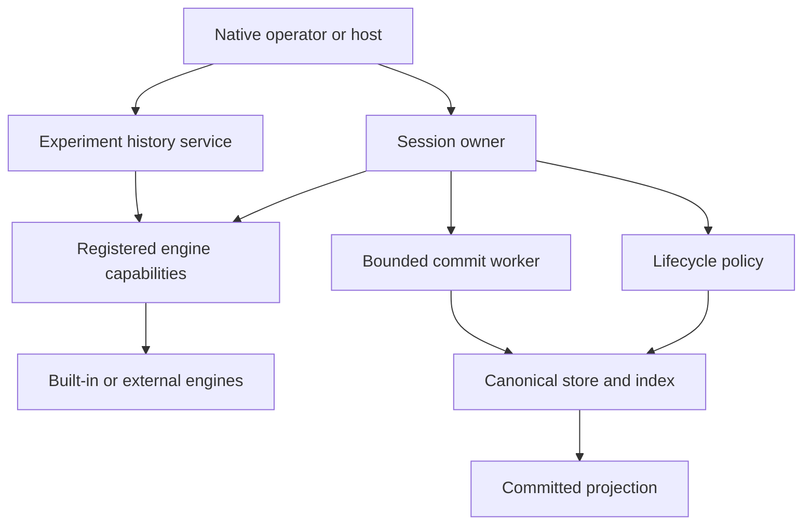

# CE-SW-38 — Compiled runtime, canonical evidence and lifecycle

This increment implements the first four delivery batches in
[CE-SW-37](CE-SW-37_modular_runtime_and_evidence_lifecycle.md): compiled modules
and extension admission, canonical indexed evidence, complete supported engine
execution/change paths, and source/peer/subscription/retention lifecycle.
The operator entry point is **`anaiero session`** in the full native build or
**`ce_modular_session`** in the controller profile. The legacy runtime and mesh
commands retain their established formats and behavior.

The supported profile has finite capacities and explicit failure results.
Continuous delivery through the existing authenticated mesh is M5. Long-duration
resource measurements, deployment qualification and release packaging are M6.
Those remaining gates are not replaced by successful functional tests.

## 1. What changed

| Batch | Implemented capability | Operator or integration proof |
|---|---|---|
| M1 | Separately compiled contracts, catalog, runtime, projection, experiments, observers, storage and built-in engines; installed C++20 SDK; versioned C ABI and bounded supervised process admission | An independently built counter engine uses only installed headers/libraries and runs linked, as a native module, and as a supervised process |
| M2 | One canonical state/evidence transaction; revision and operation identity; bounded asynchronous commit worker; sealed ordered historical index; inspection and legacy evidence migration | Fault cuts around objects, transaction, root and index reconcile; damaged indexes rebuild from verified authority; indexed lookup work is counted |
| M3 | Real finite VLM plan execution; engine-owned SW5 trials/route changes; coherent SIM3 configuration/checkpoint changes; persistent mixed-cadence cycle intent; recorded selection, explicit apply and measured outcome | Original VLM output and receipts match standalone execution; restart and isolated replay agree; live changes recover once |
| M4 | Source and epoch fences; retirement-aware active checkpoints; peer/subscription generations and leases; exact offered/acknowledged cursors; protected roots; archive/expiry/reclamation; staged quarantined restore | Active slots are reused after churn; late writes and stale ACKs reject; retained payload roots survive maintenance; restored grants cannot resume silently |

The concrete model names are **Cell Behavior Engine (SW5)**, **Multi-Colony
Engine (SIM3)**, **VLM Plan Engine**, **Passive Membrane Engine**, and
**Environment Engine**. SW5 and SIM3 are historical software identifiers; neither
is a biological maturity level or a physical operating mode.

## 2. Ownership and extension boundaries



Public SDK headers are under `native/sdk/include/anaiero/sdk`. Portable services
compile against those headers. Concrete simulation types and platform headers
are private dependencies of their implementing targets. The old include graph
is explicitly named `anaiero_legacy_compatibility`; it remains available to
compatible older commands and is not exported as the new SDK.

Catalog descriptors declare type, implementation identity, configuration/input/
checkpoint/observation/receipt schemas, bounds, finite completion, isolated trial
support and change support. Native and process modules use checked owned byte
frames and explicit admission. The installed independent consumer exercises the
boundary without private headers or edits to the core registry. Native in-process
modules are trusted extensions; the supervised process adapter owns child
startup, bounded exchange, cancellation, deadline and shutdown.

The Projector materializes committed observations. Selection and scoring are
separate services. Observer events enter a bounded deferred queue; callbacks run
outside the session owner. Callback faults, elapsed-budget overruns and dropped
events are separately observable. The owner rejects reentry and detects mutation
of an engine outside its canonical transition path.

See the [SDK guide](../../native/docs/module-sdk.md) and the generated
[exact public reference](../../native/docs/sdk-reference.md). Its source hashes,
qualified symbols, grouped overloads and full declarations are checked by the
optional documentation generator. Python is a documentation/test dependency
only, not a native controller runtime dependency.

## 3. Canonical execution and recovery

An engine prepares a complete target configuration/state, observations and
receipts without changing its live state or writing an independent authority
log. The session validates identity, schemas, bounds, previous revision and
logical state digest. Lifecycle enrichment adds source ownership, sequence,
tip and active-checkpoint fences to the **same** batch.

The native writer flushes objects and an immutable transaction before publishing
the canonical root. The derived index advances afterward. Only a committed
completion installs model state and updates the Projector. A failure after root
publication reports `committed_degraded` and requires reconciliation; it is not
reported as an uncommitted operation. Stable operation IDs resolve exact retries
before a new transition can run.

The persistent session definition retains admitted model/plan/artifact bytes,
identities, default inputs and cadences. Each cycle records its bounded intended
steps before executing any of them. A restart looks up those operations and
finishes only missing steps. `run STORE N` means **finish through absolute cycle
N**. Repeating N does not add another N cycles. Completed, paused, cancelled,
draining, sealed and retired sources do not block other runnable sources.

Logical state digests remain useful for equivalence comparisons. Canonical
checkpoint objects additionally include full source/epoch/model/module identity.
Thus expiring one retired source's checkpoint cannot prevent another source
from starting with identical logical state. Recovery uses the bounded active
catalog, then point-reads its states and metric prefixes; it does not materialize
all historical engines.

The initial index is a **native sealed AVL tree**, with bounded canonical
locators, digest-verified nodes, coverage markers, point/range APIs and repair.
This is an implementation decision replacing CE-SW-37's recommended SQLite
adapter. It keeps the native profile dependency-free beyond its compiler/runtime.
A different index can implement the same ports. Point-lookup counters and index
repair tests establish algorithmic behavior; they do not establish a deployment
latency guarantee. See the [storage contract](../../native/docs/canonical-evidence.md).

## 4. Engine behavior and experiments

### VLM plans

The VLM binding uses the existing `plans::Session` interpreter and unchanged
CEVPLAN/1 and CEVLM/2 bytes. It does not translate VLM actions into SW5 inputs.
It retains its sealed plan, base and referenced assets, then preflights task,
event and journal capacity. The initial supported bounds are eight stages and
128 logical ticks, with an initially quiescent base.

Every committed progress record retains the interpreter's complete machine
image, stage position, original progress receipts and receipt tip. Recovery
reconstructs the bounded committed prefix with publication suppressed and checks
the exact image and receipts. The supplied `bread-first.cevplan` completes after
12 ticks. Its completed state does not advance again while other session engines
continue. Pause, resume and cancellation are explicit canonical phase changes.
VLM isolated replay is supported; candidate program mutation is not advertised.

### Cell and colony changes

SW5 uses the existing cell behavior and route-policy services on staged copies.
It supports route guidance and removal, recording the previous guidance in the
change receipt. A later reversal is a new explicit change, not a rewind of
intervening simulated history.

SIM3 uses an in-memory transition service behind the compiled engine binding.
Ordinary steps preserve configuration. Supported changes commit the updated
configuration and complete checkpoint together: units on an existing colony
link, scheduling a named future teaching action, and cancellation before that
teaching action executes. Executed teaching cannot be cancelled or have its
state effects implicitly undone. Module/model/source provenance and the
10,000-tick model ceiling remain enforced.

The two numerical bindings preserve the existing analytic services, complete
checkpoint precision, simulated nanosecond clocks, and distinct microvolt and
micromolar quantities. They do not advertise isolated candidate trials or live
scientific application. The established supervised scientific/provider and
calibration workflows remain available through their compatible commands.

### Recorded selection and measured outcome

`ExperimentService` evaluates one baseline and up to eight independent candidate
changes against the same frozen source and at most 128 input steps. Comparison
requires matched metric schema, quantity, unit and horizon. Strategy identity,
implementation and configuration are included in the program digest. A tie keeps
the baseline; ties between improving candidates use deterministic identity order.
Candidate failures remain visible.

`ExperimentHistoryService` commits the source checkpoint, input program,
candidate bytes and strategy before isolated evaluation. An interrupted pure
trial can be recomputed from that retained source. One final result is committed
under the experiment identity. `resume-experiment` needs no original candidate
files. Application is a separate explicit command and requires the original live
source revision; a stale selection cannot overwrite a newer state.

Outcome review reads canonical state and typed metric records. It records both
whether the measured score meets the selected score and whether the complete
state exactly matches the trial. A same-tick phase change can preserve the score
while making exact state equality false. The operator must request a review at
the original horizon. A retry returns the frozen measured review, not a newer
measurement. Releasing an experiment expires its bounded object graph and drops
its protected source dependencies; explicit external pins can prevent release.

The CLI's supplied scorer maximizes one final metric. That is a transparent
synthetic experiment policy, not a claim that unrelated units or biological
objectives are interchangeable. Applications can supply another `IScoreStrategy`.

## 5. Lifecycle, storage policy and restore

Sources progress through registered, active, draining, sealed and retired.
Sealing requires the exact final sequence and digest. Retirement removes active
state and metrics, retains historical ownership/fencing, and releases the runtime
entry. An empty active checkpoint with nonzero lifetime observations is valid.
A new source epoch cannot silently reopen retired authority.

Peer credentials, source ownership and subscription generations are distinct.
Rotation/revocation invalidates old subscriptions. An ACK must match a committed
offer or an already acknowledged cursor in its current generation. Admission
records principal, scope, credential generation and expiry. The native writer
rechecks expiry when queued work reaches serialized admission and retains a
monotonic wall-clock floor. A later retry resolves the earlier committed result;
it does not renew a grant. Lease sweeps are explicit host/operator operations.

Retention review computes protected roots and a new replay floor. Activation
checks the reviewed source, pin and subscription revisions before committing
expiry/archive availability. Physical deletion follows canonical expiry and is
retryable. Archives have their own byte budget and verified object reads.
History availability reports retained, archived or expired explicitly; a missing
range cannot be mistaken for an empty successful replay.

The CLI persists its chosen accounted-byte budget. `capacity` changes that
policy explicitly. Serialized canonical records, present payloads and active
index bytes count against it, with conservative working headroom. Status names
this `accounted_bytes` and declares its `quota_basis`. Filesystem allocation
rounding, directories and inodes can consume more disk than that counter; native
free-space admission is a separate protection. This is not an OS-enforced disk
allocation quota. Ordinary admission also preserves bounded maintenance space;
maintenance must still fit within the absolute accounted-byte budget. Immutable
historical transaction metadata and identity fences are retained in this release:
**journal-prefix pruning is not implemented**. Payload reclamation is real, but
metadata growth can eventually stop admission at the configured quota. Archive
copies and retained migration backups consume additional declared storage;
a second directory on the same disk does not create more disk capacity.

Native `restore` locks a quiescent source, copies it into private staging,
verifies the clone, commits quarantine, then publishes the destination without
replacement. Source bytes remain unchanged. The restored store cannot execute
or grant replay until an explicit current operator policy declaration is recorded.
Reauthorization retires restored sources, invalidates peer/subscription grants,
and records durable cleanup identities so a crash cannot strand runtime roots.
New source UIDs use the restored incarnation prefix; credentials and replay
subscriptions must be enrolled again. The operator declaration does not prove
that an old backup was the newest available state.

See the [lifecycle guide](../../native/docs/modular-lifecycle.md) for exact state
machines, archive rules, bootstrap and recovery boundaries.

## 6. Operator workflow

Build the full distribution:

```sh
cmake -S native -B build/native -DCMAKE_BUILD_TYPE=Release -DCE_WIND_BUILD_TESTS=ON
cmake --build build/native --config Release --parallel 3
ctest --test-dir build/native -C Release --output-on-failure
```

On Linux, use `./build/native/anaiero`. With the usual MSVC layout, use
`.\build\native\Release\anaiero.exe`. The command arguments are the same:

```sh
anaiero session catalog
anaiero session init examples/runtime/modular-native.cevsession ./modular-state
anaiero session run ./modular-state 4
anaiero session status ./modular-state
anaiero session run ./modular-state 20
anaiero session export-plan ./modular-state program ./program.avlm ./receipts.ndjson
anaiero session audit ./modular-state
```

The example runs cells every cycle, colonies every second cycle, and the VLM,
passive membrane and environment engines every cycle. At cycle 20, their ticks
are respectively 20, 10, 12 (completed), 20 and 20. Source files may be removed
after successful initialization because admitted bytes are retained.

For a controller-only build, add `-DANAIERO_CONTROLLER_ONLY=ON`. Invoke
`ce_modular_session` directly with the arguments after `session`; this profile
does not build the `anaiero` dispatcher. Existing `ce_colony_runtime` and native
scientific utilities remain present.

A separate experiment uses a fresh store and the supplied route-change file:

```sh
anaiero session init examples/runtime/modular-native.cevsession ./experiment-state
anaiero session select ./experiment-state cells route-review 8 active_links examples/runtime/route-guidance.cechange
anaiero session selection ./experiment-state route-review
anaiero session resume-experiment ./experiment-state route-review
anaiero session apply-selected ./experiment-state route-review apply-route-review
anaiero session run ./experiment-state 8
anaiero session outcome ./experiment-state route-review measure-route-review
anaiero session release-experiment ./experiment-state route-review release-route-review
```

The source must be at the frozen revision when applying. The outcome command
must run at the selected final tick. `pause`, `resume`, `cancel`, `change`,
`configure`, `capacity` and administration commands take stable operation IDs.
`configure` can add new admitted sources and adjust cadence/default inputs;
removing a source requires its explicit retirement first. It cannot silently
replace an engine's current model configuration.

`admin STORE COMMAND_FILE [ARCHIVE_DIRECTORY]` reads one bounded command. Source
commands are `source inspect UID EPOCH`, `source drain UID EPOCH OP`,
`source seal UID EPOCH SEQUENCE DIGEST OP`, and `source retire UID EPOCH OP`.
Use `-` for the empty digest at sequence zero. Peer/subscription/pin/maintenance
commands and bootstrap follow the typed fields documented in the lifecycle guide.

`restore SOURCE NEW_DESTINATION OP` publishes a quarantined clone. Its `status`
shows the incarnation. An administration file containing
`restore reauthorize "current-policy.txt" OP` records a current declaration and
repeats any interrupted cleanup. New sources must use `INCARNATION.` as their UID
prefix. A restore never overwrites an existing unrelated destination.

## 7. Compatibility and evidence

`ANAIEROSESSION/1` is the new operator definition format. Legacy CEVSESSION/1
SW5/SIM3 definitions can be admitted into a fresh modular store. The existing
CEVSESSION/2 segmented/scientific format remains owned by the compatible legacy
runtime; its version number is not reused for the new architecture.

`migrate-evidence LEGACY_STORE NEW_STORE` imports a locked, verified legacy
Registry, including segmented history. It preserves original CAS identities,
exact sealed event wire bytes, tuple/origin duplicate semantics and opaque
provenance. It stages and verifies the destination before activation and reports
the separate retained source backup footprint. It is **evidence migration**;
it does not reinterpret old live engine/session state as the new runtime.
Use the legacy binary to inspect/continue those live stores until an explicit
state migration is supplied. `audit` and `repair-index` work directly on canonical
stores without initializing a session or requiring a particular model module.
They require an existing canonical `ROOT`; inspecting an empty or legacy
directory does not initialize it. An optional working-budget argument selects
the store's accounted-byte budget for that command without changing the saved
runtime policy. Index reconstruction is explicit work over retained history
and requires temporary disk headroom; this argument is not a hard filesystem
allocation ceiling for the rebuild.

New recovery state pins the source/build manifest and the current executable
artifact. `module-packages STORE` lists the retained implementation/artifact
identities, and `export-artifact STORE SHA256 OUTPUT` extracts verified bytes
without requiring the pinned model module to load. These inspection/export
commands do not run the extracted executable. Compiler/platform/configuration changes produce a different built-in
module identity. Use the compatible retained installation for its old active
sources, or retire/migrate them explicitly. This increment does not implement
transparent hot upgrades or a portable arbitrary-binary dependency packager.

The added suites are `anaiero_sdk_conformance`, `anaiero_sdk_installed_consumer`,
`anaiero_evidence_tests`, `anaiero_migration_tests`, `anaiero_lifecycle_tests`,
`anaiero_modular_engines`, `anaiero_modular_session`,
`anaiero_recorded_experiments`, `anaiero_artifact_publication`, and
`anaiero_modular_cli`.
They cover real independent module admission, commit cuts, index damage and
complexity, queue expiry, migration, five-engine recovery, original VLM receipt
equivalence, actual changes and outcomes, churn, expiry, archive, bootstrap,
quarantine and operator retry. The new native workflow runs the full distribution
on Windows and Linux, plus the controller profile without Python discovery.

These are software correctness and recovery fixtures. Scientific model validity,
physical acquisition/actuation, arbitrary VLM optimization, continuous mesh
fan-out, indefinite finite-disk operation and filesystem power-loss guarantees
are not established by this increment. M5/M6 and the separate model/reference
qualification workstream retain their own acceptance evidence.
