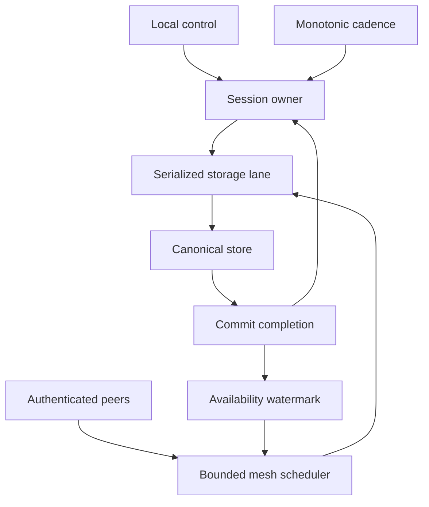

# CE-SW-39 — Continuous native operation and qualification profiles

This changeset continues the compiled runtime in
[CE-SW-38](CE-SW-38_compiled_runtime_and_lifecycle.md). It implements the next
four operational capabilities under [CE-SW-37](CE-SW-37_modular_runtime_and_evidence_lifecycle.md):

| Delivery | Usable result | Roadmap relationship |
|---|---|---|
| Continuous canonical mesh | Authenticated live subscriptions share the modular session's serialized storage lane, with indexed catch-up, exact receipts/ACKs and bounded scheduling | M5 implementation |
| Reviewed canonical compaction | A verified canonical base replaces redundant history before physical prefix deletion; interrupted cleanup resumes and operation-history expiry is explicit | Completes the optional history-pruning portion of M2/M4 |
| Continuous native host and packages | Event-driven owner, local control, native service lifecycle, retained executable artifacts and an installed package integrity/compatibility workflow | Deployment portion of M6 |
| Measured native profiles | Predeclared evidence/churn workloads, resource and complexity reports, package/failure tests, Windows/Linux CI artifacts | Functional qualification portion of M6 |

These are four concrete deliveries within the existing six-milestone plan.
They do not renumber M5/M6 or make a short native test equivalent to the planned
24-hour and seven-day release runs. The numerical models remain within their
existing declared simulation scope.

**Continuation:** [CE-SW-40](CE-SW-40_operating_envelope_and_package_lifecycle.md)
adds bounded receiver-history reclamation, canonical package activation/rollback,
the actual mixed-host measurement path and reduced index work. The original
limitations below describe this increment; use the continuation and current
operator guides for their implemented disposition.

## 1. One canonical ownership boundary

The continuous host owns the modular `SessionService` and `SessionRunner`.
Transport threads never read or mutate their canonical store directly. They
submit owned, bounded work through `IStoreTaskExecutor`. The host serializes
that work with engine commitment, on a separate storage lane; cached local
status and control admission remain independent of a pending storage task.



Engine preparation, durable commitment and installation keep their established
order. Cycle intent is persisted before any cycle step. A restart resumes the
remaining operations using their original identities. A mesh job cannot race
a synchronous store read against the runtime's asynchronous writer.

Storage completion and commit availability are signals, not a per-peer event
copy. A receiver catches up through indexed durable state. The mesh rechecks
the availability watermark around its transition to waiting, so a commit
cannot disappear between the final read and the wait. Native socket readiness,
completion, control, credit and bounded lifecycle/retry timers provide wakeups.

## 2. Continuous native host

Initialize a modular session using the existing retained-input flow, then run
the new host. Commands below use the full distribution; controller builds use
the corresponding `ce_modular_session` and `ce_modular_host` executables.

```text
anaiero session init examples/runtime/modular-native.cevsession ./session
anaiero host start anaiero-example ./session 100 paused
```

From another terminal:

```text
anaiero host query anaiero-example STATUS
anaiero host query anaiero-example THROUGH 12
anaiero host query anaiero-example STATUS
anaiero host query anaiero-example RUN
anaiero host query anaiero-example PAUSE
anaiero host query anaiero-example STOP
```

The period is a **wall monotonic pacing interval**, in the range
1–3,600,000 milliseconds. It does not reinterpret an engine's logical tick,
physical-time unit or model cadence. A completed finite VLM stays completed
while other eligible engines continue. Automatic execution becomes idle when
no lifecycle-eligible runnable engine remains. Existing model horizons still
apply; this host does not enlarge the SIM3 model's supported horizon.

`THROUGH` uses an absolute cycle target. `RUN`, `PAUSE`, `THROUGH` and recent
local tickets are transient host scheduling state. Canonical cycle intent,
completed cycle progress, source identity and stable engine-control operation
IDs survive restart. The operator selects the initial running/paused mode on
each launch. A queued response is not a durable acknowledgement.

Per-engine controls preserve the original operation identity:

```text
anaiero host query anaiero-example ENGINE_PAUSE cells operator-pause-1
anaiero host query anaiero-example RESULT 1
```

Use the actual returned ticket for `RESULT`. The bounded recent-result cache
can expire old tickets; the stable canonical operation ID remains the retry
identity. Cached status includes source/engine identity, phase, tick/revision,
state digest, completed/pending cycle, canonical generation, quota accounting,
queue sizes and owner wakeups. Engine details are paginated. Checkpoint payloads
are not copied into status responses. Unchanged state digests are reused.

Native stop closes new admission, drains accepted storage work and the active
cycle where durability permits, then joins workers. Pending local controls are
explicitly cancelled. A storage failure leaves its durable intent available
for recovery and surfaces a recovery-required outcome. The optional mesh is
stopped before its backing host is joined. Linux signals/systemd notification
and Windows console/SCM behavior use native adapters.

The deployment templates and service-account instructions are in
[deployment/native](../../deployment/native/README.md). Uninstallation preserves
evidence. Neither a successful compatibility check nor a new executable grants
transparent live upgrade of a retained engine implementation.

## 3. Continuous authenticated canonical mesh

Enable the optional native transport with `-DANAIERO_ENABLE_MESH=ON` and its
OpenSSL dependency. The default native controller remains usable without it.
The full dispatcher exposes `anaiero mesh-live`; `anaiero mesh` retains the
legacy CEVMESH/1 path. The new canonical path negotiates **CEVMESH/2** and a
distinct ALPN, so it does not silently reinterpret CEVMESH/1 `PERSISTED`.

The listener composes directly with a live modular session:

```text
anaiero host start anaiero-example ./session 100 --mesh server.cevmesh
anaiero host query anaiero-example MESH_STATUS
```

Use the [continuous mesh operator guide](../../native/docs/continuous-mesh.md)
for exact certificate, configuration, enrollment, scoped grant, subscriber,
artifact and bootstrap commands. Enrollment and grants are trusted local
administration. The network protocol cannot execute arbitrary host commands,
experiments or provider processes.

Local `MESH` administration is also asynchronous. It returns a bounded ticket
with `durable:false`; `MESH_RESULT` returns its completion code and response.
The cache has at most 32 entries, never discards a pending result, and can
recycle completed entries. Callers retain the command's stable operation ID.
`STATUS` and `STOP` do not wait for a local enrollment/grant commit to finish.

The implementation separates unauthenticated TCP/TLS admission from the
authenticated scheduler. A stalled handshake consumes a bounded handshake slot
instead of the only accept path. Each connection has one bounded queued work
unit and one outstanding delivery page. Deficit round robin charges bytes and
work, with principal/source budgets and a bounded control reserve. Slow peers
retain cursors rather than unbounded copies of future events.

Current credential generation, certificate expiry, grant/source context and
relevant subscription/artifact/bootstrap authority are rechecked before a
scheduled handoff. Receive batches commit relay receipt, observations,
projection state and receive cursor atomically. Exact ACKs identify the
offered page, subscription generation and digest. A lost reply reconciles
against committed state; it cannot fabricate a durable ACK.

Local sources and explicitly granted relay sources share a source-UID authority
fence. Certificate rotation does not transfer that source's ownership or clock.
Receive evidence remains labeled as authenticated **relay** attribution. An
original-author signature is not asserted merely because a payload digest or
TLS peer is valid.

Artifact bytes are scope-authorized and digest-verified before installation.
Bootstrap pins the offered checkpoint and its exact context, installs a new
cursor/checkpoint atomically and records a distinct acceptance. It does not
pretend the receiver received expired original observations. Exact retries
must match the original offer bytes. Retained, archived, unavailable and expired
history retain distinct outcomes. Archive retrieval, expanded authorization
or explicit bootstrap are operator decisions, not silent cursor advancement.

The current bootstrap path requires the source to remain quiescent through
acceptance; pause the producer and resume it after acceptance. Source advance
conflicts explicitly. Received relay observations, receipts, artifacts and
bootstrap installations remain canonical retained roots in this profile.
There is no automatic receiver-history expiry policy: a full receiver applies
backpressure instead of discarding acknowledged evidence. Long-running relay
retention/archive policy is a declared remaining deployment capability.

## 4. Canonical history compaction

Payload retention and canonical-history compaction are distinct operations.
The existing lifecycle policy decides which payloads expire or move to a
verified archive. Compaction can then summarize redundant record revisions
and fully expired contiguous observation prefixes, while retaining the latest
authority, ownership, source-tip, pin and tombstone records.

Run with the host stopped and use a reviewed immutable plan:

```text
anaiero session compact-review ./session compact-2026-11-18 ./review.cecompact
anaiero session compact ./session ./review.cecompact
anaiero session audit ./session
```

Review reports identify the exact source root/generation, expected working
bytes, retained record/blob/operation identities, summarized versions and
transactions to remove. Execution rechecks the root and recomputes the plan.
A changed root rejects the old plan. The artifact is never overwritten with a
different review.

The native adapter verifies canonical evidence, builds bounded sealed base
pages and a new derived index, then publishes the canonical base in `ROOT/2`
before deleting old transaction/index files. Original receipt/root identities
remain intact. Subsequent transactions form the retained suffix. A missing
derived index rebuilds from the verified base plus suffix. Audit distinguishes
retained bytes from committed summaries; it cannot reverify deleted bytes.

If publication or cleanup is interrupted:

```text
anaiero session compact-resume ./session
```

The optional recovery working-budget argument bounds inspection/rebuild work.
Recovery opens canonical authority before consulting the indexed capacity
policy, so missing coverage cannot block the after-root/before-index cut.
It does not revise the persisted ordinary-admission budget. Incomplete physical
cleanup remains accounted and explicitly reported.

Default compaction retains operation receipts, making it compatible with
existing session cycles, engine controls and recorded experiment retries.
Explicit receipt expiry is an advanced epoch-aware SDK/evidence operation.
It advances a reserved operation namespace; unknown old operations return
`HISTORY_EXPIRED` instead of being accepted as new mutations. A caller must
never relabel an uncertain old retry into the new namespace. The modular CLI
rejects receipt expiry on an existing modular session. Native restore also
rejects unsupported explicit-epoch stores before copying them.

All latest authority/catalog identities and blob identity fences still consume
finite storage. Arbitrarily many unrelated source UIDs, retained modules,
receipts or pins cannot fit indefinitely on a finite disk. The policy remains
verified expansion/archive, explicitly authorized expiry/summary, or stopped
admission. Compaction does not manufacture a new authority policy by deleting
fences. See the [canonical storage contract](../../native/docs/canonical-evidence.md).

## 5. Native packages and compatibility

The native package recipe installs into a new directory, records sorted paths,
file sizes/SHA-256, profile/configuration and compiled builtin identity, then
verifies the installed host. The verifier rejects missing, altered, additional,
duplicate and symlink entries, including symlink ancestors. A quiescent-store
compatibility check rejects an incompatible retained engine/module identity.

```text
cmake "-DANAIERO_BUILD_DIR=build/native" "-DANAIERO_PACKAGE_DIR=build/package" "-DANAIERO_CONFIG=Release" -P native/cmake/BuildNativePackage.cmake
cmake "-DANAIERO_PACKAGE_DIR=build/package" "-DANAIERO_STORE_DIR=./session" -P native/cmake/VerifyNativePackage.cmake
```

These commands provide a reproducible recipe and exact local inventory. They
do not establish publisher authentication, a bit-identical archive across
toolchains, or inclusion of every operating-system/OpenSSL runtime dependency.

The host retains its actual executable separately from the session CLI's engine
package. `session module-packages` and `session host-packages` expose bounded
inventories; `session export-artifact` verifies and exports the retained bytes.
Keeping a digest alone is insufficient to recover a removed implementation.
After new writes are acknowledged, an older store snapshot is not a valid
rollback that may discard that suffix. Retain a compatible implementation or
perform a separately supported state migration.

## 6. Qualification and remaining gates

The [native profile guide](../../qualification/native/README.md) describes the
exact workloads, budgets, measurements and reproducible commands. The runner
measures the real canonical store and lifecycle services, using bounded
histograms and queries. Reports identify their exact profile and build,
record both serialized accounting and measured regular-file allocation, and
separate lookup/reopen work from full audit.

Native tests additionally exercise injected compaction cuts, missing/corrupt
indexes, stale maintenance reviews, explicit operation-history floors,
retained pins, native process termination, pending cycle recovery, bounded
controls/completions, package tampering, live TLS fairness, revocation, exact
ACKs, artifacts and bootstrap. The required CI paths make unavailable native
IPC/TLS a failure rather than a success with skipped transport coverage.

Passing those tests establishes the stated software invariants and measured
profile. M6 still requires dedicated mixed-engine/peer workload evidence,
the 24-hour integration soak, the seven-day release profile, hardware-specific
storage-pressure/crash qualification and supported operational upgrade
evidence. The one-million-observation profile is runnable but remains an
unachieved gate until its report is retained. Process-kill, OS-crash and device
power-loss claims remain separate.

Exact commit/run results accompany the implementation PR and native CI
artifacts. This document is a capability/contract map; it does not replace
those reports with an architecture rating.
