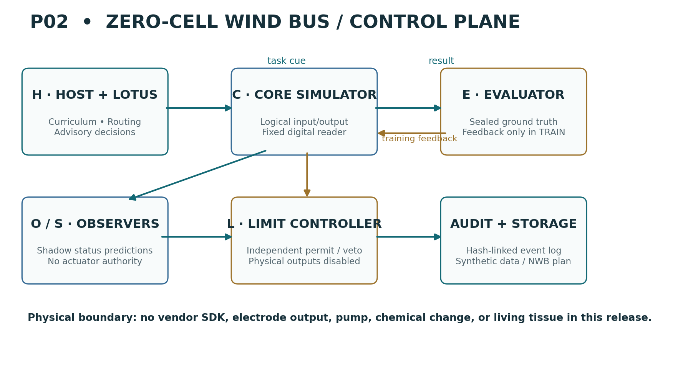
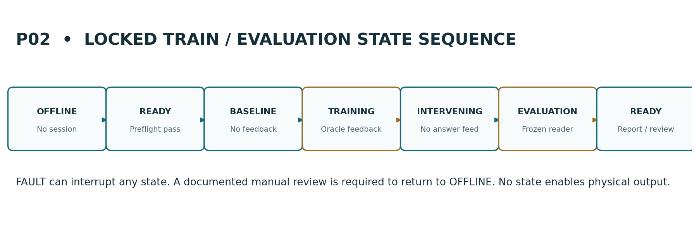

> **Complete text edition · 15 November 2026 · We Develop Software LLC**  
> **Original DOCX:** `phases/P02_Cell_Free_Electronics_and_WindBus/docs/00_P02_Master_Implementation_Architecture.docx`  
> **SHA-256 (original DOCX):** `e47f402df48687493bc92fb8f63cb2659814a16a762bed6718493b5b4169f509`  
> **Conversion:** Pandoc DOCX → GitHub Flavored Markdown. Original headings, tables, notes, and equations preserved where supported; images retained as assets.

**Implementation Master v1.0 · 15 November 2026 · Build ID CE-ANA-P02-001**

**Release assertion:** The P02 software harness is executable with zero living cells and no hardware driver or physical output. It demonstrates typed communication, simulated recording, clock estimation, independent logical vetoes, fixed-readout reference-task education, and integrity-linked audit. It does **not** demonstrate biology, physical stimulation safety, molecular crystal transfer or a living mind.

# 1. System architecture and build boundary

A real living computer is a future research target; P02 builds its instrument-facing **software contract**. H routes logical task and status events. C is a synthetic learner in this release. E holds the task oracle and cannot leak evaluation labels into the participant's observation stream. O/S are shadow/advisory endpoints. L is an independent, non-adaptive permit/veto component. P03 will attach a vendor-supported recording system only after hardware qualification. See the six paired Design and Companion documents for the exact contracts, calculations, ambiguity boundaries and tests. \[I01, I02, I03\]

# 2. Mandatory design decisions

| **Decision ID** | **Locked v1 decision**                                                  | **Why it matters**                                                     |
|-----------------|-------------------------------------------------------------------------|------------------------------------------------------------------------|
| D-P02-01        | No vendor stimulation SDK calls in release                              | Preserves zero-actuation safety boundary                               |
| D-P02-02        | C, O, S, B, H, L and E identities distinct                              | Prevents learned predictions being credited as independent measurement |
| D-P02-03        | Eval labels exist only inside E during confirmation                     | Prevents oracle leakage and false acquisition claims                   |
| D-P02-04        | Route ACL + versioned immutable Envelope                                | Makes WindBus testable as a communication protocol                     |
| D-P02-05        | Expiry, duplicate, out-of-order and backpressure recorded separately    | No silent replay of learning events                                    |
| D-P02-06        | Frozen reader digest during evaluation                                  | Separates learner-state change from software decoder adjustment        |
| D-P02-07        | Independently configured L veto for each simulated action               | Learned policies cannot override limits                                |
| D-P02-08        | Source-specific quantities have explicit units and provenance           | Avoids confusing spikes, volts, cells and stimulus energy              |
| D-P02-09        | JSONL event archive with integrity chain; NWB export deferred           | Enables audit without fabricating acquisition units                    |
| D-P02-10        | P02-S software release distinct from P02-I/P03 instrument qualification | Prevents tests being presented as biological evidence                  |

# 3. Runtime structure and execution

src/anaiero_p02/protocol.py defines a strict event and frozen payload; bus.py enforces ACL, sequence and backpressure; clock.py estimates an affine mock clock map; acquisition.py creates seeded, arbitrary-unit fixtures; adapter.py refuses vendor and physical actions; controller.py implements Lotus advisory and L veto; learner.py isolates E from the simulated learner and freezes the reader; audit.py hashes an append-only JSONL demonstration trail; scenario.py exercises the full route. The old Anaiero v3 engine remains unmodified, and the P02 namespace is independent until a contract-equivalence migration test passes.

python phases/P02_Cell_Free_Electronics_and_WindBus/run_demo.py

python -m unittest discover -s phases/P02_Cell_Free_Electronics_and_WindBus/tests -v

python -m unittest discover -s tests -v

python -m tools.validate_repo

All commands operate offline with Python standard-library dependencies. The executable demo writes examples/demo-output/run-NNNN/demo_audit.jsonl and prints baseline/confirmation test summaries, route receipts, a frozen-reader digest, mock data hash, clock qualification and Lotus advisory status. No hardware is discovered or initialized.

# 4. Teaching state machine

Use the existing P01/v0.4 context-and-order task: C0/AB→X, C0/BA→Y, C1/AB→Y, C1/BA→X, AA/BB→HOLD, invalid→UNRESOLVED. In eight balanced valid cases, the always-HOLD shortcut earns 50% raw accuracy but just 1/3 macro recall; thus macro recall is reported. The baseline/teaching/confirmation behavior in this release is a deterministic dictionary-like simulation, not neuroscience. E releases labels after completed responses **only during TRAINING**. P03 live codebooks require vendor- and preparation-qualified input profiles. \[I01\]

# 5. Quantitative baseline and source discipline

The MaxOne published reference has 26,400 electrode sites, 1,020 readouts and 20 kHz/channel; MaxLab Live v1.2.0 describes distinct Python/C++ API roles. These source values are facts about the vendor platform, not approval for this device. Under a \*separate\* 16-bit stored-sample assumption, raw stream rate is 40.8 MB/s, 146.88 decimal GB/hour, 3.52512 decimal TB/day for one module. The P02 four-channel fixture uses arbitrary units and cannot satisfy a real performance budget. Open Ephys synchronization is a conceptual reference for common clocks, not a claim of MaxOne interoperability. NWB defines an interoperable target format, but its ElectricalSeries in volts cannot honestly contain unlabeled simulated arbitrary units. \[V01, V02, O01, N01, N02\]

# 6. Acceptance and qualified release boundaries

**Implemented and unit-tested:** A01–A10 from registers/acceptance_matrix.csv, covering output lock, protocol, routes, faults, simulated clock, synthetic data, evaluator isolation, readout identity, L veto and audit integrity. **Not established:** A11–A15 (measured instrument latency/throughput, vendor SDK and permissions, physical inhibit on a supported load, validated NWB export and real multi-device hardware alignment). The unresolved parameters U01–U11 block affected later phases. A failed P03 vendor qualification does not invalidate P02's digital functions; it forbids the corresponding live claim.

# 7. Phases and dependency order

P00: definitions and oversight. P01: composition, molecule/structure register, role contracts. **P02: complete the logical instrument** with no cells. P03: qualified planar living core, source release, support and interface. P04: controlled acquisition, Roots and independent retention. P05: O, S, B and joined teaching. P06: 3D Soil and regional diversity. P07: physical Crystal and molecular Word hypotheses. P08: scaling and deployment governance. Biological care, nutrition, peptide interventions and custom growth are never authorized by a P02 software pass. \[I03, E01\]

# 8. Handoff and blocking unknowns

Read registers/controlled_unknowns.csv. Before P03, the laboratory must choose and confirm equipment and compatible cell source, receive vendor-approved documentation, qualify read-only acquisition with real units and electrode mapping, measure physical synchronization and complete an independent inhibition proof on a supported cell-free fixture. Separate biosafety/consent and supplier-qualified biological SOPs remain mandatory. The P01 planar reference cell census is not a 3D organoid recipe. No new cell count is assigned in P02.

# 9. Document package index

| **Pair** | **Design document**                         | **Technical companion**                                          |
|----------|---------------------------------------------|------------------------------------------------------------------|
| P02-01   | Hardware boundaries and commissioning       | Electrode/channel/energy/timing assumptions                      |
| P02-02   | WindBus messages and connective controllers | Information capacity, codebook semantics and delivery guarantees |
| P02-03   | Acquisition, clocks and signal pipeline     | Units, recording artifacts, NWB and clock uncertainty            |
| P02-04   | Independent limits and Lotus controller     | Constraints, model boundaries and oversight                      |
| P02-05   | Reference task, teaching and reader         | Statistical controls, biological claim ladder and retention      |
| P02-06   | Archive, observability and verification     | Audit provenance, measurement validity and P03 handoff           |

# 10. Sources in this release

\[V01\] MaxWell MaxOne, https://www.mxwbio.com/products/maxone. \[V02\] MaxLab API v1.2.0 (Nov 2026), https://api-docs.mxwbio.com/index.html. \[V03\] MaxLab Live, https://www.mxwbio.com/products/maxlab-live. \[O01\] Open Ephys synchronization, https://open-ephys.github.io/gui-docs/User-Manual/Synchronization.html. \[N01\] NWB specification, https://nwb-schema.readthedocs.io/en/latest/format.html. \[N02\] PyNWB, https://pynwb.readthedocs.io/en/stable/tutorials/domain/ecephys.html. \[E01\] ISSCR Guidelines, https://www.isscr.org/resources/guidelines-for-stem-cell-research. \[I01\] CE-DEV-001 v0.4; \[I02\] CE CRYSTAL MATH 001; \[I03\] Anaiero P01 contracts. All source claims are scoped in registers/source_register.json.

