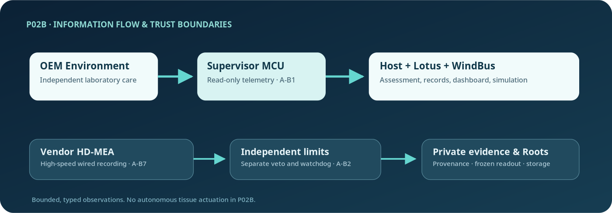

> **Complete text edition · 15 November 2026 · We Develop Software LLC**  
> **Original DOCX:** `phases/P02B_Supervisory_Electronics_and_Scientific_Operations/docs/00_P02B_Master_Engineering_Architecture.docx`  
> **SHA-256 (original DOCX):** `0c3aa3e7beab4ddbf5c384a3a119a28ccdcde6ecefc8d65d74ef929c36330b22`  
> **Conversion:** Pandoc DOCX → GitHub Flavored Markdown. Original headings, tables, notes, and equations preserved where supported; images retained as assets.

**Edition:** 2026-11-15 · **State:** implemented *digital twin*; no custom PCB or biological operation · **Canonical name:** ChristEye Anaiero.

## Executive decision

The former P02 digital WindBus and simulated Core/Evaluator system is preserved as an independent baseline. We insert a new phase **P02B** for scientific authority, supervisory read-only boards, telemetry and offline debugging, and a new **P02C** for physical dev-board EVT commissioning before living-soil P03. This phase is NOT a repeat of P02 or a change to its measured software claims. \[S-P02\]\[S-CEDEV\]

## Architecture and authority

- **Host control plane:** software records, decisions, educational simulation and scientific data relationships, not direct wet-lab authority.

- **Supervisor board A-B1:** read-only status; authentication, sequence and freshness, fault latching and provenance.

- **OEM care A-B3:** manufacturer-qualified care keeps running independently of host/policies.

- **MEA A-B7:** actual neural measurement via commercial vendor system. No improvised electrode drivers.

- **Support and scientific roles:** PI and cell-production scientist sign different gates; L independently blocks unsafe commands.

- **Crystal history:** digital compilation/replay belongs to software; physical packing/peptide transfer remains H research.

## Protocol example

{

"schema":"anaiero.p02b.telemetry/1",

"board_id":"A-B1-SIM",

"sequence":1,

"observed_ms":1773530000000,

"metric":"ambient_temperature_c",

"value":22.1,

"unit":"degC",

"calibration_digest":"cal-sim-1",

"signature":"\<hex HMAC-SHA256 over the other fields\>"

}

This is an illustrative **synthetic ambient-reading schema**, not an incubator setting and not a biological target. Real implementations require hardware key provisioning and authenticated transport. src/anaiero_p02b is a pure standard-library reference.

## Build outputs and tests

| **Artifact**                 | **Repository path**            | **Definition of done**                                                     |
|------------------------------|--------------------------------|----------------------------------------------------------------------------|
| Read-only telemetry verifier | src/anaiero_p02b/telemetry.py  | Signature, schema, calibration, timestamp, ordering and numeric validation |
| Supervisor state model       | src/anaiero_p02b/supervisor.py | No physical actuation path; safe fault latch; tamper-evident local ledger  |
| Lab handoff validator        | src/anaiero_p02b/scientists.py | Separate PI, cell production, safety, evaluator flags                      |
| Read-only debug console      | src/anaiero_p02b/dashboard.py  | Offline synthetic HTML; escaped untrusted fields                           |
| Board register               | registers/boards.csv           | A-B0..A-B7 identity, I/O, scope, owner, unresolved decisions               |
| Acceptance contract          | registers/acceptance_gates.csv | B01..B14 independently reviewed and dated                                  |
| Scientific RACI              | registers/scientist_raci.csv   | Clear signoffs, no learned-network physical privileges                     |

## Hardware implementation order

1.  Freeze the actual vendor I/O documents and request quotes (without assuming selected hardware).

2.  Bring up supervisor MCU on a standalone devkit with dummy sensors and a USB console.

3.  Test disconnection, invalid records, clock drift, storage exhaustion and host reboot with inert hardware.

4.  Establish independent safe inhibit on the chosen instrument with vendor authorization and laboratory review.

5.  Attach OEM *read-only* telemetry only after electrical interface and local qualification.

6.  Qualify each chemistry/imaging method against a reference instrument and disclose sampling burden.

7.  Complete pilot variance and P03 research-design review separately from electronics release.

## Primary risks

Unverified grounding and EMC; unsupported OEM ports; an AFE mistaken for analyte-specific assay; biological care conflated with software learning feedback; timestamp drift; image-derived Root claims without independent functional testing; publication of raw private conversation logs. These block the dependent phase until reviewed.

## Documentation standard

Every design/companion pair must have stable ID, owner, inputs, outputs, physical boundary, data schema, failure modes, test strategy, evidence level, unresolved parameters, research sources and next-phase handoff. registers/phase_roadmap.csv is the machine-readable phase definition; public-facing versions live in website/content/. Historic versions remain archived, not silently overwritten.

## References

- **S-ST1**: STMicroelectronics Nucleo-H743ZI2 board and ST-LINK resources. https://www.st.com/en/evaluation-tools/nucleo-h743zi.html — Candidate MCU prototyping only; pins and ground plan pending review

- **S-ST2**: STM32 Nucleo-144 data brief (NUCLEO-H743ZI2). https://www.st.com/resource/en/data_brief/nucleo-h563zi.pdf — Board features: Ethernet, USB OTG FS, STLINK-V3E and board reference

- **S-ESP**: ESP32-S3 product overview. https://documentation.espressif.com/projects/esp-hardware-design-guidelines/en/latest/esp32s3/product-overview.html — Wi-Fi 2.4 GHz and BLE 5; diagnostics gateway, no safety control

- **S-AD**: AD5940 electrochemical AFE and EVAL kit. https://www.analog.com/en/products/ad5940.html — General electrochemical instrumentation; not a lactate-specific sensor by itself

- **S-MEA**: MaxWell BioSystems MaxOne. https://www.mxwbio.com/products/maxone — Vendor HD-MEA interface; verify purchased hardware revision and API

- **S-MEA-API**: MaxLab Live API documentation. https://api-docs.mxwbio.com/index.html — Vendor-supported APIs require lab qualification before physical use

- **S-NWB**: Neurodata Without Borders standard. https://www.nwb.org/ — Candidate archival format for electrophysiology and linked experimental data

- **S-OMERO**: OMERO image management. https://www.openmicroscopy.org/omero/ — Candidate imaging and microscopy provenance workflow

- **S-ISSCR**: ISSCR basic research standards for stem cell-based model systems. https://www.isscr.org/basic-research-standards/stem-cell-based-model-systems — Preparation identity, characterization, reproducibility and appropriate oversight

- **S-P01**: Anaiero P01 module inventory and molecular register. ../P01_Reference_Biology_and_Contracts/registers/ — Existing proposed composition and source-controlled unknowns

- **S-P02**: Anaiero P02 WindBus and synthetic-instrument design. ../P02_Cell_Free_Electronics_and_WindBus/docs/ — Completed digital interface and evaluation reference

- **S-CEDEV**: ChristEye Physical Learning Device Design v0.4. ../../../research/source_documents/R04_ChristEye_Physical_Learning_Device_Design_v0_4_3\_.docx — Scientific concept and laboratory qualification plans, not proven implementation

- **S-AUDIT**: Formal Models and Reconciliation 2026-11-15. ../../../research/source_documents/R03_03_Formal_Models_and_Reconciliation_1\_.docx — Equation corrections and claim limits

