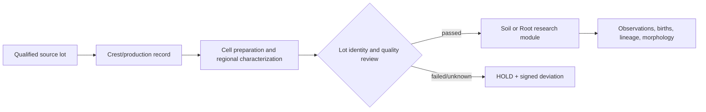

# BIO-01 · Crest source, cell birth, lineage and release

**Owner:** qualified cell-production scientist. **Co-review:** scientific director, assay specialist, biosafety officer. **Status:** biological requirements design; no source-cell manufacture authorized by this document.

## 1. What is actually being produced?

The term **Crest** denotes Anaiero's *cell-source and production steward*, implemented initially as a digital audit and qualified human production workflow. It does not create a new biological species or make a cell "know" it is a memory unit.

The separate things that grow or change are:

| Thing | Biological reality | Output needed |
|---|---|---|
| Source line | Qualified bank of pluripotent/progenitor or pre-differentiated cells | identity, source, permissions and batch lineage |
| Progenitor | A dividing cell observed under a qualified preparation | cell population and lineage/birth evidence |
| Neuron | A differentiated cell, generally post-mitotic, whose processes may extend or remodel | subtype, functional identity and axon/dendrite organization |
| Astrocyte | A qualified supporting glial population | markers, exchange and state measurements |
| Axon / dendrite / spine | **Parts of neurons, not separately cloned cells** | morphology, physical route and verified function |
| Spinal Root network | A candidate spinal-derived neuronal/glial sub-assembly | regional identity, independent functional baselines |
| Soil | Complete living organoid, with potentially heterogeneous cell populations | preparation version, source and 3D observation coverage |

Regional spinal identities can be assessed using **MNX1/ISL1/CHAT** (motor neuron candidate), **VSX2** (V2a candidate), **GAD1/GAD2/SLC6A5** (inhibitory candidate), and astrocyte populations with **SOX9/ALDH1L1/GFAP**. A marker is not equivalent to terminal maturation, stable function or a validated Root. [B08](../research/evidence/anaiero-biology-2026-11.md), [P01 molecular inventory](../phases/P01/docs/02_Molecules_Structures_and_Development_Companion.md).

## 2. Production events, not assumptions

Controlled process states: `REQUESTED → SOURCE_IDENTIFIED → QUALIFICATION_PENDING → IDENTITY_REVIEW → RELEASED → OBSERVED → RETIRED`. No transition to `RELEASED` without source/consent verification, human signoff, qualified preparation assay, batch history and the instrument boundary needed for that preparation. The cell-production lead owns the complete SOP; Anaiero software records results rather than inventing wet-lab steps.

## 3. Per-cell identity proposal (digital-first)

No lineage barcode automatically assigns a **globally unique** identifier to every daughter cell. Use four noninterchangeable identifiers:

- `source_lot_id`: immutable bank/lot provenance.
- `clone_lineage_id`: shared ancestor lineage; *multiple daughter cells may share it*.
- `cell_instance_id`: UUID for a confidently resolved, observed individual at a specified observation event.
- `cell_track_id`: time-linked imaging track with match confidence and possible identity breaks.

A parent division can create a `CellBirthEvent` with `parent_cell_track_id`, `daughter_observation_ids`, `division_detected_at`, `lineage_confidence`, `imaging_run_id`, `source_lot_id` and `confirmation_method`. When division is not observed, a unique new baby-cell identity is **unknown**, not fabricated.

**Research-only alternative:** validated lineage barcoding could tie descendants to a parent clone, but the barcode is not guaranteed unique to every daughter. Collision, dropout and perturbation must be measured; it is **not** appropriate to prescribe insertion methods or genotype every cell by default. [B04](../research/evidence/anaiero-biology-2026-11.md), [B05](../research/evidence/anaiero-biology-2026-11.md).

## 4. Growth versus delivery distinction

Do not interpret increased electrical activity or arbor length as "new cells born." Require different denominators: observed divisions, subtype counts with sampling uncertainty, region volume, neurite extension, axonal routes, synaptic density and network function. Each must identify its optical/assay scope. Whole-cell RNA/protein changes are states of particular sampled cells, not continuous video of every cell.

## 5. Release and negative controls

A Crest lot is **held** if identity, provenance, lot/reagent status, assay validity, consent or approved operating procedures are missing. Downstream learners must not infer the missing measurements from prior batches. Baseline cells need a reference-source comparison, contamination/identity review and instrument-only controls before developmental conclusions.

**Reference:** [ISSCR guidelines](https://www.isscr.org/resources/guidelines-for-stem-cell-research) and the 2025 lineage identification tradeoff [B05](../research/evidence/anaiero-biology-2026-11.md).

## 6. Food/peptide-change decision card

| Field | Mandatory record |
|---|---|
| Proposed trigger | Developmental anomaly or independently recorded nutrient/exchange deficiency; **not** weak learning alone |
| Evidence | assay with calibration, source and matrix controls, task-independent care status |
| Requested change | named category and scientific hypothesis, **not** an automated dose |
| Approval | scientific director + cell-production lead + institutional qualified SOP |
| Protected outcomes | viability, identity stability, old Roots, axon function, optical and electrophysiological comparators |
| Next state | `PROPOSED`, `LAB_REVIEW`, `APPROVED_IN_SOP`, `REJECTED`, `UNRESOLVED` |
| Data per cell | digital provenance IDs, observed identity and lineage uncertainty; no assumed encoded semantic knowledge |

**No cell-ID coding or peptide recipe is authorized.** The first implementation is a provenance database and simulated Crest agent.
