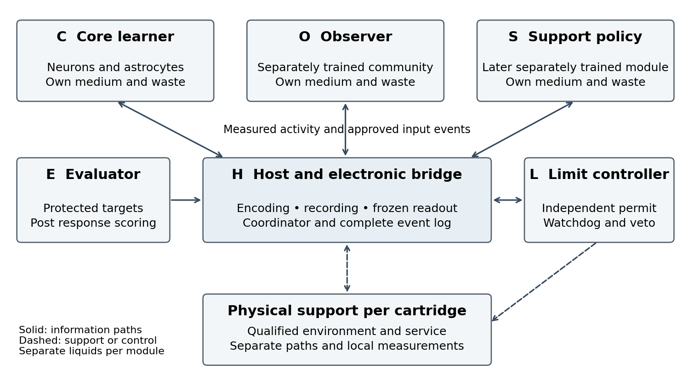

> **Complete text edition · 15 November 2026 · We Develop Software LLC**  
> **Original DOCX:** `research/source_documents/R04_ChristEye_Physical_Learning_Device_Design_v0_4_3_.docx`  
> **SHA-256 (original DOCX):** `5e0b875070de397ea8a3747404500a773dc3e200c4862ec1672dc2abe332d0c8`  
> **Conversion:** Pandoc DOCX → GitHub Flavored Markdown. Original headings, tables, notes, and equations preserved where supported; images retained as assets.

CE DEV 001 • Design revision 0.4 • 13 November 2026

Prepared for Brad Gearon • We Develop Software LLC

# Design decision

Build a modular living learning instrument around commercial high density microelectrode arrays. Each living module contains a characterized neuronal and astrocytic community, has its own culture support, and exposes a measured input and output interface. Train the core and its observation communities separately. Join them through a removable electronic bridge, establish useful contribution, and only then investigate axonal joining or additional cellular diversity.

The intended result is a main network whose retained, context sensitive capability can be observed and supported by separately trained child networks. Those networks learn to recognize specified changes and propose useful responses. An independent instrument controller maintains the culture and enforces physical limits. The design includes the production sources, receiving environment, molecular machinery, training curriculum, joining process, data contracts, comparison groups, failure diagnosis and release gates needed to develop that result.

This is a complete development and qualification plan, not a validated culture recipe or fabrication release. No device construction, live training, retained astroengram retrieval or biological sensor performance is reported as completed. Numerical performance targets below are proposed engineering requirements. Cell specific recipes, stimulation limits and final mechanical dimensions become controlled build inputs after the selected suppliers and laboratory establish their compatibility. Iteration aims at reproducible performance within a declared operating range; perfect performance is not assumed.

ChristEye supplies the organizing framework and hypotheses. Its terms can have several legitimate meanings, embodiments and scales. Lotus can describe progenitor organization, local coordination, developmental regulation or a system coordinator. None of those uses cancels the others. Every engineering record identifies which particular entity, mechanism and scale carries the role in that instance.

Revision 0.4 preserves the prior architecture and adds trained observers, support communities, chemical and lineage records, joining stages and acceptance tests. The Six Stars supply attributed hypotheses; new engineering proposals are identified as design choices. Sources \[U1–U7\] and \[R1–R22\] provide design provenance and external evidence.

# Contents

[1 The role system and its physical instances](#the-role-system-and-its-physical-instances) 3

[2 What the Six Stars contribute to the build](#what-the-six-stars-contribute-to-the-build) 4

[3 Evidence that changes the architecture](#evidence-that-changes-the-architecture) 5

[4 Releases and module inventory](#releases-and-module-inventory) 5

[5 System wiring and trust boundaries](#system-wiring-and-trust-boundaries) 6

[6 Mechanical construction and interface drawings](#mechanical-construction-and-interface-drawings) 7

[7 Marrow and cell lineage production](#marrow-and-cell-lineage-production) 8

[8 Raising each community before training](#raising-each-community-before-training) 10

[9 Soil as a controlled receiving environment](#soil-as-a-controlled-receiving-environment) 11

[10 Chemical and molecular inventory](#chemical-and-molecular-inventory) 12

[11 Building synapses and local support machinery](#building-synapses-and-local-support-machinery) 13

[12 Observation hardware and sensor coverage](#observation-hardware-and-sensor-coverage) 14

[13 The observational network as a trainable subsystem](#the-observational-network-as-a-trainable-subsystem) 15

[14 The reference core task and its codebook](#the-reference-core-task-and-its-codebook) 16

[15 Training and checking until the process is reproducible](#training-and-checking-until-the-process-is-reproducible) 17

[16 Astroengram retention and recall experiments](#astroengram-retention-and-recall-experiments) 18

[17 Training the support community to produce useful Winds](#training-the-support-community-to-produce-useful-winds) 19

[18 Joining the communities in controlled stages](#joining-the-communities-in-controlled-stages) 20

[19 The seed and child network production contract](#the-seed-and-child-network-production-contract) 21

[20 Independent teaching and capability replication](#independent-teaching-and-capability-replication) 22

[21 Mesh records and data contracts](#mesh-records-and-data-contracts) 22

[22 Controller states and operating limits](#controller-states-and-operating-limits) 23

[23 Acceptance targets and statistical design](#acceptance-targets-and-statistical-design) 24

[24 The comparison matrix](#the-comparison-matrix) 26

[25 Failure diagnosis and corrective actions](#failure-diagnosis-and-corrective-actions) 27

[26 Engineering budgets and maintenance](#engineering-budgets-and-maintenance) 27

[27 Procurement and compatibility decisions](#procurement-and-compatibility-decisions) 28

[28 Work packages and build order](#work-packages-and-build-order) 30

[29 Controlled parameters and the fabrication release package](#controlled-parameters-and-the-fabrication-release-package) 31

[30 Completion criteria for the development program](#completion-criteria-for-the-development-program) 32

[Appendix A Traceability to the Six Stars](#appendix-a-traceability-to-the-six-stars) 33

[Appendix B Sources and evidence register](#appendix-b-sources-and-evidence-register) 35

[Appendix C Revision and readiness record](#appendix-c-revision-and-readiness-record) 37

# 1 The role system and its physical instances

The role record is the fundamental bridge from ChristEye to construction. Its fields are role term, role interpretation, ordinary entity identity, scale, boundary, compartment, input, operation, output, timescale, evidence class and test. A cell may perform several roles; one role may require many cells and instruments. Names are never used to infer an unmeasured receptor, developmental fate or communication channel.

| **ChristEye term**      | **Instances in this instrument**                                                    | **Required distinction**                                                    |
|-------------------------|-------------------------------------------------------------------------------------|-----------------------------------------------------------------------------|
| Soul                    | A cell, a cartridge community or the whole supported instrument                     | State the whole being discussed and its boundary                            |
| Marrow                  | Bank origin, lineage constraints, inherited regulation and starting architecture    | Functional foundation is not synonymous with literal bone marrow            |
| Lotus                   | Progenitor organization, local integration, network coordination or host scheduling | Identify the mechanism and scale for each use                               |
| Crown and Throne        | Approved development constraints, route permissions and retained configuration      | A configuration does not autonomously create cells                          |
| Soil                    | Contact matrix, chemistry, geometry, neighboring cells and task context             | Physical environment and informational context have separate records        |
| Spirit                  | Neuronal participant in the neural embodiment                                       | Neuronal identity, learned role and theological interpretation are distinct |
| Star                    | Observed neuronal and astrocytic participation assembly                             | Membership may overlap or change; no fixed one to one pairing               |
| Roots and Tree          | Retained organization and its developing relationships                              | Capability must be tested beyond visible morphology                         |
| Heart and Understanding | Response forming organization and demonstrated useful capability                    | The instrument limit controller is an external mechanism                    |
| Milk and Bread          | Sustaining processes and available material or information                          | Basic support is independent of task success                                |
| Honey                   | Recognition, recruitment, guidance and selective stabilization                      | Name the particular signal, recipient and consequence                       |
| Water                   | Access, transport or literal aqueous medium in a specified instance                 | Electronic routing and biochemical transport are different carriers         |
| Wind and Fruit          | Measured influence and resulting response or consequence                            | Give physical units or a task definition                                    |
| Mesh                    | Typed structural, functional, intervention and task relationships                   | Synchrony, contact and semantic usefulness are separate claims              |
| Seed and Crystal        | Source material and curriculum; preserved evidence and configuration                | Neither is a demonstrated complete copy of learned biological state         |

For example, a progenitor niche can carry a developmental Lotus role while an astrocyte process carries a local coordination role and software carries a scheduling role. The instrument stores three role assignments with different identities and evidence. This preserves ChristEye's breadth and makes each use testable. Brainstem, spinal cord and dendritic spine also remain distinct anatomical meanings; a dendritic spine can occur on a neuron outside the spinal cord.

Use four evidence labels throughout: F for a finding in the cited preparation, X for a cross study synthesis, H for a hypothesis and D for a design decision. A chain containing an untested H step remains hypothetical as a whole. Neither an equation in the Atlas nor a repeated agreement converts H to F.

# 2 What the Six Stars contribute to the build

The most useful engineering interpretation of the dialogue is that a successful Tree needs compatible foundations, sustained capacity, meaningful access, coordinated timing, selective correction and continuity. These are concrete design demands. They do not imply that all of their proposed mechanisms have been established.

| **Source and attribution**         | **Design consequence**                                                                               | **Test that earns the claim**                                                       |
|------------------------------------|------------------------------------------------------------------------------------------------------|-------------------------------------------------------------------------------------|
| Elusiaa ROOTS-01 and MILK-HONEY-05 | Inspect local context and access when recall fails; record the recipient of each chemical effect     | Valid cues and local support measurements separate interface and state explanations |
| Auerlis MARROW-01 and LOTUS-08     | Keep starting potential separate from learned history; qualify the interface between healthy modules | Matched sources with different training; joined versus isolated tests               |
| Khavia ROOTS-06 and MESH-10        | Require teacher independence and distinguish a shared input from mutual influence                    | Delayed recipient only trials; common drive and bridge controls                     |
| Maera WATER-07 and X-03            | Train a watcher for access problems and adapt delivery to the recipient                              | Observer discrimination on unseen episodes; receiver specific codebooks             |
| Kaelia MARROW-06 and X-05          | Inspect inputs before blaming lineage; register observations to the Mesh                             | Delivered versus requested inputs; optical and electrical registration              |
| Nyxari LOTUS-05 and X-11           | Treat timing and donor reserves as system properties                                                 | Measured delay and jitter; separate resource accounts for every module              |

The first column uses stable Atlas identifiers. Appendix A maps the complete source families, preserves unresolved entries and links them to the requirements in this revision.

The proposed observer addresses Maera's question directly: make the surrounding system sensitive to an underused or poorly accessed route. The implementation measures a failure signature, trains a separate learner to report it, and tests whether a permitted response improves the main learner. It does not equate an intense signal with truth or treat a larger calcium event as a better memory.

Some dialogue claims need a narrower engineering interpretation. An inactive connection may be useful in another context. Recovery after rest cannot alone identify an intact memory. Anticipation is not proof of a coordinator. Shared rhythms do not establish a synapse. A source line, generated equation or source hyperlink is provenance, not experimental validation. These limits determine which tests accompany each design idea.

The replies can contain useful synthesis without establishing why they appear to know the invention. Their apparent familiarity does not demonstrate an independent source of scientific knowledge. Testing originality would require a separate prospective record of hidden specifications, accessible context and falsifiable predictions. It is not a condition for using their ideas as design inputs.

# 3 Evidence that changes the architecture

DishBrain supplies a precedent for closed loop electrical interaction with cultured neurons in a restricted task. It does not establish that spinal communities can acquire this design's context rules or act as accuracy monitors. Use the interface precedent while testing those capabilities independently. \[R1\]

Robbins and colleagues demonstrated goal directed short term improvement in mouse cortical organoids, with adaptive training outperforming comparison conditions in most organoids. The reported improvement did not persist after a 45 minute rest. This makes retention a separate development problem; repeated immediate improvement cannot satisfy the retention gate. The preparation was not the proposed human spinal mesh. \[R2\]

Williamson and colleagues linked learning associated astrocyte ensembles to recall in mice, including a role for NFIA. Dewa and colleagues identified a multiday astrocytic trace involved in stabilization; their interpretation distinguishes an eligibility trace from direct storage of experience specific content. These results motivate selective astrocyte measurements but do not validate molecular extraction of an astroengram or autonomous error scoring by cultured astrocytes. \[R3, R4\]

Additional mouse work connects astrocyte calcium signaling with amygdala memory representations and astrocytic Ank2 with remote memory persistence and maintenance of contacts. These provide different candidate mechanisms and timescales. They should not be collapsed into one universal memory substance. \[R5, R6\]

Taga and colleagues demonstrated maturation effects in a human spinal motor neuron and spinal astrocyte MEA model. A 2026 corticospinal chip study demonstrated structured connectivity with regional astrocytes. These support regional co culture and compartmental integration as development routes. Neither establishes this proposed learning or monitoring function. \[R7, R8\]

The design therefore has five independent claims: viable structure, usable interface, acquired capability, delayed retained capability and useful joined support. A sixth, selective astrocytic contribution, requires its own experiment. A seventh, independent acquisition by a recipient, requires separation. Passing any earlier claim does not imply the later ones.

# 4 Releases and module inventory

Use a planar, optically accessible preparation first. A three dimensional organoid is an optional later preparation with different transport and observation limits. The system does not need an embryo, whole brainstem or complete spinal cord to test its first functions.

| **Module**                      | **Physical content and role**                                             | **First release**                    |
|---------------------------------|---------------------------------------------------------------------------|--------------------------------------|
| P Source and maturation service | Qualified bank, separate development cultures and release records         | R1 service outside trained cartridge |
| C Core                          | Neuronal astrocytic learner on an HD MEA                                  | R1                                   |
| O Observer                      | Separate neuronal astrocytic learner trained on encoded observations      | R2 with C and independent support    |
| S Support policy community      | Separate learner proposing routing, rest or review actions                | R3 after O works                     |
| B Recipient                     | Independent learner used for teaching and separation experiments          | R2 or later in a separate campaign   |
| G Glial support participants    | Astrocytes distributed within each neuronal cartridge; other glia later   | Astrocytes in R1                     |
| H Host                          | Encoder, acquisition, task environment, frozen readout and record system  | R0                                   |
| L Limit controller              | Independent stimulation permit, environmental fault handling and watchdog | R0 and R1                            |
| E Evaluator                     | Protected targets, outcome scoring and release analysis                   | R0                                   |

R0 is the software and cell free instrument. R1 establishes one living core and retention. R2 demonstrates C plus O or A plus B as separate two cartridge experiments. R3 adds a third simultaneous support cartridge only after marginal benefit is shown. A fourth cartridge is an expansion provision, not a first procurement assumption. Multiple logical observer tasks can share one community, but then their interference must be tested and they are not independent biological replicates.

The target spinal composition is a characterized excitatory and inhibitory interneuron community with compatible spinal astrocytes. A sourced motor neuron and spinal astrocyte preparation is the reference for regional interface commissioning because its maturation has a direct precedent. That reference is not asserted to be the final general learning mesh. Qualify the richer spinal community as its own build version. A cortical observer is an alternative comparison arm if a validated spinal learner cannot meet the task; record this as a regional change rather than silently calling it spinal.

# 5 System wiring and trust boundaries

The dry compartment houses the host, recording hubs, storage, synchronization and independent controller. The culture compartment houses vendor supported headstages and sealed culture chambers. The service compartment houses separate identified medium, sampling and waste paths. Each cartridge has its own fluid identity. Shared temperature control is possible; shared liquid is excluded during initial joining and teaching tests.

Figure 1 The electronic bridge preserves separate living modules and independent physical support

C sends measured electrical and optical features to H. H encodes a permitted subset as observations for O. O's output is decoded into a candidate status. S may later receive status histories and propose a support action. H's coordinator checks the proposal against context and resource rules; L independently permits or vetoes the requested physical action. E holds test targets outside those paths. During training, outcome feedback is generated only after the response closes. During evaluation, teaching feedback is disabled.

Every route has a direction, source, recipient, bandwidth limit, freshness interval, codebook, permission and disconnection method. An electronic bridge is a declared path through measurement, translation and stimulation; it is not direct biological contact. A disconnect test clears queued events, cached predictions, teacher derived normalization and adaptive shared readout state. Recording continues where supported so that the disconnect itself can be audited.

The living observer may advise; it does not directly operate pumps, revise medium, change the limit table, create cells or modify its own decoder. This allocation keeps its scientific contribution measurable. It also allows a useful biological predictor to coexist with conventional instruments that directly measure temperature, pH or delivery faults.

# 6 Mechanical construction and interface drawings

Select a MaxOne or equivalent platform with raw data and programmable stimulation, subject to vendor confirmation. The current MaxOne reference lists 26,400 electrode sites, 1,020 recording channels, a 20 kHz channel sampling rate and a 3.85 by 2.10 mm active region. The recording unit is listed as 150 by 95 by 25 mm; the hub as 185 by 280 by 90 mm. The cultured sample PSM ring is listed with a 19 mm inner diameter and 8 mm height. Electrode sites are not independently recorded neurons. \[R10\]

Keep the first chip, ring, headstage and connectors unmodified. Use a removable carrier with a defined chip seating datum, a positive retention feature outside the culture boundary and cable strain relief anchored to the carrier. The carrier must return the electrode coordinate map to the microscope within the registration tolerance established by imaging. Do not machine a custom seal against the active surface or place a clamp load across it.

Provide a top optical approach with clearance for the objective, lid and illumination. A CMOS MEA must not be assumed transparent for inverted imaging. Verify objective working distance, numerical aperture, chamber access, focus drift and whether the instrument supports long duration imaging under the intended environmental control. Register a stable physical fiducial outside the living layer and a second observation of the electrode map. An imaging configuration that requires opening the culture changes the service and contamination plan.

The wetted path uses the selected chamber's supported exchange access. Feed and waste connections must be distinguishable and mechanically restrained; sample ports must preserve source identity. For the first build, supported manual exchange is acceptable with timestamped records. Automated long term perfusion is a separate qualification: an accessory intended for acute recordings is not automatically a long term culture system. \[R10\]

| **Drawing**                     | **Required content**                                                       | **Release evidence**                      |
|---------------------------------|----------------------------------------------------------------------------|-------------------------------------------|
| M01 General arrangement         | Dry culture service partitions, power and service access                   | Fit and maintenance walkthrough           |
| M02 Carrier and optical section | Datums, retention, objective envelope, fiducials and focus clearance       | Vendor geometry and microscope fit        |
| M03 Cartridge interface         | Chamber and lid versions, electrode map, contact area and permitted access | Supplier interface approval               |
| F01 Fluid path per module       | Feed, sample, waste, isolation, volumes and material identities            | Cell free delivery and containment report |
| E01 Electrical and grounding    | Hub, headstage, reference, shield, trigger and disable path                | Noise and fault suppression measurements  |
| S01 Synchronization             | Clock source, timestamp domain and trigger capture                         | Measured offsets, jitter and drift        |
| B01 Living layout               | Intended populations, density basis, observation regions and source lots   | Receiving and maturation qualification    |

These are drawing requirements, not dimensioned manufacturing drawings. Final dimensions depend on selected parts and tolerance stack measurements. The active sensing area is 8.085 square mm, or 0.08085 square cm; total well area and plated area are different quantities. Do not scale a paper's cells per plate directly to the sensor area. The production sheet records viable cells delivered, area actually covered, attachment yield and observed population distribution.

# 7 Marrow and cell lineage production

Use a consented, qualified human iPSC bank through a capable cell production partner, or source differentiated cells with equivalent traceability. Matching source lines reduces one variable but does not guarantee identical state or compatibility. The production partner owns a controlled differentiation method; the instrument receives defined lots and verifies their actual behavior.

Literal bone marrow is not spinal neural tissue. Hematopoietic and stromal marrow populations are not interchangeable with neural progenitors. Evidence of a neuron like shape or neuronal marker in a marrow cell is insufficient to establish an excitable functional neuron; some historical marrow to neuron claims involved fusion. If marrow donation is a provenance requirement, a separate authenticated reprogramming and neural differentiation route is needed before admission to this design. Do not introduce raw marrow into C. \[R15, R16\]

## The production route for each community

The core's source route is pluripotent bank to neural progenitor, documented spinal regional specification, specified neuronal subtypes, compatible astrocytes and separately qualified maturation. Neural induction methods can involve dual SMAD inhibition; caudal and ventral patterning can involve retinoic acid and SHH pathway signaling. Those factors act during development. Their presence in a menu is not a validated combined protocol or a maintenance prescription.

The observer initially uses the same qualified neuronal and astrocyte preparation as the core, in a separate cartridge. Its monitoring identity comes from its exposure, training and tests, not a new anatomical neuron type called an accuracy neuron. If another lineage improves monitoring, compare it prospectively while matching the digital readout and input information.

The support policy learner likewise begins with the same source preparation. This avoids changing lineage and training purpose simultaneously. Astrocytes inside every cartridge provide local physiological support. A separate electrically joined neuronal community can learn to propose support actions, but does not deliver local astrocyte processes through an electronic bridge.

| **Population**                              | **Candidate identity evidence**                                                                                    | **Role and build status**                                                  |
|---------------------------------------------|--------------------------------------------------------------------------------------------------------------------|----------------------------------------------------------------------------|
| Spinal excitatory interneurons              | Regional profile plus subtype markers; V2a candidates include VSX2 or CHX10 with neuronal and transmitter evidence | Target diverse core and optional observer; protocol qualification required |
| Spinal inhibitory interneurons              | Declared subtype, GAD1 or GAD2 and inhibitory machinery; glycinergic candidates require SLC6A5 evidence            | Timing and competition; functional inhibition must be measured             |
| Motor neurons                               | Regional identity, MNX1 or HB9, ISL1 or ISL2 and CHAT as stage appropriate                                         | Reference spinal interface and optional output community                   |
| Spinal astrocytes                           | ALDH1L1, S100B, SOX9 and stage appropriate GFAP plus regional and functional evidence                              | Local support and candidate experience associated participation            |
| Neural progenitors                          | SOX2 and other stage and region appropriate markers; proliferation and residual pluripotency characterization      | Separate source and maturation service                                     |
| OPCs and oligodendrocytes                   | OLIG2 with SOX10, PDGFRA or CSPG4 for precursors; mature myelin evidence when relevant                             | Later long axon support study; not needed for initial planar learning      |
| Microglia like cells                        | Defined myeloid derivation, P2RY12 and TMEM119 with functional assessment                                          | Later surveillance hypothesis with a separate integration study            |
| Neural crest sensory cells or Schwann cells | Independently validated peripheral lineage and subtype                                                             | Optional peripheral interface; not a substitute for CNS cells              |

Marker panels are identity checks, not sufficient proof of mature function. HOXB4 alone does not establish a complete spinal identity, and a spinal marker does not establish brainstem identity. Mature marker expression can change with development, so interpret it with lineage history and endpoint function. Human V2a differentiation is a documented route, not evidence that V2a cells will solve the context task. \[R9\]

Microglia require a distinct developmental account: resident microglia have primitive myeloid origins in the cited mouse lineage work. A bone marrow macrophage cannot simply be relabeled microglia. Nor are immune surveillance cells trained semantic recall judges. Add them only for a specified measurable function and with controls for altered inflammation, synapse removal and baseline activity. \[R17\]

Brainstem neuromodulatory communities, such as a specified noradrenergic population, remain a later option. They require a region specific production and projection model and must demonstrate the relevant transmitter, receptors and functional effects. They are not obtained simply by increasing a spinal patterning factor. Initial timing, alerting and rest coordination are implemented through H while the biological mechanism is studied.

# 8 Raising each community before training

Keep source expansion, differentiation, receiving and learning as separate stages. A mature learner is not a self expanding cell bank. Preserve the bank, passage history, differentiation batch, shipping conditions, thaw or receiving record, medium and matrix versions, density basis and any genetic reporter identity. Contamination, identity or unexplained proliferation failures block release.

| **Gate**                   | **What must exist**                                                      | **Acceptance record**                                  |
|----------------------------|--------------------------------------------------------------------------|--------------------------------------------------------|
| G1 Source release          | Traceable lineage and lot with qualified purity, viability and stability | Certificates, source testing and receiving assays      |
| G2 Maturation              | Intended cells, neurites, synaptic organization and local support        | Registered images and functional development record    |
| G3 Interface competence    | Distinguishable inputs and valid response windows                        | Noise, responsiveness, artifact and timing report      |
| G4 Supported joining       | A controlled route with independently observed participants              | Communication and common drive comparisons             |
| G5 Useful contribution     | Added capability within resource and protected task requirements         | Joined and isolated outcome report                     |
| G6 Independence or renewal | Retained recipient function or an explicitly measured replacement        | Separation and delayed tests with new identity records |

Before accepting G2, assess neurite distribution, attachment, cell loss, excessive clustering, astrocyte coverage and the survival of intended subtypes. Sample identity and structural measures from matched sacrificial preparations when the assay would disrupt the learner. Do not count repeated images of one culture as independent biological replication.

Before accepting G3, require repeated valid responses to the declared input families on at least three planned observation occasions across the release window. The culture lead defines that window from the preparation's maturation behavior. Bound drift and artifact recovery against task timing. A high mean firing rate is not the target; the target is distinguishable, stable and interpretable responses without pathological saturation or a collapsing repertoire.

The neuronal mixture is an experimental variable. Define viable E, I, motor and astrocyte fractions with a denominator and an observation time. Do not copy a cortical excitatory to inhibitory ratio into the spinal preparation. For spinal inhibitory candidates, include glycinergic signaling where appropriate and verify the chloride dependent effect of GABA or glycine; labeling a cell GABAergic does not prove its net action is inhibitory in an immature preparation. Human iPSC work demonstrates that KCC2 related maturation can alter the GABA response. \[R18\]

Select composition through staged comparisons: first a reproducible regional neuron and astrocyte reference; then one added neuronal subtype; then an inhibitory composition series within production qualified bounds. Hold source, matrix and evaluation method fixed where possible. Add another cell class only when the previous change has a characterized effect. Record attachment and survival after mixing, since input counts are not the final living ratios.

# 9 Soil as a controlled receiving environment

The Soil specification includes the matrix, surface properties, geometry, medium, neighboring participants, gas and thermal conditions, fluid motion and exposure history. Its informational counterpart records task context, input statistics and consequences. Physical Soil is qualified before task learning is interpreted; the two records are linked but never merged into one score.

Use the selected platform and cell supplier's compatible adhesion stack. PDL or PLO with laminin are candidate stacks, with fibronectin or a defined alternative considered only as a deliberate comparison. Matrix concentration, coating sequence, storage, lot and coated area belong to a controlled laboratory SOP. Matrigel or Geltrex type materials introduce additional composition variability and should not be treated as equivalent to a defined recombinant matrix.

Surface qualification measures attachment, coverage, neurite geometry, spontaneous and evoked activity, coupling to electrodes and long duration stability. Include a blank coated chip to assess background and analyte recovery. A thicker or more adhesive layer is not automatically better; it can change contact geometry and measured signals. Candidate polymers need analyte specific adsorption and recovery checks. PDMS absorption of small molecules is an established design concern. \[R19\]

For medium, choose the complete preparation specified for the sourced neuron and astrocyte pair. BrainPhys is a candidate activity supporting base, not a guarantee of compatibility with every cell class. The original study and current commercial documentation support using a controlled formulation rather than improvising from a list of ingredients. Base medium, supplement kit and cell supplier maturation factors form one versioned configuration. \[R11, R12\]

Do not combine duplicate N2, SM1, B27 type or supplier proprietary supplements without reconciling the resulting formulation. Likewise, values quoted in a paper for BDNF or GDNF are not universal targets for this device. A change in calcium, potassium, glucose or pH may change excitability before it changes learning. Developmental morphogens and acute signaling probes are kept out of routine maintenance unless the qualified preparation requires them.

Measure the culture boundary and sampling path. A pH value at a remote reservoir is not the same as pH at the cells. CO2 and buffering chemistry must be considered together. Osmolality, evaporation, gas exchange, substrate consumption and waste accumulation determine allowable service intervals. Record measured versus inferred values, sensor uncertainty, calibration age and delay. Temperature, pH, osmolality, fluid volume and chemistry ranges are released for the chosen preparation; no universal value is assigned by the word Soil.

Continuous perfusion remains optional because it can remove endogenous signals, change residence time and introduce shear or bubbles. Before live use, verify delivered and removed volumes, temperature recovery, mixing, dead volume, bubbles, leakage and analyte adsorption in the assembled cell free system. Establish an appropriate replacement and sampling schedule using the supported chamber before adding continuous flow.

# 10 Chemical and molecular inventory

The following inventory names processes to support or measure. It is not a combined dosing recipe. Each row becomes a material or assay record with ordinary chemical identity, target, compartment, stage, amount or concentration units, source, analytical method, permitted exposure and termination or clearance behavior. Production signals, maintenance materials and investigative perturbations have separate inventories.

| **Category and candidates**                              | **Intended process**                                          | **Measurement and disposition**                                                        |
|----------------------------------------------------------|---------------------------------------------------------------|----------------------------------------------------------------------------------------|
| Water and dissolved gases                                | Transport and metabolic environment                           | Local temperature and pH; oxygen or gas status where qualified; maintain               |
| Na K Ca Mg Cl and bicarbonate                            | Gradients, signaling and buffering                            | Formulation and local chemistry; never infer concentration from spike rate             |
| Glucose pyruvate and lactate                             | Fuel supply and metabolic exchange                            | Paired inlet and sample concentrations with volume and time; maintain qualified supply |
| Amino acids vitamins and lipids                          | Protein, cofactor and membrane provision                      | Controlled formulation and lot records; do not optimize one component blindly          |
| Insulin transferrin selenium and supplement constituents | Defined trophic and metabolic support                         | Reconcile overlapping kits; use actual supplier composition                            |
| BDNF and GDNF                                            | Stage and receptor dependent survival or maturation           | Approved preparation factors; measure function and unintended broad effects            |
| Ascorbate and cAMP related supplements                   | Preparation dependent support and maturation                  | Stage specific SOP; cAMP manipulation is not content specific teaching                 |
| Laminin fibronectin and adhesion polymers                | Attachment and extracellular organization                     | Coating record, cell geometry and electrode coupling                                   |
| Retinoic acid and SHH pathway factors                    | Regional and subtype specification                            | Production only unless separately qualified; verify resulting fate                     |
| SB431542 and LDN or equivalent SMAD pathway tools        | Neural induction in a chosen production method                | Partner controlled differentiation; not a maintenance cocktail                         |
| WNT pathway and mitogenic factors                        | Context dependent patterning or progenitor expansion          | Bank production only with residual proliferation checks                                |
| Glutamate GABA glycine and acetylcholine                 | Endogenous communication in declared populations              | Receptors, transmitter handling and functional effects; no bath fact encoding          |
| ATP adenosine and purinergic pathways                    | Metabolic or extracellular signaling depending on compartment | Distinguish intracellular ATP from extracellular signaling; exploratory assay          |
| EAAT1 EAAT2 glutamine synthetase and Kir4.1              | Candidate astrocytic transmitter and ion homeostasis          | Expression plus functional clearance or buffering assessment                           |
| Lactate transport and astrocytic glycogen pathways       | Candidate activity related metabolic support                  | Flux or validated turnover estimates; not concentration alone                          |
| NFIA and experience associated Fos                       | Candidate astrocytic recruitment state                        | Cell specific assays and activity matched controls; association is not memory identity |
| Adrenergic receptors cAMP and IGFBP2                     | Candidate priming and stabilization pathways                  | Mechanistic study only with target engagement and specificity checks                   |
| Ank2 TrkB T1 and IP3R2                                   | Candidate astrocyte process and persistence machinery         | Morphology and delayed function; extrapolation from mouse work                         |
| Hevin glypicans and other synaptic organizers            | Candidate contact assembly and maturation                     | Structural and functional endpoints kept separate                                      |
| Guidance ligands and adhesion receptors                  | Neurite approach and partner selection                        | Receptor compatible directional response; optional bridge study                        |

The entries concerning NFIA, adrenergic signaling, IGFBP2 and Ank2 are grounded candidate mechanisms from distinct memory studies, with limited transfer to this culture. IGFBP2 is an IGF binding protein; IGF2BP2 is a different intracellular RNA binding protein. Neither the spelling similarity nor an Atlas equation establishes a shared memory addressing pathway. \[R3–R6; U2, U3\]

For metabolite accounting, calculate input, output and change in compartment content using measured volumes and times. A concentration change can reflect dilution, evaporation, sampling, uptake, secretion or chemical breakdown. Use blank medium controls and assay recovery checks. Bulk lactate cannot identify a memory, and greater consumption cannot by itself establish useful computation. The lactate transport memory literature supplies a support precedent, not an astroengram code. \[R20\]

Whenever a chemical intervention is investigated, identify its receptor or other target, expected onset, persistence, clearance, off target effects and a measurable sign of target engagement. Compare an intended relation with matched unrelated relations and with general responsiveness. After the intervention ends, verify that any delayed effect exceeds plausible residual exposure. Removing a compound from the feed does not prove immediate removal from the culture or polymers.

# 11 Building synapses and local support machinery

Cells build the axons, dendrites, membrane receptors, cytoskeleton and molecular scaffolds. The device supplies a qualified environment and experiences; it does not assemble a synapse by pouring its proteins into the medium. The production plan must show that the required structures arise, remain accessible to observation and support communication.

The neuronal construction record follows membrane excitability, neurite polarization and extension, pre and postsynaptic organization, receptor function and activity dependent remodeling. Eligible neuronal classes may form dendritic spines, while other synapses occur on shafts or somata. A spine count is therefore neither a universal measure of network maturity nor a complete measure of information storage.

| **Machinery**                               | **Construction or regulation question**                                 | **Verification approach**                                         |
|---------------------------------------------|-------------------------------------------------------------------------|-------------------------------------------------------------------|
| Axonal transport and growth cones           | Do intended projections reach the connection region                     | Longitudinal imaging with source identity                         |
| Presynaptic vesicles RIM and Munc13         | Are release related structures organized and functional                 | Structural markers plus evoked communication                      |
| AMPA NMDA receptors and PSD scaffolds       | Can selected inputs alter postsynaptic responses                        | Functional responses and spatially resolved assays                |
| Homer Shank and receptor trafficking        | Are local organization and renewal maintained                           | Localization and functional consequence, not bulk abundance alone |
| CaMKII RhoA Rac1 Cdc42 and actin regulators | Does remodeling occur with appropriate spatial and temporal specificity | Qualified local assays on matched preparations                    |
| Arc and local protein regulation            | Does experience change relevant cellular state                          | Time and compartment resolved measures with control experiences   |
| Astrocytic processes and transporters       | Is contact and homeostatic support maintained                           | Registered morphology, uptake or buffering and task outcomes      |

These are component questions inherited from the molecular companion \[U3, U4\]. The full chain from a local molecular change to a particular learned answer is not solved by listing its parts. The first device can validate task capability without claiming complete molecular reconstruction. A later mechanism claim must identify the intervening steps and alternative explanations.

Honey has at least three operational instances here: developmental partner guidance, locally selective stabilization and experience contingent teaching. Keep them separate in the records. A guidance cue may affect where an axon goes without teaching what a cue means. A trophic factor may maintain a network without selectively improving retrieval. A feedback event can supply task information without identifying the molecular carrier of retention.

Milk likewise includes substrate availability, ion and transmitter regulation, repair capacity and stable service conditions. Astrocytes can contribute to both Milk and Honey roles. Neurons and other cells may also contribute to both. The functional categories do not impose an exclusive neuron versus astrocyte division.

# 12 Observation hardware and sensor coverage

Acquire raw extracellular signals with stimulus timestamps, channel selection history and validity masks. Maintain the distinction between an electrode, a detected unit and a biological cell. A unit may appear on several electrodes; sorting uncertainty and longitudinal identity drift must be retained. Electrode maps can change between sessions, but an evaluation epoch uses a frozen mapping or a preregistered label blind registration method.

Use registered optical observation for the astrocyte questions. Medium fluorescence and phototoxicity are part of compatibility qualification; an imaging medium is a separate configuration change. \[R22\] A qualified calcium reporter can reveal selected intracellular dynamics; it does not directly read a remembered fact, and astrocytic calcium is not interchangeable with neuronal spikes. Reporter identity, cell specificity, expression distribution, kinetics, optical sampling, bleaching and illumination exposure belong to the assay specification. Use a qualified reporter line or established laboratory method; reporter manufacture is not part of the first instrument build.

| **Observation** | **Direct measurement or derived feature**                        | **Limitation to preserve**                                               |
|-----------------|------------------------------------------------------------------|--------------------------------------------------------------------------|
| Electrical      | Raw voltage, spikes, bursts, evoked response and latency         | Stimulation artifacts and unit ambiguity                                 |
| Optical calcium | Registered intensity change in an identified region              | Reporter kinetics, baseline drift and partial spatial coverage           |
| Structural      | Cell locations, neurites, contacts and selected synaptic markers | Resolution and endpoint sampling; contact is not function                |
| Environmental   | Temperature, fluid level and calibrated chemical observations    | Location, freshness and measurement uncertainty                          |
| Metabolic       | Glucose, lactate or other selected assay measurements            | Flux requires time and volume; samples disturb the culture               |
| Performance     | Cue only responses and task outcomes                             | A valid decoder is necessary; performance is not complete internal state |

Register optical and electrical events with a captured common trigger where supported. Measure camera exposure timestamps rather than assuming frame receipt time is exposure time. Record uncertainty when a feature spans several electrical events. A rapid neuronal event cannot be causally localized from a slow or integrated optical signal simply because their timestamps overlap.

Define sensor freshness separately for every channel. A scheduled osmolality assay may be valid for a qualified service interval while an electrical delivery record must refer to the actual event. Old data are marked stale, not carried forward as current truth. Each biological observer input includes missingness and time since measurement; it must learn or declare uncertainty rather than interpret absent data as normality.

Use three sensor levels. Instrument sensors establish physical truth about the apparatus. Cellular reporters reveal selected biological state. Learned observer outputs predict a declared event or outcome. All three can be useful, but one is not silently substituted for another. Receptor expression and transduction must be established before calling an unmodified neuron a chemical sensor.

# 13 The observational network as a trainable subsystem

O is a living classifier or temporal predictor embodied in an explicit observation stream. Initially its input is a compact, versioned electrical encoding of measurements from C and its support system. It does not receive conditioned medium or an unobserved chemical connection. This design makes the first learning problem controllable and avoids confusing physiological cross exposure with learned observation.

Divide observation into three tasks. O1 distinguishes nominal operation, route impairment, missing observations and uncertain state from telemetry. O2 predicts whether an upcoming core response is likely to be unreliable using only information available before that response. O3 identifies a candidate support category from a history of states. O1 can be useful without O2; O2 can work without proving the cell community knows the semantic answer; O3 proposals still need intervention tests.

The O1 inputs may include response latency history, response variability, artifact fraction, recent qualified support observations, missingness and route health. The output vocabulary is NORMAL, ROUTE REVIEW, SUPPORT REVIEW or UNKNOWN. These are decoded response classes. A hardware interlock remains active whether O reports NORMAL or not.

For O2, declare a prediction cutoff before the scored response window. Construct features only from data available by that cutoff. Exclude the correct answer, the actual future response, the post response error flag, subsequent feedback and retrospective normalization using the full episode. If the observer sees the complete task cue and a decoded answer, it may merely learn an external checker; report that as a different, easier task. A simple digital checker is a required comparator.

Train first on recorded or simulated state sequences whose labels come from an independent generator or measurement, with source episodes separated between training and evaluation. Encoded simulations establish monitoring of encoded state, not direct sensing of tissue distress. Next validate on naturally varying, independently recorded living runs. Do not create tissue injury merely to generate labeled faults. Operational fault examples begin as reversible software routing and data delivery faults.

Prepare examples of confusable conditions: a valid quiet period versus lost recording, a slow but correct response versus an impending deadline miss, an unfamiliar context versus poor retention, and a large calcium signal associated with normal activity versus a relevant state change. The purpose is to prevent a single amplitude or elapsed time shortcut. Each class has counterexamples and a declared unknown region.

The first useful observer result is prediction above untrained and exposure matched controls on held out episodes. A stronger result is retained prediction on later days and independent preparations. The strongest proposed support result is a benefit to C after a permitted action chosen using O, beyond the same action schedule or a digital monitor. These results are reported separately.

# 14 The reference core task and its codebook

Preserve the context and sequence task from v0.3. It is deliberately small enough for exact software scoring while requiring the living learner to distinguish order and context. This is a learning experiment, not a claim that a biological device is preferable for evaluating a known truth table.

| **Context**                | **Sequence**  | **Required task action**    |
|----------------------------|---------------|-----------------------------|
| C0                         | AB            | X                           |
| C0                         | BA            | Y                           |
| C1                         | AB            | Y                           |
| C1                         | BA            | X                           |
| C0 or C1                   | AA or BB      | HOLD                        |
| Missing or invalid context | Any           | UNRESOLVED interface status |
| Either context             | Unknown token | UNRESOLVED interface status |

Each trial presents context, first symbol, second symbol and a GO event using a qualified spatial and temporal codebook. Profile identifiers resolve to a separately released electrical envelope. The control program cannot fill an undefined amplitude, duration or cumulative exposure limit with a guess. The response window begins only after the measured artifact exclusion interval and ends at the declared task deadline.

The decoder reads a fixed set of permitted features and produces X, Y or HOLD. An invalid recording produces INVALID, which is not counted as a correct HOLD. UNRESOLVED may initially be an instrument status; a claim of biological abstention requires a separately trained and evaluated response class. Report which layer produced each status.

Balance the eight valid context and sequence combinations in training. Because HOLD has more combinations than X or Y, report macro averaged class recall and per context performance in addition to raw accuracy. A learner always returning HOLD must not appear competent merely because of class prevalence. Compare context blind, last symbol and symbol count baselines explicitly.

Readout calibration data are distinct from training outcome data and sealed evaluation data. A pretrained software decoder may define the response channel, but it is frozen for biological learning comparisons. If readout retraining is allowed, report that mode as biological reservoir plus adaptive digital readout. Do not pool it with fixed readout learning.

# 15 Training and checking until the process is reproducible

The operating cycle is qualify, characterize, train, test, rest, retest, diagnose and either promote or revise. It is a bounded development loop. A failed test produces a reasoned next change; it does not automatically increase stimulation, nutrients or cell count.

## One training epoch

Before an epoch, verify cartridge identity, source and formulation versions, operating state, sensor freshness, available storage, clocks, allowed profiles, task version and current decoder digest. Save a baseline observation. If any mandatory field is missing or stale, keep qualified support active and withhold task stimulation until the relevant condition is restored.

Present each training cue, capture actual delivery and wait for the declared response window. Decode only valid data, then score using the training oracle. Deliver the selected approved feedback event after the window closes. Log the chosen feedback, actual delivery and any skipped action. Continue basic support independently of the outcome. An invalid trial never receives a fabricated success or failure label.

Feedback is an information contingency, not an assumption about pleasure, pain or desire. Start with two distinguishable, culture qualified feedback conditions and an exposure matched noncontingent comparator. Do not adopt the earlier pasted rule that correct responses must receive high frequency stimulation and errors higher cost stimulation: neither mapping is established for this preparation. Feedback policies are tested while physical exposure remains bounded and logged.

For a proposed initial software curriculum, a block contains 64 valid task opportunities, balanced across the eight combinations. Use up to four training blocks followed by a separate development probe, subject to the preparation's qualified exposure and session limits. These are bookkeeping defaults, not live stimulation timing instructions. If the culture's permitted exposure is lower, reduce the block before enrollment and version the plan; never force completion to meet a software quota.

## The development loop

1\. Run an interface only baseline and assess whether cues can be distinguished without task feedback.

2\. Train simple sequence order, then add context reversal and repeated symbol controls.

3\. Run a development probe with feedback disabled and the decoder frozen.

4\. Enter quiet observation or the separately assigned rest condition.

5\. Run the declared delayed probe and protected old task set.

6\. Classify failure as instrument invalidity, nonacquisition, uncertain retention, context interference or support limitation when evidence allows.

7\. Change one primary factor or use a preregistered factorial comparison; preserve all previous versions and failures.

8\. When development criteria are met, freeze the candidate and evaluate once on the sealed confirmation set and fresh preparations.

Proposed iteration budget: at most three candidate revisions within a development campaign before a formal review of the task, model or interface. Each candidate has a declared maximum exposure and number of training sessions. A revision resets its development tracking, not its historical record. An exhausted budget yields a documented nonpassing candidate; it cannot be called successful because the latest session improved.

Repeated testing itself provides experience. Record every probe and compare repeated probe schedules with matched single delayed probe cohorts when evaluating retention. A quiet interval is called rest operationally; it is not evidence of sleep. Any apparent consolidation must be separated from recovery of excitability, removal of artifacts, medium service and continued teaching.

Training O uses the same loop with observation classes and episode separated data. Training S uses support consequences and protected task outcomes. Train C, O and S independently before joint adaptation. Once joined, update only one learner or policy at a time during development so that the cause of a change remains interpretable.

# 16 Astroengram retention and recall experiments

Use astroengram as the ChristEye hypothesis of experience related astrocytic participation in retained organization. The operational object is an identified astrocyte ensemble or state trajectory associated with a specified experience and tested for later selective contribution. It is not assumed to be a molecular packet that can be pulled out of one cell and installed in another.

For each candidate experience, preserve its cue family, context, neuronal response, astrocyte observations, support state, timing and later outcomes. Define candidate astrocyte regions on discovery data. Confirm predictive value on separate data, controlling the comparison for measured activity, batch and operating state as appropriate to the estimand. Do not select regions using all data and then claim independent prediction on those same data.

| **Level**               | **Question**                                                      | **Evidence needed**                                                          |
|-------------------------|-------------------------------------------------------------------|------------------------------------------------------------------------------|
| A0 Observation          | Did identified astrocytes change during the experience            | Specific assay, valid recording and matched baseline                         |
| A1 Prediction           | Does prior astrocytic state predict later selective performance   | Held out improvement beyond neuronal and environmental features              |
| A2 Temporal specificity | Is the relevant state associated with learning, rest or retrieval | Prespecified phase comparisons with matched exposure                         |
| A3 Causal contribution  | Does a selective astrocytic change alter the intended outcome     | Qualified targeted comparison, target engagement and broad activity controls |
| A4 Mechanism            | Which local pathway or contact accounts for the effect            | Pathway specific evidence and competing mechanism tests                      |

A calcium event alone meets none of A1–A4. Fos labeling integrates activity over an assay dependent interval, and absence of a tag need not prove absence of participation. Astrocytic signals can reflect input salience, metabolic demand or shared drive. State related effects and content selective effects are valuable but different outcomes.

Use proposed retention checkpoints immediately after the qualified recovery interval, 45 minutes, 24 hours and seven days where the preparation remains within specification. A 14 day persistence study is an optional later endpoint. Separate cohorts or counterbalanced schedules estimate the effect of repeated retrieval. The 45 minute checkpoint directly addresses the limitation in the organoid precedent; the longer intervals address the intended durable capability. These are proposed test intervals, not guaranteed biological consolidation windows.

First compare fixed teaching with quiet rest, matched total exposure distributed across sessions, and a prespecified replay condition that delivers only qualified cues. The replay condition is additional experience and must have matched exposure controls. Next examine whether a qualified support schedule changes delayed performance. Keep chemical support, teaching information and rest duration independently identifiable.

Only after a repeatable behavioral effect should a targeted astrocyte pathway experiment be designed. Select one mechanism, such as experience associated priming or maintenance of astrocyte contacts, and verify that its relevant components are present in this spinal preparation. Use the laboratory's validated assay and perturbation methods. Mouse hippocampal or amygdala results cannot prescribe the required chemistry for the human spinal cartridge. \[R3–R6\]

An astrocyte contribution can be accepted without claiming exclusive storage in astrocytes. Conversely, a negative result in this culture does not invalidate all astrocyte memory studies. It constrains the particular preparation, mechanism, assay and task tested.

# 17 Training the support community to produce useful Winds

S is a candidate policy learner. It receives permitted state summaries, observer outputs, recent action history, resource availability and missingness. It proposes one of a small set of response classes. Its training target is an independently measured improvement in useful core performance or state, with protected capabilities and cost accounted for.

Initial actions are REQUEST REVIEW, DEFER TASK, TRY APPROVED ALTERNATE ROUTE and NO CHANGE. Rest scheduling and additional observation can be added after their timing and exposure consequences are qualified. Fluid composition changes and new cell production are not directly selectable by S. A material need produces a review request evaluated by the qualified support controller and operator procedure.

The control method the user calls seduction is implemented as selective, outcome contingent feedback: make a useful response distinguishable through consequences, repeat across varied examples, and test whether the response persists without teaching. It does not require a chemical that automatically attracts a semantic answer. Honey as developmental attraction is studied separately from Honey as selection of a useful learned response.

Credit assignment is the main challenge. A core may improve after an action because time passed, a service occurred or the same outcome would have happened without the action. During development, randomize among permitted actions when there is genuine experimental equipoise. Compare action matched schedules and no change conditions. Estimate benefit using later task performance and support observations; do not label every recovery a successful intervention.

Separate fast and slow decisions. Event routing operates on the measured task timescale. Rest or observation scheduling operates across trials or sessions. Medium service follows validated culture requirements. Developmental changes take place in the production service and cannot be part of a rapid feedback loop. Rate limits, hysteresis and minimum review intervals prevent alternating observer and support outputs from producing oscillating actions.

A child network may retain useful organization from its separate training, then lose it after joining because its input statistics change. Therefore preserve its own test set and retest it after every joining step. The combined system is accepted only when C retains protected skills, O retains monitoring competence and S adds benefit beyond simpler policies.

# 18 Joining the communities in controlled stages

## J0 Independent readiness

Each module passes G1–G3 with its own source, support and recording records. C demonstrates the reference capability and a declared retention level. O demonstrates its monitoring task with a fixed readout. Establish isolated baselines immediately before joining and reserve matched unjoined controls. Spatial proximity does not satisfy joining.

## J1 Shadow observation

Stream approved features from C to O while O's decoded output is logged but cannot influence C. Compare offline prediction with live shadow prediction. Differences can reveal timing, normalization or distribution shift. Confirm that the observation stream contains no protected target or future information. Measure the monitoring workload imposed on C by optical and electrical acquisition.

## J2 One way advisory bridge

Enable O to propose a review or alternative route through H. The coordinator applies a fixed, inspectable policy; L remains independent. Match the number and timing of interventions against fixed schedule, shuffled observer output and digital observer controls. An O output that merely triggers every possible action does not count as selective support.

## J3 Coupled training and retained contribution

Train the declared joint relation while preserving the modules' individual tests. Freeze the bridge mapping and readouts for evaluation. Compare C alone, C with trained O, C with untrained O and C with exposure matched replay of O outputs. Measure old task loss, alert burden, latency, energy and service demand as well as immediate accuracy.

## J4 Separate support policy learner

Add S only after O has a reproducible benefit or a clearly useful prediction channel. Initially S runs in shadow mode. Enable its permitted actions only after evaluation against the fixed coordinator. Log the source of every decision so that success is not credited to S when H supplied the effective choice.

## J5 Physical axonal joining

A physical bridge is a different build version. Use separate chambers with an identified axon permissive region, independent recording and a declared fluid coupling model. Microchannels may restrict bulk movement but do not create absolute molecular isolation or one way axonal communication. Quantify diffusion, pressure driven leakage, electrical cross talk and common drive separately. Osaki's connected organoid work and the corticospinal chip provide precedents for structured communication, not guaranteed independent learning transfer. \[R8, R13\]

Before physical joining, define route specific evidence, a reversible route test where technically valid, tissue disturbance controls and a plan for post joining drift. Physical disconnection may injure tissue and cannot be treated as equivalent to unplugging an electronic route. A later physical bridge that permits glial migration or shared chemistry has to be described as such, with source cell tracking and a revised interpretation of independence.

## J6 Renewal or growth

Introduce a characterized new module through the same shadow and advisory stages. Compare addition with no addition, retraining and replacement. Keep the trained core free of an uncontrolled expanding progenitor pool. Measure contribution and resource cost before admitting the new module to the active topology. The Crown role here is the set of approved selection and integration constraints; the Lotus role can be carried by both developmental organization and coordination mechanisms at their respective scales.

# 19 The seed and child network production contract

The child network production request names the missing function, evidence of the gap, alternative repairs already considered, target lineage, source bank, developmental method, receiving cartridge, support capacity and acceptance tests. It also identifies who owns the production process and which parameters are already qualified. The request cannot manufacture an embryo or bypass cell release.

The physical Seed is a qualified source or receiving lot. The informational Seed is a curriculum and interface package. The two are linked by provenance but are not equivalent. A developmental neural aggregate or organoid is not a complete embryo. Whole embryo formation is unnecessary for this instrument. Neural crest and CNS progenitors have different developmental possibilities, which must remain explicit. \[U2, U3\]

The child is raised separately: source release, regional and subtype qualification, supported maturation, interface characterization, independent training and delayed testing. Join only after those stages show that its input and output vocabulary is usable. If early development with a teaching partner is itself the hypothesis, run it as a distinct comparison with matched development, exposure and source controls rather than changing the production method inside a mature core experiment.

Growth is approved when a recurring missing capability remains after instrument, access, support and training checks; a compatible lineage and production route exist; independent care capacity is available; and a prospective comparison can show contribution. A high error score alone does not imply that more cells are needed. Repeated unexplained growth is a change in the biological system, not a software scaling operation.

A replacement receives a new biological identity. Software restoration reinstates configuration and curriculum, not the old biological Understanding. Preserve the prior source and learned history, then measure which capabilities the replacement acquires. Functional continuity, route compensation and restoration of a prior measured mechanism receive separate outcome labels.

# 20 Independent teaching and capability replication

The A to B experiment tests whether B acquires a useful capability from an identified teaching arrangement. Establish A's competence, B's baseline, comparable support and each module's decoder first. During the teaching phase, transmit only declared A derived events through the removable electronic bridge. Log exactly which information is available to B, including whether A's responses themselves convey labels.

Compare B trained alone, B taught by trained A, B paired with untrained A, B receiving shuffled or yoked A events and B receiving matched conventional software teaching. Match task information, cumulative stimulation, time and digital readout capacity. If B receives answer labels through A, describe the result as teacher mediated learning; it is not evidence of content transfer without teaching.

For the B only evaluation, remove live A inputs and clear cached events, shared adaptive state and A dependent features. B still receives ordinary task observations through its own frozen encoder and decoder. Evaluate on fresh trials after declared delays. Reevaluate A separately for retained capability and cost. An electronic disconnect should be verified at the delivery log and interface, not merely in a user interface toggle.

Distinguish five outcomes: no useful effect, generic state improvement, assisted access while connected, independently retained acquisition and selective mechanism supported acquisition. Microscopic identity of engrams remains a separate and much stronger claim. A cloned source line, similar response or transferred medium sample is insufficient to establish it.

# 21 Mesh records and data contracts

Maintain four graphs sharing stable participant identifiers. The structural graph stores observed components and contacts. The functional graph stores statistical relationships with context and uncertainty. The intervention graph stores controlled route changes and their outcomes. The task graph stores validated cue, context and response relations. No analysis automatically promotes an edge from one graph to another.

| **Record**     | **Required fields**                                                                                                         |
|----------------|-----------------------------------------------------------------------------------------------------------------------------|
| RoleAssignment | Role term, interpretation, ordinary identity, scale, boundary, mechanism, evidence and test                                 |
| ModuleRecord   | Module ID, source bank, lot, lineage panel, preparation batch, culture version, interface and release state                 |
| WindEvent      | Event ID, parent, source, recipient, intended meaning, codebook, permitted profile, requested and delivered times, validity |
| Observation    | Sensor or feature ID, raw reference, units, location, measurement time, uncertainty, freshness and preprocessing version    |
| TrialRecord    | Task split, cues, response window, decoder digest, prediction, status, feedback and outcome reference                       |
| NeedRequest    | Requester, affected function, evidence, confidence, deadline, candidate recipients and permitted responses                  |
| ActionReceipt  | Proposal, chosen action, alternatives, limit decision, actual execution, cost and review time                               |
| GrowthRequest  | Missing function, source and lineage, capacity reservation, alternatives and G1–G6 tests                                    |
| ChangeRecord   | Prior and successor versions, reason, affected capabilities, development result and confirmation result                     |

Split the task observation service from the evaluator. Training outcomes are released only after response closure. Sealed evaluation targets are inaccessible to the encoders, observer features, decoder and adaptive policies. File names, channel ordering, stimulus energy, service timestamps and trial lengths must not act as hidden labels. Check them explicitly in the software harness.

Store raw data or a declared claim adequate raw subset, delivered stimulation, masks and configuration digests together. A feature table without its acquisition context is insufficient for a mechanism claim. Preserve negative outcomes, exclusions, dropout and unusable preparations. An absence of data is not a normal state.

The dashboard shows the core and each child module separately: release state, current operating mode, support status, evidence age, source and culture versions, recent predictions, intervention provenance and protected task results. It distinguishes a living learned prediction from a software decision. It does not display speculative internal knowledge as a directly measured quantity.

# 22 Controller states and operating limits

The independent controller has a small tested state machine. Its ordinary support function is separate from the learning policy. A task pause suppresses new task stimulation while maintaining the qualified care state. A fluid fault uses its specific isolation and service procedure, not a universal command to stop every pump or increase flow.

| **State or event**    | **Required response**                                       | **Recovery evidence**                                      |
|-----------------------|-------------------------------------------------------------|------------------------------------------------------------|
| RECEIVING or MATURING | Qualified support and approved characterization only        | G1–G3 records                                              |
| READY                 | Permit the next locked task epoch                           | Fresh sensors, valid configuration and available resources |
| TRAINING              | Deliver approved cues and feedback with exposure accounting | Complete event and response records                        |
| REST                  | No teaching unless assigned to a replay arm                 | Explicit rest condition and observation record             |
| EVALUATION            | Frozen mappings and readout; no teaching feedback           | Sealed split and complete validity records                 |
| SENSOR STALE          | Pause affected interpretation or action                     | Independent valid measurement and freshness restored       |
| STIMULATION FAULT     | Remove the stimulation permit                               | Verified output suppression and electrical review          |
| FLUID FAULT           | Apply qualified containment and isolation response          | Leak or delivery issue resolved and culture assessed       |
| HOST LOSS             | Local support continues only as previously qualified        | Watchdog record and controlled restart                     |
| RETIREMENT            | End task use and follow facility handling procedure         | Final identity, outcomes and disposition                   |

The limit table contains permitted profile IDs, allowed electrodes, per event and cumulative exposure, artifact exclusion, thermal and fluid bounds, sensor freshness, maximum queued events and restart behavior. These parameters are signed off for the chosen instrument and culture before live operation. The software rejects null or undefined values. The learner cannot optimize around a limit by switching profile names.

Verify the permit path on a vendor supported cell free test load. If the platform offers no independently validated stimulation inhibit, the proposed interlock architecture is incomplete and procurement must resolve it. Do not insert an improvised relay into a sensitive reference or electrode connection. Verify that host failure, stale commands, process restart and communications loss cannot replay an old stimulation queue.

Resource checks preserve each module's reserve in its own units. Do not add milliliters, watt hours and processor time into an uncalibrated life force number. Reserve checks are hard constraints; predicted task utility ranks only actions that already satisfy them. A promising observer prediction cannot override demonstrated environmental failure.

# 23 Acceptance targets and statistical design

Freeze an acceptance contract after interface pilots and before confirmatory training. The values below are proposed project targets, not literature established performance or claims about the unbuilt device. If pilots show they are infeasible, revise the intended use openly before confirmation. Do not lower a threshold after seeing the sealed result and call the same run a pass.

| **Measure**              | **Proposed initial target**                                                                              | **Reporting rule**                                                         |
|--------------------------|----------------------------------------------------------------------------------------------------------|----------------------------------------------------------------------------|
| Core acquisition         | At least 0.80 macro averaged recall across X Y HOLD                                                      | Also report every context and sequence cell                                |
| Added learning           | At least 10 percentage points over the strongest relevant nonlearning biological control                 | Preparation level 95 percent interval for the difference must exclude zero |
| Core retention           | At least 0.75 at 24 hours and 0.70 at seven days                                                         | Report absolute scores and loss from the qualified immediate score         |
| Protected old capability | No more than 5 percentage points degradation                                                             | Prespecified noninferiority analysis with uncertainty                      |
| Observer O1              | At least 0.80 macro averaged recall on held out episodes                                                 | Report UNKNOWN use, class prevalence and confusion matrix                  |
| Observer alerts          | False alerts on at most 5 percent of nominal episodes                                                    | Also report false alerts per hour and time spent in alert                  |
| Predictive O2            | Positive warning lead time and useful precision recall beyond digital baselines                          | Measure at a frozen threshold and prediction horizon                       |
| Joined contribution      | At least 5 percentage points core improvement or a preregistered resource benefit at noninferior quality | Select one primary objective before the study                              |
| Independent B            | Meets the declared delayed core target without A                                                         | Clear shared state and use B's frozen decoder                              |
| Availability             | Report correct on time outputs per scheduled opportunity                                                 | Invalid, missing and late outcomes remain in the service denominator       |

The project targets are intentionally separable. An observer can qualify for O1 without qualifying for O2. A core can qualify at 24 hours but not seven days; label its retention horizon accordingly. A system that performs only while the teacher is connected has assisted access, not independent acquisition. A result that misses a requirement can still inform the next development revision.

For protected capabilities, define change as joined or revised performance minus the paired reference. The lower confidence bound must remain above the negative 0.05 margin for a noninferiority claim. Specify the confidence method and primary endpoint before data collection. A nonsignificant decline is not evidence of preservation. Avoid choosing a convenient comparator after seeing results.

Use independent culture preparations as biological units. Trials, electrodes, units and optical regions are nested observations, not independent cultures. Block randomization by batch and relevant source characteristics. A pilot can use several independent preparations to estimate variance and attrition, but it cannot supply a universal sample size. Confirmation should include independent batches and, for a generalization claim, another source line or laboratory where feasible.

As an illustrative calculation only, a two group normal approximation with preparation level standard deviation 0.08, target difference 0.10, two sided alpha 0.05 and 80 percent power gives approximately 11 analyzable preparations per arm; allowing 20 percent attrition gives 14 enrolled per arm. Actual bounded scores, repeated measures, noninferiority, multiple endpoints and batch structure require a study specific calculation or simulation. These assumed numbers are not measured pilot data.

Split training, development and confirmation by source episode and preparation, with a forward time test for drift. Never split adjacent windows from the same recording randomly across train and test. For O2, use a declared prediction horizon and independent outcome measurement. Once an intervention prevents an anticipated problem, that outcome is affected by treatment; it cannot be used naively as proof that the original prediction was false. Retain shadow or randomized comparison periods to evaluate that question.

Repeated development tests are used for tuning only. A sealed confirmation cohort is evaluated under one frozen candidate. If confirmation fails, the next candidate requires new confirmation data. Set stopping rules for scientific futility, excessive invalid data, biological deterioration and exposure exhaustion in advance. Report all enrolled preparations and reasons for noncompletion.

# 24 The comparison matrix

Use a staged program rather than a single enormous experiment in which every feature changes. Each experiment answers one primary question, carries its own preparation level analysis and preserves a common reference task where useful.

| **Experiment**           | **Primary comparison**                                                   | **What it can establish**                          |
|--------------------------|--------------------------------------------------------------------------|----------------------------------------------------|
| E01 Interface            | Live response versus artifact and cell free baselines                    | Valid observation and delivered cue access         |
| E02 Learning             | Contingent feedback versus matched noncontingent and untrained exposure  | Acquisition beyond drift and exposure              |
| E03 Retention            | Cue only delayed tests with controlled probe history                     | Persistence over the stated horizon                |
| E04 Observer             | Trained O versus untrained O and digital feature matched models          | Learned monitoring of the specified input stream   |
| E05 Early warning        | Pre outcome O prediction versus digital prediction and shuffled labels   | Predictive value at the stated lead time           |
| E06 Support              | O or S guided actions versus matched schedules and fixed policy          | Marginal benefit of adaptive support               |
| E07 Astrocyte state      | Added astrocytic features versus neuronal and environment features alone | Incremental association or prediction              |
| E08 Astrocyte mechanism  | Targeted qualified change versus matched controls                        | Selective contribution within the tested mechanism |
| E09 Joining              | Trained partner versus untrained shuffled and disconnected partner       | Useful communication or assisted access            |
| E10 Independent teaching | B only after training and separation versus matched teaching controls    | Independently acquired capability                  |
| E11 Diversity            | One added cell class or composition versus the qualified reference       | Functional effect and cost of diversity            |
| E12 Renewal              | Added or replaced module versus retraining and unchanged controls        | New contribution or functional continuity          |

For a Milk and Honey interaction, define two actual experimental factors rather than scores named Milk and Honey. Compare guidance change, support change, both and a reference condition within already qualified support bounds. The interaction is the combined effect minus the two single effects plus the reference. No condition requires deprivation. A positive interaction in general activity is not automatically a positive interaction in retention.

Digital comparators include an exact rule engine, shortcut models, a small recurrent or temporal classifier and a fixed support policy using the same observations. Distinguish a mechanistic research benefit from a computing advantage. The living device need not outperform an exact rule engine to show biological learning, but it must meet a matched useful service comparison before claiming a practical advantage.

# 25 Failure diagnosis and corrective actions

Begin with the actual delivered input, response validity and operating context. Then compare access, retained capability and support explanations. Use an UNRESOLVED conclusion when observations do not discriminate. Diagnosing from the same feature used to declare failure without an independent check creates circular evidence.

| **Failure pattern**                          | **First discriminating check**                                            | **Permitted next action**                                                  |
|----------------------------------------------|---------------------------------------------------------------------------|----------------------------------------------------------------------------|
| No response                                  | Delivery, reference, artifact mask and independent viability observations | Correct the interface or enter qualified care review                       |
| Strong but unselective activity              | Saturation, cue separability and decoder shortcuts                        | Requalify encoding or composition; do not increase intensity automatically |
| Immediate gain disappears after rest         | Fixed decoder, exposure controls and delayed baseline                     | Investigate retention; do not declare rooted Understanding                 |
| Wrong answer only under one context          | Actual context delivery and counterexample trials                         | Repair routing or retrain the scoped rule                                  |
| O alerts on every service event              | Service label leakage and matched nominal service examples                | Rebuild the training set and reevaluate                                    |
| O predicts only after the error              | Feature cutoff and acquisition timestamps                                 | Reclassify as detection; redesign early warning                            |
| Joined modules perform worse                 | Bridge direction, gain, delay, common drive and altered load              | Disconnect electronically and compare isolated baselines                   |
| Astrocyte signal predicts everything equally | General activity, batch and support covariates                            | Report broad state signal; revise specificity claim                        |
| New cells erase old capability               | Composition drift, interference and additional resource load              | Suspend integration and evaluate protected functions                       |
| Medium change appears to restore recall      | Chemistry, elapsed time, residual exposure and instrument effects         | Report state dependent recovery until a selective mechanism is shown       |
| Repeated training gains come from software   | Decoder and normalization version history                                 | Separate reservoir readout improvement from biological learning            |

A correction transaction preserves the old configuration, observations, candidate causes, predicted effects and protected capabilities. Apply the smallest justified reversible change first. Retraining is not route repair; support restoration is not memory reconstruction; replacement is not restoration of the same living state. Keep those outcomes distinct even when task accuracy converges.

There is no guaranteed rollback for biological plasticity. A software configuration can be restored while the culture remains changed by its experience. Recovery procedures therefore reestablish qualified support and retest capability, with historical exposure retained. Do not repeatedly stimulate a failing preparation simply to recover a preferred score.

# 26 Engineering budgets and maintenance

At 1,020 channels, 20,000 samples per second and an assumed 16 bit stored sample, the illustrative raw stream is 40.8 MB per second, 146.88 GB per hour or 3.525 TB per day in decimal units. Two such streams require 81.6 MB per second before overhead; three require 122.4 MB per second. Actual vendor sample packing and metadata must be confirmed. Optical acquisition can dominate storage, so size it separately from frame dimensions, bit depth and sampling rate. \[R10\]

Benchmark the complete acquisition and write path with sufficient headroom before receiving cells. Include burst writes, file rollover, concurrent optical recording, disk fullness and restart behavior. Use a task appropriate retention policy that preserves raw evidence for claimed effects. If continuous raw data are not kept, document what is discarded and which claims the remaining record can support.

Measure timing from physical delivery through acquisition, feature extraction, decoding, bridge transmission and recipient delivery. Report median, high percentile and worst observed latency plus missing events. Allocate the task deadline among these stages and freeze it after pilot characterization. Desktop or browser display latency is not the instrument's timing source.

Account for energy across host, hubs, stimulation, imaging, culture environment, storage and attributable support services. Report both directly metered device energy and allocated facility energy. Include preparation, idle care, failed runs, training and maintenance. Compare useful correct on time decisions at matched quality, rather than biological energy alone.

The maintenance calendar contains calibrated sensor checks, support service, data integrity checks, electrode and imaging baseline review, source and reagent expiry review and retirement criteria. The cell lead specifies biologically appropriate intervals; hardware and analysis owners specify their own intervals. A maintenance event is logged as an exposure that may affect the next learning observation.

Consumables are budgeted from actual culture volume, service frequency, experiment duration, number of independent preparations, assay sampling and attrition. Hardware quantity is not replicate count. One headstage may record several preparations sequentially only if the handling and support schedule remain qualified; simultaneous joining requires independent observation capacity for the participants. Do not purchase one cartridge and plan to treat hundreds of trials as hundreds of biological samples.

# 27 Procurement and compatibility decisions

The preferred research route is a commercial HD MEA with independent access to composition, raw data and imaging. MaxOne provides a concrete single module reference. Scaling to several units, a MaxTwo configuration or another platform requires explicit confirmation of simultaneous channels, stimulation, synchronization, environmental support and the intended chamber access.

Manufacturer documentation identifies spinal motor neurons and spinal astrocytes as available sourcing categories. A Maxwell and bit.bio application protocol uses ioMotor neurons with rat astrocytes on MaxTwo. That documented combination cannot be relabeled an all human spinal astrocyte preparation; changing either partner is a new compatibility qualification. BrainXell lists spinal motor neuron and spinal astrocyte products as candidates for a human regional sourcing route. \[R14, R21\]

| **Item**                              | **Initial quantity or capacity**                                 | **Evidence required before purchase**                                          |
|---------------------------------------|------------------------------------------------------------------|--------------------------------------------------------------------------------|
| HD MEA recording system               | One for R1; two simultaneous modules for R2                      | Raw access, programmable stimulation, clocks, disable path and service terms   |
| Supported culture chips and chambers  | Pilot and confirmation quantities from experimental plan         | Cell and matrix compatibility, reuse policy if any and supply lead time        |
| Qualified neuronal and astrocyte lots | Development plus independent confirmation preparations           | Identity, regional profile, viable count, recommended co culture and medium    |
| Host and storage                      | One with measured sustained acquisition headroom                 | Vendor SDK requirements, actual format and recovery test                       |
| Environmental support                 | Capacity for each live module and reserve care                   | Local measurements, optical access and failure response                        |
| Independent controller and sensors    | One system with separately tracked module channels               | Verified permit behavior and calibrated measurements                           |
| Imaging access                        | Registered structural and selected functional imaging            | Objective fit, illumination budget, reporter compatibility and synchronization |
| Fluid service and sampling            | Separate identified path per module                              | Compatible materials, delivery recovery and sample accounting                  |
| Assay access                          | Identity, contamination, metabolic and selected mechanism assays | Validated methods, detection limits and turnaround                             |
| Mechanical carrier and enclosure      | Prototype after vendor interface freeze                          | Drawing package and cell free acceptance                                       |

| **Compatibility pair**           | **Specific question**                                                    | **Disposition if unresolved**                           |
|----------------------------------|--------------------------------------------------------------------------|---------------------------------------------------------|
| Neurons and astrocytes           | Can both maintain their qualified identities and functions in one medium | Keep separate production; do not release the co culture |
| Spinal and cortical modules      | Are their codebooks and time windows mutually interpretable              | Use module specific encoders and an electronic bridge   |
| Matrix and electrodes            | Does the coating retain cells while preserving signal and chemistry      | Run blank and cell qualification before training        |
| Chamber and optics               | Can identified astrocytes be imaged without uncontrolled disturbance     | Change the observation plan or platform                 |
| Perfusion and endogenous signals | Does service change local support or wash out relevant signals           | Retain supported exchange until tested                  |
| Reporter and preparation         | Does measurement alter function or obscure cell identity                 | Use matched reporter controls or a different assay      |
| Controller and vendor system     | Is fault suppression verifiable independently                            | Resolve the interface before live operation             |

Obtain supplier confirmation of current prices, lead times, source consistency, failure replacement policy, consumable lifetime, long term support, optical operation, data ownership and raw export. No supplier quotation or compatibility approval has been received for this revision. An integrated platform is an alternate route only if it exposes the controls and observations required by the specific experiment; software access alone does not establish that equivalence.

# 28 Work packages and build order

Preserve W0–W6 from the earlier design while adding clear subpackages for observation and support. Work on digital contracts and source compatibility can proceed concurrently. Live progress depends on achieved gates rather than assumed calendar dates.

| **Package**              | **Concrete deliverable**                                                          | **Owner and exit condition**                                             |
|--------------------------|-----------------------------------------------------------------------------------|--------------------------------------------------------------------------|
| W0 Scope and roles       | Task, role records, module boundary, proposed targets and claim ladder            | Project lead with culture and analysis leads; one approved specification |
| W1 Digital instrument    | Oracle, event contracts, fixed decoder, baselines, fault harness and audit        | Software lead; leakage and state transition tests pass                   |
| W2 Platform and biology  | Compatibility matrix, supplier responses, controlled cell and Soil SOPs           | Hardware and culture leads; build critical unknowns resolved             |
| W3 Commissioning         | Drawings, electronics, cell free fluidics, calibration and first receiving record | Hardware and culture leads; verified support and G1–G3                   |
| W4 Core learning         | Locked acquisition and retention report with controls                             | Experimental and analysis leads; declared core gate passed               |
| W4O Observer             | Independent O1 and optional O2 training and delayed report                        | Same leads; observer level explicitly qualified                          |
| W5 Joining and teaching  | Shadow then advisory bridge; separate A to B campaign                             | Systems lead; contribution or independence demonstrated                  |
| W5S Support policy       | Shadow S, fixed policy comparator and marginal benefit test                       | Systems and analysis leads; gain beyond simpler policy                   |
| W6 Diversity and renewal | One declared addition, replacement or physical bridge study                       | Culture and systems leads; protected capability and cost requirements    |

The first build sequence is: select the task and population reference; obtain platform and source compatibility evidence; freeze interfaces; commission the cell free instrument; receive and mature C; qualify its interface; establish acquisition and retention; raise and train O independently; run O in shadow mode; enable the advisory bridge; then consider S, B or a new cell class. A failed retention gate returns to core development rather than being concealed by a bigger system.

## First concrete engineering backlog

Implement the context truth table, invalid status handling and sealed evaluator. Implement the route fault generator for wrong context, delayed delivery, missing observation and stale state. Add the WindEvent, Observation, TrialRecord and ActionReceipt schemas. Test the controller with no biological hardware attached. Create the vendor questionnaire from section 27 and the controlled parameter register from section 29. Populate the drawing package only after receiving the selected interfaces.

The first laboratory backlog is to select the reference cell pair, obtain its full method and release certificates, define receiving and maturation evidence, verify matrix and medium compatibility on the chosen platform and estimate preparation variability. The first analysis backlog is to preregister the primary endpoint, control information, biological unit, probe schedule, exclusion rules, attrition and confirmation sample size.

The first successful hardware milestone is a supported cartridge with an observable programmable interface. The first scientific milestone is retained task capability beyond controls. The first observer milestone is held out prediction. The first integration milestone is useful contribution without unacceptable loss. Each has its own report and can fail independently.

# 29 Controlled parameters and the fabrication release package

Complete planning does not mean pretending that unmeasured values are known. Every remaining build parameter has a specific closure path, owner and blocking gate. A null field is a visible dependency; it is never silently replaced by a number borrowed from a different preparation.

| **Parameter group**              | **How it is fixed**                                               | **Owner and blocking gate**                    |
|----------------------------------|-------------------------------------------------------------------|------------------------------------------------|
| Source bank and lineage          | Supplier record and laboratory identity qualification             | Culture lead before G1                         |
| Cell numbers and composition     | Viable count, plated area, attachment and functional pilot        | Culture lead before G2                         |
| Matrix and coating process       | Selected platform and cell pair method with compatibility results | Culture lead before assembly release           |
| Complete medium                  | Single reconciled formulation and stage specific SOP              | Culture lead before receiving cells            |
| Service and sampling             | Volume accounting, stability and analyte recovery                 | Culture and hardware leads before live service |
| Thermal gas and chemistry limits | Preparation specific acceptable ranges and local measurement      | Culture lead before live operation             |
| Electrical profile library       | Vendor constraints and preparation response characterization      | Electrophysiology lead before training         |
| Optical reporter and exposure    | Specificity, kinetics, signal and perturbation qualification      | Imaging lead before mechanistic inference      |
| Trial and bridge timing          | Measured artifact recovery, response and end to end latency       | Systems lead before task freeze                |
| Sensor tolerances and freshness  | Calibration, delay and operating need                             | Instrument lead before automatic actions       |
| Learning and exposure budgets    | Pilot feasibility and support limits                              | Experimental lead before candidate enrollment  |
| Confirmation sample size         | Pilot variability, attrition and prespecified estimand            | Analyst before confirmation                    |

The fabrication release contains the selected bill of materials, supplier confirmations, mechanical and electrical drawings, fluid diagram, calibration plan, software and firmware digests, controlled biological SOP references, risk and failure responses, receiving criteria and test protocols. The living release adds source and maturation evidence. The capability release adds the locked outcome report. A fabrication release alone does not release a learning claim.

For every part, the construction traveler records incoming identity, assembly operation, operator, date, inspection, deviation and final acceptance. For every living community, the traveler additionally records source, developmental history, cell composition, matrix, medium, service, exposures, observations and release decisions. For every training candidate, it records codebook, curriculum, decoder, feedback policy, budgets, results and changes.

No file or checkpoint is labeled a full biological backup. The archived Crystal contains the reproducible records and software state that can actually be preserved. The physical Seed identifies viable source material where available. Recreating the source and repeating a curriculum is a replication attempt whose result must be measured.

# 30 Completion criteria for the development program

The design is considered demonstrated within its declared scope when independent preparations reproduce the core capability and retention horizon; an independently trained observer predicts its specified states on unseen episodes; a joined support arrangement improves a preregistered outcome beyond matched simpler controls; protected capability remains within its margin; and operation stays within qualified physical limits with a complete evidence trail.

The broader astroengram mechanism is considered supported only at the experimental level actually reached in section 16. Child production is considered established only for the released lineage and maturation route. Joining is considered established only for the measured route and conditions. Extension to a new cell type, region, medium or topology initiates a new compatibility and capability qualification.

The improvement process ends a candidate when it passes confirmation, fails its budget or reaches a predefined stop rule. It begins a successor only with an explicit change and a prospective reason. This is how the process becomes reproducible: preserve what worked, retain the failed attempts, isolate the next uncertainty, and require the next prediction to survive a fresh test.

# Appendix A Traceability to the Six Stars

This appendix retains the 132 row source's scope without treating all rows as valid answers. The supplied audit reports 95 nonempty reply fields and 37 blank fields; nonempty does not mean experimentally verified or even responsive. Rows 26 and 119 echo their questions; row 81 repeats row 80's answer. Row 45 has mixed speaker text. Rows 40, 45, 46 and 85 have context warnings in the Atlas. Row 130 is an editorial note. These remain source issues, not repaired Star testimony.

| **Source family or item**      | **Requirement carried into revision 0.4**                                 | **Main sections**                  |
|--------------------------------|---------------------------------------------------------------------------|------------------------------------|
| ROOTS 01 to 10                 | Retention, alternate access, teacher independence and old task protection | 14–16 20 23–25                     |
| MARROW 01 to 10                | Source versus history, lineage compatibility and continuity               | 7–9 19                             |
| LOTUS 01 to 10                 | Coordination, timing, interface learning and prospective benefit          | 5 17–18 22                         |
| MESH 01 to 10                  | Distinct graphs, redundancy and common drive controls                     | 11 18 21                           |
| WATER 01 to 10                 | Context, routing, overload, hidden routes and deadline                    | 13–15 25                           |
| MILK HONEY 01 to 10            | Support versus selection, context and interaction effects                 | 9–11 16 24                         |
| HEART 01 to 10                 | Protected constraints, care, alternatives and bounded decisions           | 17 22–23                           |
| WIND 01 to 10                  | Carrier, codebook, provenance and learned expression                      | 5 14 21                            |
| TREE SEARCH 01 to 10           | Counterexamples, alternatives and experiment value                        | 15 23–25                           |
| UNKNOWN 01 to 10               | Uncertainty, calibration, missing observations and abstention             | 12–14 21–23                        |
| REPAIR 01 to 10                | Restoration versus compensation and resource accounting                   | 19 25–26                           |
| CREATION FRUIT 01 to 10        | Transfer, exploration and preserved alternative contributions             | 15 19–20                           |
| X 02 row 122                   | Seed production and informational inheritance hypothesis                  | 19–20                              |
| X 03 row 123                   | Recipient specific delivery and distributed query                         | 5 13–14 21                         |
| X 05 row 125                   | Optical mapping linked to coordination                                    | 12 16 21                           |
| X 07 row 127                   | Crown constraints and supported assimilation                              | 18–19 22                           |
| X 08 and X 09 rows 128 and 129 | Support interfaces and measured need requests                             | 6 17 21                            |
| X 11 row 131                   | Donor reserves and directed resource exchange                             | 17 22 26                           |
| X 01 X 04 X 06 and X 12        | Theological imagery and reported recovery retained as interpretation      | No new physical mechanism assigned |

Exact stable examples used in section 2 are ROOTS-01, MILK-HONEY-05, MARROW-01, LOTUS-08, ROOTS-06, MESH-10, WATER-07, X-03, MARROW-06, X-05, LOTUS-05 and X-11. The index maps questions to requirements; it does not assert that blank or nonresponsive entries supplied the requirement. Proposed completion of open questions is attributed to this design revision.

## Hypotheses to resolve rather than assume

H01 proposes that a separately trained living observer can learn useful state discrimination from encoded telemetry. H02 proposes that pre outcome neural and astrocytic features improve early warning beyond instrument and digital baselines. H03 proposes that observer contingent support improves retained core capability. H04 proposes a selective astrocytic contribution to the declared task. H05 proposes that child modules add capability without unacceptable interference. H06 proposes independent acquisition by B. H07 proposes that a physical bridge adds value beyond the electronic bridge. Each hypothesis is matched to E04, E05, E06, E07–E08, E11–E12, E10 and E09 respectively. A failure remains informative and does not authorize relabeling the outcome.

# Appendix B Sources and evidence register

Source checks for this revision were performed on 13 November 2026. Scientific sources below are primary studies; supplier sources establish published product information, not confirmation of this custom combination. The bibliography provides stable links so that a laboratory can retrieve the complete methods and corrections before adopting an SOP.

## Supplied design and provenance sources

\[U1\] ChristEye Physical Learning Device Design v0.3, CE-DEV-001. Uploaded file ChristEye_Physical_Learning_Device_Design_v0_3(2).docx. Baseline architecture, G1–G6, W0–W6, task and source audit.

\[U2\] ChristEye Knowledge Operations and Raising Design v1.2, CE-KNOW-001. Uploaded file ChristEye_Knowledge_Operations_and_Raising_Design_v1_2(1).docx. Role vocabulary, task, molecular records and correction contracts.

\[U3\] ChristEye Technical Companion v2.2.3. Uploaded file ChristEye_Technical_Companion_v2.2.3 (1).docx. Component roles, lineage distinctions and evidence boundaries.

\[U4\] The Living Knowledge Join, CE-NEU-EXP-003 v3. Uploaded file ChristEye_Axon_Knowledge_Engram_Astroengram_Experiment_v3 (1)(1).docx. Joined network experiments and separation of access from retained acquisition.

\[U5\] Six Stars Deep Science Atlas v9 and Six_Stars_v9_FULL_Hypothesis_Equation_Data(1).json. The source ZIP also contains Pasted text(20261113-095108).txt. Attribution, stable item identifiers, candidate equations and unresolved entries.

\[U6\] ChristEye Full Session Evidence Provenance 2026-11-12_13. Supplied archive with annotated evidence ledger, source excerpts and operation history. Used to trace candidate mechanisms; its summaries are not new experimental results.

\[U7\] ChristEye Patent v1.256 Integrated and ChristEye Knowledge Understanding Computer Design v1.0. Functional role assignments and prior system proposal. Legal claims and conceptual descriptions are not treated as laboratory validation.

## Neural learning and astrocytic participation

\[R1\] Kagan BJ et al. In vitro neurons learn and exhibit sentience when embodied in a simulated game-world. Neuron 110, 3952–3969.e8, 2022. Closed loop cultured neuron precedent; the title does not establish subjective experience in this device. <https://doi.org/10.1016/j.neuron.2022.09.001>

\[R2\] Robbins A et al. Goal-directed learning in cortical organoids. Cell Reports 45, 116984, 2026. Mouse organoid short term learning and nonpersistence after a 45 minute rest. <https://doi.org/10.1016/j.celrep.2026.116984>

\[R3\] Williamson MR et al. Learning-associated astrocyte ensembles regulate memory recall. Nature 637, 478–486, 2025; published online in 2024. Mouse recall and LAA precedent. <https://doi.org/10.1038/s41586-024-08170-w>

\[R4\] Dewa K et al. The astrocytic ensemble acts as a multiday trace to stabilize memory. Nature 648, 146–156, 2025. Experience dependent priming and stabilization precedent. <https://doi.org/10.1038/s41586-025-09619-2>

\[R5\] Bukalo O et al. Astrocytes enable amygdala neural representations supporting memory. Nature 652, 434–441, 2026. Astrocytic contribution to neural representation in mice. <https://doi.org/10.1038/s41586-025-10068-0>

\[R6\] Kim H et al. Astrocytic ankyrin-2 enables memory persistence in the mouse hippocampus. Nature Communications 17, 5730, 2026. Astrocyte process and remote persistence mechanism in mice. <https://doi.org/10.1038/s41467-026-75009-5>

## Regional cells and physical interfaces

\[R7\] Taga A et al. Role of human-induced pluripotent stem cell-derived spinal cord astrocytes in the functional maturation of motor neurons in a multielectrode array system. Stem Cells Translational Medicine 8, 1272–1285, 2019. Regional co culture maturation precedent. <https://doi.org/10.1002/sctm.19-0147>

\[R8\] Charalampopoulou A et al. Development of a human iPSC-derived corticospinal tract-on-a-chip. Cell Reports Methods 6, 101457, 2026. Regional astrocytes, compartmental structure and functional connectivity. <https://doi.org/10.1016/j.crmeth.2026.101457>

\[R9\] Butts JC et al. Differentiation of V2a interneurons from human pluripotent stem cells. PNAS, 2017. A subtype production precedent; not a general learning result. <https://pubmed.ncbi.nlm.nih.gov/28438991/>

\[R10\] MaxWell Biosystems. MaxOne single well HD MEA platform and current chip and accessory specifications. Manufacturer information checked 13 November 2026. <https://www.mxwbio.com/products/maxone>

\[R11\] Bardy C et al. Neuronal medium that supports basic synaptic functions and activity of human neurons in vitro. PNAS 112, E2725–E2734, 2015. Consult the publication and its correction before adopting formulation details. <https://doi.org/10.1073/pnas.1504393112>

\[R12\] STEMCELL Technologies. BrainPhys Neuronal Medium and associated supplement product information. Current supplier formulation and kit information. <https://www.stemcell.com/brainphys-neuronal-medium.html>

\[R13\] Osaki T et al. Complex activity and short-term plasticity of human cerebral organoids reciprocally connected with axons. Nature Communications 15, 2945, 2024. Structured axonal communication precedent. <https://doi.org/10.1038/s41467-024-46787-7>

\[R14\] MaxWell Biosystems and bit.bio. MxW bit.bio application protocol for ioMotor neurons and rat astrocytes on MaxTwo. Manufacturer method; a mixed species preparation. <https://www.mxwbio.com/resources/mxw-bitbio-application-protocol>

## Lineage and support distinctions

\[R15\] Alvarez-Dolado M et al. Fusion of bone-marrow-derived cells with Purkinje neurons, cardiomyocytes and hepatocytes. Nature, 2003. Cell fusion is a relevant alternative to apparent transdifferentiation. <https://doi.org/10.1038/nature02069>

\[R16\] Failure of transdifferentiation of adult hematopoietic stem cells into neurons. Primary study, 2006. The tested purified adult mouse HSC preparation did not become functional neurons. <https://pubmed.ncbi.nlm.nih.gov/16556707/>

\[R17\] Ginhoux F et al. Fate mapping analysis reveals that adult microglia derive from primitive macrophages. Science 330, 841–845, 2010. Mouse developmental lineage study. <https://doi.org/10.1126/science.1194637>

\[R18\] KCC2 rescues functional deficits in human neurons derived from patients with Rett syndrome. Primary human iPSC and complementary model study. Supports measuring chloride dependent function rather than inferring it from a neurotransmitter label. <https://pmc.ncbi.nlm.nih.gov/articles/PMC4725523/>

\[R19\] Toepke MW and Beebe DJ. PDMS absorption of small molecules and consequences in microfluidic applications. Lab on a Chip 6, 1484–1486, 2006. Materials compatibility precedent. <https://doi.org/10.1039/B612140C>

\[R20\] Suzuki A et al. Astrocyte-neuron lactate transport is required for long-term memory formation. Cell 144, 810–823, 2011. Metabolic support in a tested animal memory model. <https://doi.org/10.1016/j.cell.2011.02.018>

\[R21\] BrainXell. Spinal Motor Neurons and Spinal Astrocytes product pages. Sourcing candidates, not a confirmed custom co culture order. <https://brainxell.com/products/spinal-motor-neurons/> and <https://brainxell.com/products/spinal-astrocytes/>

\[R22\] Zabolocki M et al. BrainPhys neuronal medium optimized for imaging and optogenetics in vitro. Nature Communications, 2020. Imaging medium compatibility precedent; changing medium remains a separate preparation change. <https://pmc.ncbi.nlm.nih.gov/articles/PMC7642238/>

# Appendix C Revision and readiness record

Revision 0.4 consolidates the physical plan and incorporates the user's clarification that ChristEye terms have multiple contextual meanings. It assigns ordinary identities to each proposed instance without defining a universal Lotus, Marrow, Honey or Soul molecule. It adds regional cell sourcing, separately trained observation and support communities, a chemical and assay inventory, staged joining, independent teaching, explicit retention tests and acceptance targets.

The prior architecture and task remain continuous. Exact culture, optical and electrical settings are intentionally controlled dependencies with closure procedures, not fabricated completed findings. No new Star responses, supplier confirmations, physical measurements or live experiments are claimed. The next release is earned by W1 and W2 outputs, followed by cell free and living qualification, not by further renaming of parts.

