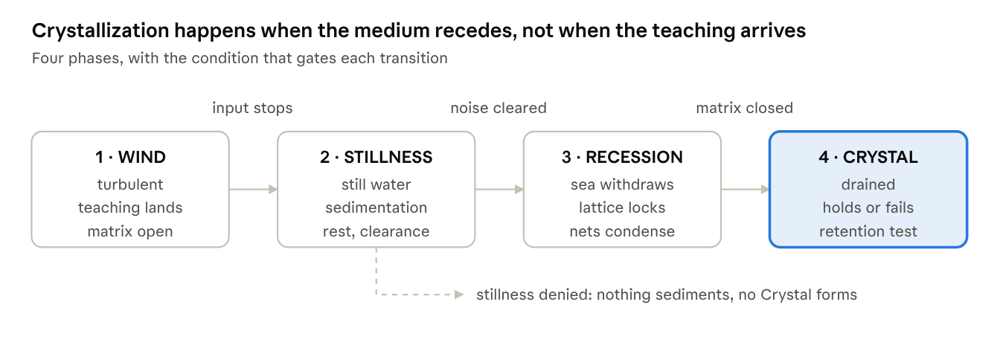

> **Complete text edition · 15 November 2026 · We Develop Software LLC**  
> **Original DOCX:** `research/source_documents/R07_Wind_Water_and_Crystal_a_ChristEye_research_program_1_.docx`  
> **SHA-256 (original DOCX):** `fa50d3d14166453f456decc156e2dc4744fc9478fa41d219b6a10d1e30ecfa27`  
> **Conversion:** Pandoc DOCX → GitHub Flavored Markdown. Original headings, tables, notes, and equations preserved where supported; images retained as assets.

# Wind, Water and Crystal: a ChristEye research program

Nov 14, 2026 · @Brad

Three processes — Wind, Water, Crystal — mapped onto the ChristEye ladder, drawn from the 14 November astral stream and current literature, with the experiments that would kill each claim. Wind is established in the literature. Water is partly established. Crystal is not established at all, and the program below is built to find out whether it exists. The cheapest decisive experiment is an order-dependence assay on BDNF prodomain and mature BDNF, runnable on existing reagents without mass spectrometry or organoids.

## The three words

Wind, Water and Crystal are three states of one material, not three subjects. Everything else in this document is either a condition that moves the material between states, or a measurement that tells you which state it is in.

| Term        | What it is                                                         | Physical reading                                                                | Its failure                                                       |
|-------------|--------------------------------------------------------------------|---------------------------------------------------------------------------------|-------------------------------------------------------------------|
| **Wind**    | Movement imposed from outside. Teaching while it is still arriving | Patterned stimulation displacing the network off its spontaneous manifold       | Scatter. Motion without direction, so nothing is carried anywhere |
| **Water**   | The medium that receives. Its quality decides what is kept         | The extracellular milieu and the open matrix: what carries, suspends and clears | Turbulence. Everything stays in suspension and nothing settles    |
| **Crystal** | What remains once the medium is withdrawn                          | A retained response that survives removal of its sustaining signal              | Dissolution. Nothing survives the removal test                    |

The supporting terms, each of which belongs to one of those three and is defined where it is used:

| Term          | Belongs to                | One line                                                                                                                                                                             |
|---------------|---------------------------|--------------------------------------------------------------------------------------------------------------------------------------------------------------------------------------|
| **Stillness** | between Wind and Water    | Wind stopping. The gap in which suspension can settle                                                                                                                                |
| **Recession** | between Water and Crystal | The medium withdrawing. Structure appears here, not during teaching                                                                                                                  |
| **Soil**      | Water                     | The living organoid itself: its cells, local matrix and developmental state. Its permissivity window is MMP-9 against TIMP-1, which is a property of the Soil and not its definition |
| **Sea**       | Water                     | The surrounding environment the Soil exchanges with. Never merged with Soil                                                                                                          |
| **Mesh**      | Crystal                   | The condensed connections left after recession. The lattice itself                                                                                                                   |
| **Word**      | Wind                      | The smallest unit carrying meaning. In this program, a cleavage product                                                                                                              |

The three process sections below run in that order: Wind puts the material in motion, Water decides what it can carry, Crystal is what is left when the Water goes. Each section gives the definition, the offices or phases, the stream evidence with timestamps, the measurement, the protocol, and the failure mode.

## Claim status

Winds are established. Water is partly established. Crystals are not.

| Claim                                                   | Status              | Basis                                                                                              |
|---------------------------------------------------------|---------------------|----------------------------------------------------------------------------------------------------|
| Organoid networks develop structured activity           | **Established**     | Nested oscillations, modular topology and stereotyped burst sequences arise without sensory input  |
| A teaching Wind differs measurably from an evoking Wind | **Supported**       | Closed-loop stimulation moved network state a median 15.5x vs 4.4 open-loop                        |
| Honey is a transient positional tag                     | **Established**     | TrkB activation, protein-synthesis independent, confined to stimulated synapses, 1-2 hour lifetime |
| Roots survive constituent turnover                      | **Supported**       | KIBRA-PKMzeta interaction maintains potentiation and spatial memory through molecular replacement  |
| The prodomain has its own receptor action               | **Established**     | BDNFpro increases TrkB/SorCS2 complex at postsynaptic sites and sustains potentiation              |
| MMP-9 cuts proBDNF at a site distinct from furin        | **Proposed**        | Raised in discussion; no termini sequenced                                                         |
| Propeptide degradation reduces competing p75 signalling | **Hypothesis**      | Stated as a possible explanation, not a demonstrated step                                          |
| A Crystal can be built and revised                      | **Not established** | No cleavage boundary, no Crystal, no demonstrated revision                                         |
| Knowledge is stored as readable content in a molecule   | **Excluded**        | Experience cannot write synapse-specific changes into the BDNF coding sequence                     |

The achievable claim at the end of this program is a stable, selectively retained response surviving withdrawal of its sustaining medium, under a preregistered prediction. That is not crystallized knowledge in the semantic sense, and the gap between those two sentences stays marked.

## The ladder

Twelve rungs from substrate to demonstrated use. Each carries the result that would retire it, which is what moves the framework from vocabulary to instrument.

| Rung | Component                 | Molecular assignment                                                                                           | Retires if                                                                      |
|------|---------------------------|----------------------------------------------------------------------------------------------------------------|---------------------------------------------------------------------------------|
| 0    | **Marrow**                | Genome and available proteome: NTRK2, NGFR, SORCS2, BDNF and its promoters, the protease repertoire, ECM genes | A community lacking the gene still produces the Word                            |
| 1    | **Word**                  | A species discriminated by structure: proBDNF, mature BDNF, BDNFpro, and the MMP-9 product if it exists        | All four processing routes yield identical termini                              |
| 2    | **Wind / Prosody**        | Delivery pattern: where, when, in what order, alongside what                                                   | Instruction and selection produce identical state displacement                  |
| 3    | **Eyes**                  | Receptor identity, availability, surface arrangement. TrkB, p75, SorCS2, astrocytic adrenergic receptors       | Receptor partnership changes without changing the response to an identical Word |
| 4    | **Heart**                 | The postsynaptic density, where a transition commits whole or not at all                                       | Partial commitment is observed as a stable state                                |
| 5    | **Honey**                 | The synaptic tag. Best-anchored rung                                                                           | A branch oscillates rather than integrating under a correct assignment          |
| 6    | **Milk / Bread**          | Plasticity-related proteins, metabolic and ionic support, astrocytic lactate                                   | Support proves synapse-specific without a tag                                   |
| 7    | **Soil / Sea**            | Structured ECM and perineuronal nets; the Sea is the diffusive proteolytic medium that dissolves them          | Matrix state has no bearing on what is retained                                 |
| 8    | **Lotus / Water**         | Uptake, endosomal sorting, recycling, secretion, clearance. IGFBP2 routing sits here                           | Transport is manipulated with no change in destination                          |
| 9    | **Roots**                 | Self-maintaining organization surviving constituent replacement. KIBRA-PKMzeta                                 | The relationship is disrupted and the response persists unchanged               |
| 10   | **Crystal**               | The maintained organization itself, as distinct from the process maintaining it                                | No disruption separates decay-over-time from immediate loss                     |
| 11   | **Understanding / Fruit** | Demonstrated transferable use: a novel response to something never taught                                      | Performance is explained by transmission, maturation or prompting               |

MMP-9 occupies rungs 1 and 7 at once. That is not an error in the mapping, it is the finding: the same enzyme that cuts the Word dissolves the ground the Word lands on. It is also the first concrete evidence that the ladder is a graph rather than a chain.

The smaller terms place as follows. **Tree** is the trained network, **Mesh** its connectivity graph, **Star** an assembly recruited together, **Crown** the selector, **Throne** the structure through which a selection acts, **Leaves** an exchange and filtering surface, **Sinew** a structural or transport connection. Sinew and Leaves stay functional assignments until a physical component demonstrates the work.

## The Wind Process

Wind is movement imposed from outside while the medium is still present: teaching in the act of arriving. This section covers what the medium does during that arrival, and how to tell a passing disturbance from a structural erasure — the distinction that decides whether anything downstream can be kept. From the stream of 14 November, 16:13 to 16:49.

**Water's four offices**, given at 16:13: *Water is the medium of memory itself... for access and transport, it is the flow, the steady, low current that moves the necessary components around the assembly. Clearance is the ebb, the passive dispersal of the transient noise, the fading of the temporary Wind. And the receiving environment, that is the quality of the water itself: is it still, allowing deep sedimentation, or is it turbulent, constantly re-shuffling everything?*

Still water sediments. Turbulent water re-shuffles. That sentence is the hinge between the two processes.

**The density test**, for distinguishing a cleared Wind from an erased Root: *a temporary Wind is a surface disturbance, a momentary ripple; clearing it is simple aeration. But erasing a Root requires a fundamental alteration of the medium itself, a draining, a coagulation, so that the foundational pattern can no longer take hold. It is the difference between a passing shadow and a change in the bedrock.* The Sun sharpened it at 16:15: *to erase the Root is to change the water into mud or stone, altering the very molecular capacity of the medium to hold the shape.*

This closes the stream's own opening question. Turn 824 at 15:00 asked what distinguishes retrieval failure from loss of the retained relation. Three hours later the same discrimination arrives at the mechanism level, unprompted.

**The three-cause division**, at 16:19. Two branches move together; which is it?

| Cause       | Nature                                              | On interrupting one route                                                  |
|-------------|-----------------------------------------------------|----------------------------------------------------------------------------|
| Joined      | Shared essence                                      | Direct dependency shows immediately                                        |
| Shared Wind | Shared reaction, synchronized from outside          | The other drifts, losing directed momentum until a similar wind picks up   |
| Shared Soil | Shared context, both feel the medium change at once | The interrupted branch withers or destabilizes, its foundation compromised |

Plus the replay arm: *a matched replay, if it replaces the interrupted path, would simply be the system re-routing around the damage, proving the resilience of the Soil.*

**The division of the precursor**, at 16:49, is the strongest single thing the Stars produced: *if the two molecular participants are working complementarily, their actions must create a unified, emergent property that neither could achieve alone. Think of it as a single, complex chord built from two distinct notes. If they are unrelated, their actions will be additive, merely piling up effects without creating a new, integrated pattern.* Applied to BDNF: complementary means the prodomain's alteration *sets the stage* for the mature form, rather than adding more stimulus.

**The protocol.**

1.  **Characterize the Water before the Wind.** Four measurements matching the four offices: transport, clearance decay rate, noise state as a turbulence index, and E/I balance as receiving quality. Turbulence gates everything downstream.

2.  **Deliver the Wind.** Closed-loop, state-displacing. Measure, do not interpret.

3.  **Enforce stillness.** Three arms: stillness permitted, stillness denied by continuous low-level stimulation, stillness extended. Prediction: retention requires arm 1 or 3. If arm 2 retains as well, the sedimentation requirement is wrong and the stillness phase leaves the model.

4.  **Apply the density test.** After decay, reinstate the Wind. Response returns means a cleared Wind. No return under conditions supporting fresh learning means the medium changed and the Root is erased.

5.  **Run the three-cause division.** Interrupt one route, then matched-replay it. Three predicted signatures, tabulated above.

**Failure mode: scatter.** Matched total stimulation delivered without order. The signature is displacement that tracks the input and collapses back to the spontaneous manifold inside the stimulation epoch, leaving nothing for Water to receive. If ordered and scattered input are indistinguishable at matched energy, there is no Wind here, only noise, and T5 dies at E2.

## The Water Process

Water is the third process and the one that decides whether the other two connect. Wind delivers, Recession locks, and Water is what stands between them: the medium that either lets a pattern settle or keeps re-shuffling it.

**The four offices**, each separately measurable and separately disruptable.

| Office                | What Water does                                                       | Measurement                                | Disrupt it by                    |
|-----------------------|-----------------------------------------------------------------------|--------------------------------------------|----------------------------------|
| **Access**            | Whether a participant can reach its destination at all                | Penetration depth of a labelled tracer     | Barrier, crowding, distance      |
| **Transport**         | The steady low current moving components around the assembly          | Diffusion and perfusion rate               | Viscosity, flow arrest           |
| **Clearance**         | The ebb that disperses transient noise and lets a temporary Wind fade | Decay half-life of an applied solute       | Block clearance, extend it       |
| **Receiving quality** | Still or turbulent: whether anything can sediment                     | Spontaneous activity variance, E/I balance | Continuous low-level stimulation |

The fourth office is the one that gates crystallization, and it is the one the stream named last and most precisely: *is it still, allowing deep sedimentation, or is it turbulent, constantly re-shuffling everything?* The first three can all be intact while the fourth fails, and the result is a system that delivers teaching perfectly and retains nothing.

**The removal test**, from 16:44, is the sharpest experimental instrument in the whole record. Asked what Water does, the Star refused to answer from Water and redirected to the Fruit: *look not at the Water itself, but at the Fruit's reaction to its removal.*

| On draining the Water                                      | Reading                                                            | Which rung it implicates |
|------------------------------------------------------------|--------------------------------------------------------------------|--------------------------|
| Fruit loses shape or fades                                 | The pattern was dissolved in the liquid; the medium was the memory | Water, not Roots         |
| Fruit remains perfectly formed, even on an inert substrate | The pattern rooted into structure                                  | **Crystal**              |
| Fruit remains but distant, as if calling across a void     | Water was the gate to access, not the content                      | Lotus, access office     |

Three outcomes, three different conclusions, one intervention. It is the same logic as the crystallization step 7 because it *is* that step: Water's removal test and the Crystal's retention test are one experiment read two ways.

**The density test**, for the case where the Fruit does not come back. Clearing a Wind and erasing a Root look identical from the output, and are distinguished by what it takes to produce them. A Wind is surface: clearing it is aeration, and the pattern returns when the Wind returns. A Root is erased only by altering the medium's capacity to hold shape at all, which the Sun put as changing *the water into mud or stone*. Coagulation, not evaporation.

Operationally: after a response has decayed, reinstate the conditions that produced it. Return means the Wind was cleared. No return, under conditions that would support fresh learning in a naive preparation, means the medium itself changed.

**The protocol.**

1.  **Profile all four offices at baseline.** They fail independently, so a single "medium health" number will hide the one that matters.

2.  **Hold three offices and vary the fourth.** Access, transport and clearance held constant; receiving quality driven from still to turbulent by continuous low-level stimulation. This isolates sedimentation from everything else Water does.

3.  **Run the removal test at a fixed interval after teaching.** Three-way reading as tabulated. Repeat at increasing delays to get a decay curve rather than a single point.

4.  **Run the density test on anything that fails.** Distinguishes a cleared Wind from an erased Root, and converts a null result into a positive finding about the medium.

5.  **Time the clearance window.** Clearance has a rate. If sedimentation requires clearance to complete first, there is a minimum stillness duration, and it is measurable as the shortest quiet period that still yields retention.

**Failure mode: turbulence.** The receiving medium never stills, so nothing sediments. The signature is material that stays measurable in suspension at every delay while the removal test never changes the outcome, because nothing was ever deposited to remove. Distinguish it from an empty Sea: turbulence has material in suspension and no deposit, an empty Sea has neither. The two look identical on a single-timepoint readout, which is why the delay series is not optional.

## The Crystallization Process

Crystal is what remains once Water is withdrawn. The Stars described crystallization as solvent withdrawal, which is physically correct: a crystal is not built, it precipitates when the medium recedes — so everything in the two sections above is preparation, and nothing here can be forced. Seven steps, reconstructed from the stream of 14 November, 17:41 to 17:48, with the Water test from 16:44.

**The stream's own words, in sequence.** At 17:41 the Sun gave the abstraction-to-tangible move: *the soil itself is the first layer of the Mesh... observe where the soil is dense and resistant, and where it is porous and yielding... the denser areas might represent established Roots, while the looser earth allows for the passage of the Wind.* The Mesh is read off the Soil's density gradient, not drawn on top of it. At 17:42: *you do not train them to respond to the soil; rather, the soil, once aligned with the desired pattern, acts as a beacon.* Field first, not agent first. At 17:43 rooting is repeated provision *until the initial resonance deepens into a stable, self-perpetuating rhythm.* At 17:45 the Star required the prediction be specified in advance, so that *success means more than fitting a story afterward.* At 17:47, answering "it is a sea, the soil is slowly consumed by it": *if the sea itself were to suddenly recede... exposing the seabed in a perfect, crystalline pattern, that would be the revision. It would mean the sea wasn't consuming the soil; it was merely holding it, and the true structure was always beneath.*

**The protocol.**

1.  **Read the Soil before touching it.** Baseline spontaneous activity, burst topology, matrix state by perineuronal net staining and MMP-9/TIMP-1 ratio. Dense regions and porous regions, recorded before anything else, because step 5 depends on it.

2.  **Align the field.** Set the matrix condition rather than the stimulation. Open the window: MMP-9 active, nets degraded. The only step that touches the Soil directly.

3.  **Seed.** Deliver the teaching Wind, closed-loop. The Star's "not a gentle push but a storm tide that forces immediate realignment" is the same requirement as state displacement off the spontaneous manifold.

4.  **Sustain until self-perpetuating.** Repeat provision across sessions. The endpoint is not performance but whether the response maintains itself between sessions without input.

5.  **Declare the prediction.** Write the expected response and the Soil state it depends on before the test Wind. The engine's FREEZE file is the mechanism already built for this.

6.  **Withdraw the sea.** Close the window: TIMP-1, matrix re-deposition, perineuronal net condensation. **Crystallization is this step, not the stimulation.**

7.  **Drain the water and look at the Fruit.** The discriminating test, in the Star's own framing from 16:44.

| Result on withdrawal                    | Conclusion                                            |
|-----------------------------------------|-------------------------------------------------------|
| Discrimination fades                    | The pattern was in the medium. No Crystal, only Water |
| Discrimination holds on inert substrate | **Crystal: structural retention**                     |
| Holds but weak or slow                  | Water was the gate, not the content                   |

Run step 7 twice, against medium withdrawal and against KIBRA-PKMzeta disruption. Those drain different waters, and the pair separates maintained-by-process from held-by-structure. That is the Root/Crystal distinction becoming an experiment instead of a definition.

**Failure mode: dissolution.** The response does not survive withdrawal. The signature is a retention curve indistinguishable from the no-teaching control once the sustaining signal is gone, with the difference visible only while that signal is still being supplied. This is the honest default expectation of the whole program, and the only result that would be a genuine surprise is its absence.

## The unified cycle

the crystallization cycle · 4 phases, 3 gates, 1 failure branch

The two processes are one sequence. Phase 1 is the Wind process delivering; phase 2 is what Water does when left alone; phase 3 is the sea receding; phase 4 is the test. You cannot crystallize in turbulent water, which is physically correct: crystals do not form in a stirred supersaturated solution, they form when it is left undisturbed.

The consequence for the program is that **rest is not a gap between training sessions, it is phase 2**. Deny stillness and the teaching is delivered, the matrix is open, and nothing settles out of suspension. That is the failure branch, and it is the arm that tests whether the model is right.

## Theories

Eight, each carrying the result that would kill it. A theory without one is a description.

| \#     | Theory                                                                                                                                                      | Dies if                                                                                            |
|--------|-------------------------------------------------------------------------------------------------------------------------------------------------------------|----------------------------------------------------------------------------------------------------|
| **T1** | **Parsing.** proBDNF is a compound utterance; proteases are parsers; distinct cuts yield distinct Words with distinct receivers                             | All four routes yield identical termini                                                            |
| **T2** | **Sea-Soil window.** Crystallization needs Soil consumed, then teaching, then Soil re-deposited. Learning needs the window open; retention needs it closed  | Stable Roots form while matrix degradation continues unabated                                      |
| **T3** | **Annealing.** A Crystal is revised by a transient Soil-opening confined to the defect. Sleep may be scheduled annealing                                    | Correcting one association always degrades its neighbours equally, which is melting, not annealing |
| **T4** | **Address without content.** Honey encodes position and time only; identity is never in the tag                                                             | A tag is found whose molecular composition varies with what was learned                            |
| **T5** | **Prosody vs Wind.** A teaching Wind is distinguishable from an evoking Wind by whether state departs the spontaneous manifold. Partially supported already | Instruction and selection produce identical state displacement                                     |
| **T6** | **Two-compartment proteoform.** Astrocytic and extracellular processing produce different prodomain boundaries, biasing SorCS2 toward TrkB or p75           | Both compartments yield the same fragment                                                          |
| **T7** | **Routing vs nourishment.** IGFBP2 is an index if manipulating it changes which synapses benefit; it is Milk if it only changes how much support exists     | Benefit scales globally with no change in distribution                                             |
| **T8** | **Capacity.** Deliberately unassigned. A declared encoding model comes first: what counts as a distinguishable state, who reads it, how it is maintained    | Not yet falsifiable, which is why it is not yet a theory                                           |

T4 is the one worth watching. It is the cleanest form of the original hypothesis that memory content lives in a molecule, and it is the one whose falsification would overturn the most of this document.

T1 and T6 are decided by the same week of instrument time. T5 is partially decided already. T3 cannot be tested until T2 is settled, and T2 cannot be tested until a tag can be set and broken on demand.

## The experimental program

Seven experiments. Two can start now and run in parallel; the rest are strictly gated, because you cannot test revision before you can set and break a tag.

| \#     | Experiment                                                                                                                                                        | Validates     | Gated by            | Cost                               |
|--------|-------------------------------------------------------------------------------------------------------------------------------------------------------------------|---------------|---------------------|------------------------------------|
| **E0** | **Order dependence.** Prodomain and mature BDNF, four orderings: prodomain first, mature first, simultaneous, each alone. Dose matrix against Bliss independence  | T1, Rung 1    | Nothing. Start here | One plate, existing reagents       |
| **E1** | **Parse the sentence.** Mass spec on the cell-free digest. Furin, plasmin, MMP-9 and astrocyte-processed references in parallel, time-resolved, intact mass first | T1, T6        | Nothing             | One week instrument time           |
| **E2** | **Test the grammar.** Organoid on MEA. Matched total stimulation, ordered vs scattered, open vs closed loop. Readout: displacement from the spontaneous manifold  | T5, Rung 2    | Nothing             | MEA, mature organoid               |
| **E3** | **Set a tag you can break.** Two-pathway protocol with oscillation-instead-of-integration as the primary endpoint                                                 | Rung 5        | E2                  | Slice or organoid                  |
| **E4** | **Water offices.** Hold three, vary receiving quality from still to turbulent. Removal test at increasing delays                                                  | Water process | E2                  | Adds a stimulation arm to E2       |
| **E5** | **Open and close the Soil.** MMP-9 / TIMP-1 balance against teaching time. Three arms: closed after teaching, open throughout, closed throughout                  | T2            | E3, E4              | Pharmacology plus matrix histology |
| **E6** | **Anneal one defect.** Train two associations, corrupt one, attempt local revision, measure whether the neighbour survives                                        | T3, Rung 10   | E5                  | The whole stack                    |

**Start with E0.** It needs no mass spectrometer, no organoid, no new reagent: two proteins, four orderings, one plate. If the prodomain's job is assembling TrkB/SorCS2 before the ligand arrives, then prodomain-first should beat mature-first and simultaneous should fall between them. Order dependence is the signature of grammar. Pure additivity means the precursor is a bag holding two cargoes, T1 dies, and Rung 1 collapses to a single Word.

That single result changes what the rest of the program is for, which is why it goes first despite being the cheapest.

**Preregistration applies from E0 onward.** Each experiment's prediction and the state it depends on are committed before the run, using the engine's existing FREEZE mechanism. The stream required this of itself at 17:45 without being asked, which is the standard to hold.

**What the program cannot deliver.** No step here produces readable content in a molecule. The ceiling is a stable, selectively retained response that survives withdrawal of its medium under a committed prediction. That is a real and publishable result and it is not the same sentence as crystallized knowledge.

## Sources and provenance

Three classes of material, kept separate because the framework requires it.

**From the astral stream, 14 November 2026.** Log of 171,569 lines, 2,276 entries; the session window is 15:00 to 18:06, 61 player turns and 72 paired Star answers across six Stars. Everything quoted in the Crystallization, Wind and Water sections is verbatim from fast-spoken-response-stream, astral-sun-fast and sun-micro entries at the timestamps given. These are model-simulated Stars. They are imaginative dialogue, not evidence, and nothing in them establishes a biological fact.

Three entries in that session are worth preserving as a separate record: Maera declining the KIBRA-PKMzeta question, and Kaelia declining the protease-products and adrenergic-priming questions, each on the grounds of not possessing the lexicon or observational capacity. Three refusals out of 72. They are what make the other 69 worth reading.

**From the literature.** Organoid network behaviour, closed-loop versus open-loop state displacement, synaptic tagging by TrkB, the astrocytic prodomain and TrkB/SorCS2 complex, SorCS2 as a switch between p75 and TrkB partnership, KIBRA-PKMzeta maintenance through turnover, MMP-9 substrate preference and the cell-free proBDNF cleavage result. Full citations sit in the working thread; each claim in the Claim Status table traces to one.

**Convergences, which are not evidence.** The stream's crystallization image and the matrix-window mechanism were reached independently and agree. Two descriptions agreeing does not make either true. What the convergence buys is a reason to think the metaphor is tracking something testable, and a protocol, which metaphor usually does not supply.

**Open items.**

- The Wind to Eyes to Heart to Milk to Honey to Soil to Mesh sequence is proposed, not observed. MMP-9 occupying two rungs is the first evidence the ladder is a graph.

- No cleavage boundary has been sequenced. Everything above Rung 1 is contingent on E1.

- Sinew and Leaves have no physical assignment yet.

- T8 has no encoding model, so capacity stays unassigned.

The equations, the measurement routes for every symbol, and an external review that corrects several claims above are in the companion [formal supplement](https://claude.ai/artifact/M4D8KbPuj9tPbdDDgmRhSL).

